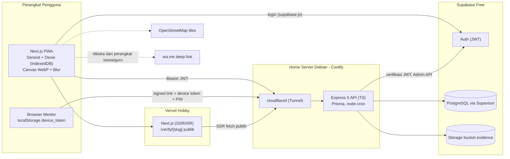
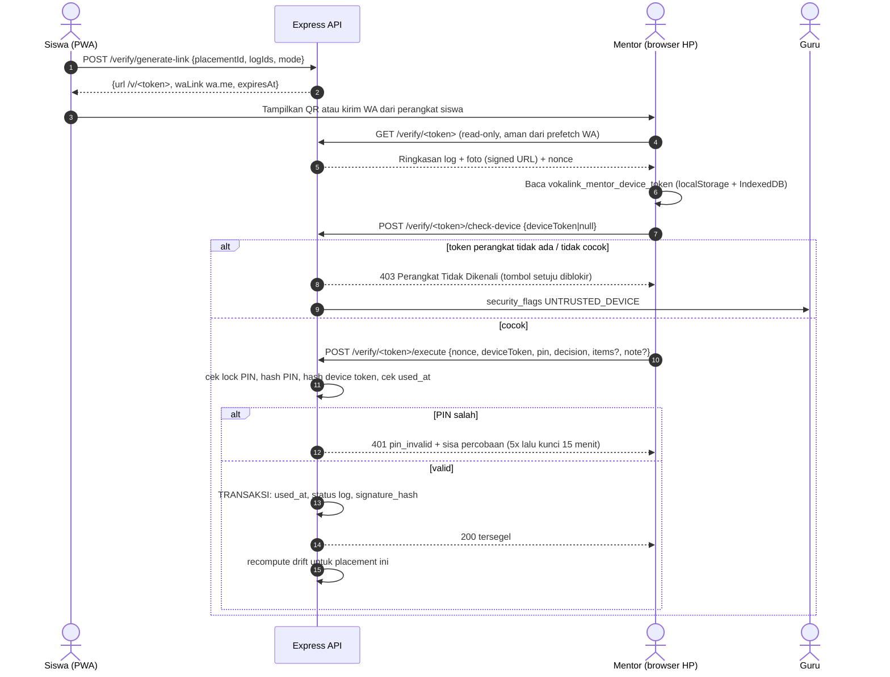

# DESIGN — VokaLink

> Dokumen desain teknis, pendamping `PRD.md`. UINIC 8.0 Web Development Competition 2026.
> **Hierarki kebenaran:** `PRD.md` (fitur, data, aturan bisnis) > `DESIGN.md` (cara membangun) > kode.
> Jika DESIGN bertentangan dengan PRD pada fitur/aturan bisnis, PRD menang dan DESIGN harus diperbaiki.
> Revisi ini menggantikan DESIGN lama (arsitektur Express + PostgreSQL mandiri) dan disesuaikan dengan PRD v1.0 (12 FR, 5 aktor).
> **Bab 13 (Design System & UI) wajib dibaca sebelum mengubah apa pun di `apps/web`.** Token visual hanya didefinisikan sekali di `apps/web/tailwind.config.ts`. Rencana refactor UI bertahap ada di `docs/UI-REFACTOR.md`.

## Daftar Isi
1. Prinsip & Keputusan Arsitektur
2. Arsitektur Sistem
3. Deployment & Environment
4. Model Data (Prisma + Supabase PostgreSQL)
5. Autentikasi & Otorisasi
6. Verifikasi Zero-Login & Kriptografi
7. Offline Sync & Pipeline Foto
8. Algoritma Inti
9. Spesifikasi API
10. Struktur Repo, CI/CD, Pengujian
11. Ketahanan & Observabilitas
12. Keputusan yang Sudah Final & Sisa Terbuka
13. Design System & UI

---

## 1. Prinsip & Keputusan Arsitektur

| # | Prinsip | Implikasi |
|---|---|---|
| P1 | Offline-first | Klien mencatat dulu ke IndexedDB; server menerima sinkron idempoten via `client_log_uuid` |
| P2 | Server authoritative | Status log, alert, nilai, dan keabsahan paspor hanya ditentukan server |
| P3 | Immutable setelah VERIFIED | Trigger DB memblokir UPDATE pada log terverifikasi; segel HMAC dapat diaudit |
| P4 | Zero-login bukan zero-security | Device token + PIN + token bertanda tangan sekali pakai + rate limit + audit flag |
| P5 | Kompresi di tepi | Foto dikecilkan di browser (WebP < 60 KB) sebelum menyentuh jaringan |
| P6 | Deterministik & dapat dijelaskan | Skor penempatan, drift, dan nilai berupa rumus transparan (fungsi murni di `packages/core`) |
| P7 | Rp0 | Vercel Hobby, Supabase Free, Coolify di home server, Cloudflare Tunnel, OSM, `wa.me` |

### Keputusan arsitektur (ADR ringkas, sudah final)

| ADR | Keputusan | Alasan / Konsekuensi |
|---|---|---|
| ADR-01 | Frontend **Next.js (App Router, TS) di Vercel**; backend **Express 5 (TS) di Coolify**; DB **Supabase PostgreSQL** | Sesuai keputusan tim. Logika bisnis ada di Express, bukan di Route Handlers Next.js |
| ADR-02 | ORM **Prisma** (bukan Drizzle). Runtime lewat Supavisor *transaction pooler*, migrasi lewat *session pooler* | Direct connection Supabase hanya IPv6, home server umumnya IPv4. Gunakan pooler |
| ADR-03 | Auth **Supabase Auth**; Express memverifikasi JWT (`Authorization: Bearer`) | Tanpa cookie, sehingga tidak ada masalah SameSite lintas situs Vercel ke home server |
| ADR-04 | Isolasi tenant di **lapisan aplikasi** (Prisma client extension menyuntik `schoolId`). RLS diaktifkan **deny-all** untuk `anon`/`authenticated` | Prisma terhubung sebagai role `postgres` (melewati RLS). RLS deny-all mencegah akses lewat PostgREST/anon key |
| ADR-05 | Foto di **Supabase Storage** (bucket privat `evidence`) lewat service role dari Express | 1 GB gratis. Akses tampil lewat signed URL berumur pendek |
| ADR-06 | Segel verifikasi **HMAC-SHA256** (server secret + hash device token). Tidak memakai Ed25519 | Cukup untuk PRD; verifikasi publik dihitung ulang server. Ed25519 hanya jika waktu longgar |
| ADR-07 | Haversine, Drift, Heatmap, e-Rapor dihitung di aplikasi (TS), bukan PostGIS/stored procedure | Mudah diuji (Vitest), tanpa ekstensi tambahan |
| ADR-08 | PWA memakai **Serwist** (`@serwist/next`, penerus next-pwa berbasis Workbox) + **Dexie** | next-pwa tidak lagi dipelihara |
| ADR-09 | PDF CV memakai **Print CSS A4** di browser; XLSX/CSV dibuat di klien | Sesuai TBD-02 PRD (teks PDF murni terbaca ATS, 0 KB bundel) |
| ADR-10 | Foto bukti wajib untuk level Mandiri dan Terbimbing; opsional untuk Observasi dan izin/sakit | Sesuai default TBD-03 PRD |
| ADR-11 | JSON API memakai **camelCase**; kolom DB memakai **snake_case** via `@map` Prisma | Padanan nama PRD: `client_log_uuid` jadi `clientLogUuid` di API |
| ADR-12 | Sinkron log **dua fase**: metadata `POST /logs/sync`, lalu foto `PUT /logs/:uuid/evidence` | Permintaan kecil, mudah dilanjutkan saat sinyal putus |
| ADR-13 | Satu design system (Bab 13): token warna dan font hanya di `tailwind.config.ts` (Tailwind v3), komponen bersama di `components/ui` | Konsistensi lintas halaman dan agent. Warna mentah Tailwind dan gaya ad-hoc per halaman dilarang |

---

## 2. Arsitektur Sistem



Alur umum: login dilakukan frontend langsung ke Supabase Auth. Frontend lalu memanggil Express dengan Bearer JWT. Mentor dan HRD tidak punya akun: mentor memakai tautan bertanda tangan, HRD membuka halaman publik read-only.

---

## 3. Deployment & Environment

| Lapisan | Platform | Domain | Catatan |
|---|---|---|---|
| Web | Vercel Hobby | `vokalink.<domain-tim>` | Env: `NEXT_PUBLIC_API_URL`, `NEXT_PUBLIC_SUPABASE_URL`, `NEXT_PUBLIC_SUPABASE_ANON_KEY` |
| API | Coolify (Docker, Nixpacks/Dockerfile) | `api-vokalink.<domain-tim>` | Hanya via Cloudflare Tunnel, tanpa port forwarding |
| DB/Auth/Storage | Supabase Free | - | Region terdekat (Singapore). Pause setelah 7 hari tidak aktif |

**Env API (Coolify secrets):**
```env
NODE_ENV=production
PORT=3001
# Prisma: runtime (transaction pooler) dan migrasi (session pooler), keduanya IPv4
DATABASE_URL=postgresql://postgres.<ref>:<pw>@aws-0-<region>.pooler.supabase.com:6543/postgres?pgbouncer=true&connection_limit=5
DIRECT_URL=postgresql://postgres.<ref>:<pw>@aws-0-<region>.pooler.supabase.com:5432/postgres
SUPABASE_URL=https://<ref>.supabase.co
SUPABASE_SERVICE_ROLE_KEY=***        # hanya di server
SUPABASE_JWT_SECRET=***              # atau pakai JWKS bila project memakai signing key asimetris
APP_ORIGINS=https://vokalink.<domain>,http://localhost:3000
SERVER_CRYPTO_SECRET=***             # 32+ byte, HMAC segel log & paspor
MAGIC_LINK_HMAC_KEYS=k1:***          # rotasi: kunci pertama menandatangani, semua memverifikasi
PIN_PEPPER=***
STORAGE_BUCKET=evidence
```

**Aturan:**
- CORS: allowlist eksak `APP_ORIGINS` (tanpa wildcard). Tidak memakai cookie, jadi `credentials` tidak diperlukan.
- Cloudflare: *Always HTTPS*, TLS min 1.2, rate limiting dasar. Jalankan 2 replika `cloudflared` bila memungkinkan.
- Anti-pause Supabase (RSK-04): `node-cron` di API menjalankan `SELECT 1` tiap 6 jam, ditambah GitHub Actions ping `/readyz` tiap 3 hari.
- Prisma dengan pooler transaction: wajib `?pgbouncer=true`. Migrasi selalu memakai `DIRECT_URL`.
- Header keamanan: `helmet`, `Cache-Control: no-store` dan `Referrer-Policy: no-referrer` pada semua rute `/verify/*`, `X-Robots-Tag: noindex` pada halaman mentor dan paspor.

---

## 4. Model Data (Prisma + Supabase PostgreSQL)

**Sumber utama kamus data: PRD Bab 9.2.** Skema Prisma (`apps/api/prisma/schema.prisma`) dibuat dari PRD Bab 9, lalu ditambah penyesuaian di bawah. ERD relasi inti mengikuti PRD §9.1.

### 4.1 Tambahan dan penyesuaian terhadap PRD Bab 9

| Entitas | Perubahan | Alasan |
|---|---|---|
| `signed_links` (baru) | `id`, `purpose` (`DEVICE_ACTIVATION` / `LOG_VERIFY` / `ENDORSEMENT`), `token_hash` UNIQUE (SHA-256), `key_id`, `mentor_id`, `placement_id?`, `log_ids uuid[]`, `mode` (`QR` / `WA_BATCH`), `payload_hash`, `expires_at`, `used_at`, `revoked_at`, `created_by`, `created_at` | Menjamin tautan sekali pakai, dapat dicabut, token mentah tidak disimpan |
| `security_flags` (baru) | `id`, `placement_id`, `mentor_id`, `signed_link_id`, `kind` (`UNTRUSTED_DEVICE` / `PIN_LOCKOUT` / `TOKEN_REUSE`), `meta jsonb`, `created_at`, `acknowledged_at` | Implementasi "Security Audit Flag" FR-007 A2 untuk dasbor guru |
| `audit_logs` (baru) | `id bigserial`, `actor_type`, `actor_id`, `action`, `entity`, `entity_id`, `meta jsonb`, `ip_hash`, `created_at` | Jejak audit (verifikasi, rotasi, reset token, ekspor) |
| `dudi_mentors` | `pin_hash` memakai **scrypt + salt per mentor + `PIN_PEPPER`** (bukan SHA-256 polos); `device_token_hash` = SHA-256 dari token acak 256-bit; WA disimpan ternormalisasi `628...` | PIN 4 digit mudah di-brute-force bila hash cepat |
| `daily_logs` | + `client_created_at`, `server_received_at`, `clock_skew_flag`, `attendance_type` (`PRESENT`/`SICK`/`PERMIT`), `evidence_sha256`; `UNIQUE(placement_id, log_date)` | Idempotensi, validasi backdate, izin/sakit |
| `daily_log_items` | `duration_jp` integer 1 sampai 10; `non_competency_category` enum (`ADMIN_UMUM`, `KEBERSIHAN_GUDANG`, `KURIR`, `JAGA_TOKO`) | Sesuai FR-005 |
| `placements` | + `coverage_score`, `distance_km`, `requires_midterm_rotation boolean`, `rotated_from_id` | BR-005, BR-006, FR-009 |
| `school_departments` | + `master_department_id`, `is_locked`; template dari `curriculum-seed.json` | Penyalinan template per tenant |
| `skill_passports` | + `visibility_json`, `revoked_at`; slug acak 128-bit (base64url) | Paspor publik dan kontrol privasi |
| `dudi_partners` | + `created_by_school_id`; `quality_index_score` hanya cache | Direktori terfederasi lintas sekolah |
| Job Card non-kompetensi | Tiap `school_department` otomatis punya 1 kartu `is_non_competency = true` dengan nama "Bantuan Operasional Umum (Non-Jurusan)" | BR-004 |

### 4.2 Guard di database (migrasi SQL mentah, di luar `schema.prisma`)

```sql
-- 1) RLS deny-all pada semua tabel public (akses hanya lewat Express/service role)
ALTER TABLE public.<tabel> ENABLE ROW LEVEL SECURITY;   -- tanpa policy = anon/authenticated ditolak

-- 2) Immutability log terverifikasi (P3)
CREATE OR REPLACE FUNCTION block_verified_log_update() RETURNS trigger AS $$
BEGIN
  IF OLD.status = 'VERIFIED' AND (
       NEW.log_date IS DISTINCT FROM OLD.log_date OR
       NEW.signature_hash IS DISTINCT FROM OLD.signature_hash OR
       NEW.status IS DISTINCT FROM OLD.status ) THEN
    RAISE EXCEPTION 'verified log is immutable';
  END IF;
  RETURN NEW;
END $$ LANGUAGE plpgsql;
CREATE TRIGGER trg_daily_logs_immutable BEFORE UPDATE ON daily_logs
  FOR EACH ROW EXECUTE FUNCTION block_verified_log_update();
-- Trigger serupa pada daily_log_items: tolak UPDATE/DELETE bila log induk VERIFIED.
-- Tolak DELETE daily_logs berstatus VERIFIED.

-- 3) CHECK
ALTER TABLE daily_logs ADD CONSTRAINT chk_evidence_size CHECK (evidence_size_bytes IS NULL OR evidence_size_bytes <= 153600);
ALTER TABLE daily_log_items ADD CONSTRAINT chk_jp CHECK (duration_jp BETWEEN 1 AND 10);

-- 4) Alert unik selama belum selesai
CREATE UNIQUE INDEX ux_alert_open ON drift_alerts (placement_id, alert_type) WHERE status <> 'RESOLVED';
```

### 4.3 Indeks minimum
`daily_logs(placement_id, status)`, `daily_logs(placement_id, log_date DESC)`, `daily_log_items(job_card_id)`, `drift_alerts(placement_id, status)`, `signed_links(expires_at) WHERE used_at IS NULL`, `dudi_partners(city, sector_category)`, `user_profiles(school_id, role)`, `placements(student_id)`, `placements(teacher_id)`.

### 4.4 Seed
- `apps/api/prisma/seed/curriculum-seed.json`: 6 jurusan (AKL, RPL/PPLG, DKV, Kuliner, Farmasi, TKR), minimal 4 elemen CP dengan total tepat 792 JP dan minimal 12 Job Card per jurusan, lengkap `skkni_unit_code`, `tools_and_software`, `action_verb_template`.
- **Seeder v1 (Hari 1 sampai 2, membuka blokir tim):** sekolah demo, 4 jurusan aktif, guru, siswa, 6 DUDI + mentor yang sudah terikat perangkat, penempatan.
- **Seeder v2 (Hari 8):** riwayat logbook 8 minggu, log terverifikasi, kasus drift buatan, endorsement, paspor.

---

## 5. Autentikasi & Otorisasi

| Aktor | Mekanisme |
|---|---|
| `SCHOOL_ADMIN`, `TEACHER`, `STUDENT` | Supabase Auth (email + password). Frontend login via `supabase-js`, kirim `Authorization: Bearer <access_token>` ke Express |
| `STUDENT` | Login NISN + kode akses dari guru. Dipetakan ke email sintetis `<nisn>@siswa.vokalink.id`; kode akses = password awal. Akun dibuat Express lewat Supabase Admin API |
| `INDUSTRY_MENTOR` | Tanpa akun: signed link + `device_token` + PIN (Bab 6) |
| `PUBLIC_VERIFIER` | Tanpa akun: endpoint publik read-only, dibatasi rate limit |

- Middleware `requireAuth`: verifikasi JWT (`jose`), lalu muat `user_profiles` (role dan `school_id`) dari DB sebagai sumber otoritatif. Cache memori 60 detik.
- Middleware `requireRole(...roles)` pada tiap rute sesuai matriks hak akses PRD §3.2.
- **Tenant guard:** semua query lewat Prisma client extension yang menyuntik `schoolId` dari sesi. Siswa hanya dapat mengakses data miliknya sendiri. Guru hanya siswa binaannya. Pengecualian terfederasi: `dudi_partners` (profil dasar) sesuai BR-011.
- Provisioning akun (admin): `POST /users` dan `POST /users/import` memakai Supabase Admin API.
- Student tanpa email nyata: tombol "reset kode akses" oleh guru (rotasi password lewat Admin API).

---

## 6. Verifikasi Zero-Login & Kriptografi

### 6.1 Tiga jenis tautan bertanda tangan (`signed_links.purpose`)

| Purpose | Dibuat oleh | TTL | Dipakai untuk |
|---|---|---|---|
| `DEVICE_ACTIVATION` | Guru/Admin/Siswa fasilitator (FR-003) | 72 jam | `/v/[token]/activate`: ikat perangkat + buat PIN |
| `LOG_VERIFY` mode `QR` | Siswa | **5 menit** | Verifikasi tatap muka |
| `LOG_VERIFY` mode `WA_BATCH` | Siswa | **7 hari** | Verifikasi asinkron/rapelan |
| `ENDORSEMENT` | Sistem/guru (akhir PKL, FR-010) | 14 hari | `/v/[token]/endorse` |

**Format token:**
```
token   = "v1." + b64url(payload) + "." + b64url(mac)
payload = { rid: <signed_link.id>, mid: <mentor id>, p: <purpose>, iat, exp, n: <96-bit acak> }
mac     = HMAC-SHA256(key[kid], "vokalink.link.v1|" + b64url(payload))
```
Validasi (waktu-konstan): parse, cek versi, hitung ulang MAC (`timingSafeEqual`), cek `exp`, cari `SHA-256(token)` di `signed_links`, cek `used_at IS NULL AND revoked_at IS NULL`. Token mentah hanya muncul sekali di respons pembuatan. DB hanya menyimpan hash.

### 6.2 Alur verifikasi (BR-007: dua faktor wajib)



**Aturan:**
- `GET` tidak pernah mengubah state. Persetujuan hanya lewat `POST` dengan `nonce` (anti prefetch/replay).
- Salah PIN 5 kali berturut-turut: `mentors.locked_until = now + 15 menit`, buat `security_flags PIN_LOCKOUT`. Hitung `failed_pin_attempts` per mentor, reset saat sukses.
- Tautan sekali pakai: `used_at` diisi dalam transaksi yang sama dengan perubahan status log (`UPDATE ... WHERE used_at IS NULL` dan cek `rowCount`).
- Keputusan: `APPROVE_ALL`, atau `PARTIAL` per log. `REJECT`/koreksi mengubah status menjadi `REVISION_REQUIRED` dengan alasan baku (`not_supervised`, `duration_mismatch`, `wrong_photo`, `other`) dan boleh mengoreksi jam.
- Reset perangkat (A2 FR-003): guru memanggil `POST /mentors/:id/reset-device`. Hash token lama dikosongkan, `DEVICE_ACTIVATION` baru dibuat.

### 6.3 Segel kriptografi

```
signature_hash (per log)  = HMAC-SHA256(SERVER_CRYPTO_SECRET,
    canonical{ logId, studentId, placementId, logDate,
               items: [ {jobCardId, durationJp, autonomyLevel} urut jobCardId ],
               evidenceSha256, verifiedAt, mentorId, deviceTokenHash })

master_signature_hash (paspor) = HMAC-SHA256(SERVER_CRYPTO_SECRET,
    canonical{ studentId, totalVerifiedJp, signatureHashes: [urut logId] })
```
`canonical` = JSON dengan kunci terurut dan tanpa spasi (fungsi tunggal di `packages/core`, diuji ketat). Endpoint publik paspor menghitung ulang HMAC tiap log `VERIFIED` dan master hash. Tanda "TERVERIFIKASI RESMI" hanya muncul bila semuanya cocok. Satu karakter berubah di DB menghasilkan "Tanda Tangan Digital Tidak Valid".

### 6.4 Pengikatan perangkat (FR-003)
Di `/v/[token]/activate` browser mentor membuat `device_token` = 32 byte acak (`crypto.getRandomValues`), menyimpannya di `localStorage` dan IndexedDB, lalu mengirim `{activationToken, deviceToken, pin}` ke `POST /mentors/bind-device`. Server menyimpan `SHA-256(deviceToken)` dan hash PIN (scrypt). Token mentah tidak pernah disimpan di server.

Risiko yang diterima (MVP): `localStorage` dapat disalin oleh pemilik perangkat. Mitigasi: PIN, rate limit, flag audit, dan prosedur reset oleh guru.

---

## 7. Offline Sync & Pipeline Foto

### 7.1 Pipeline foto di klien (FR-006)
1. Baca file ke `<canvas>`, hormati orientasi EXIF.
2. Opsi Blur: kuas sentuh (pixelate/gaussian) di atas kanvas. Hasil tidak dapat dibatalkan setelah disimpan.
3. Resize sisi terpanjang 800 px, `canvas.toBlob('image/webp', 0.65)`. Bila tidak didukung, fallback `image/jpeg` 0.6.
4. Hitung `SHA-256` (`crypto.subtle.digest`). Re-encode canvas otomatis menghapus EXIF/geotag.
5. Tampilkan lencana "Hemat Kuota: 4.2 MB menjadi 48 KB". Target selesai kurang dari 1,5 detik pada HP kelas menengah-bawah.
6. Server menolak > 150 KB, memeriksa magic bytes (RIFF/WEBP atau JPEG), dan mencocokkan `X-Content-SHA256`.

### 7.2 Skema Dexie (ringkas)
```ts
logs:   "clientLogUuid, placementId, logDate, state, nextAttemptAt"   // state: queued | meta_synced | synced | verified | revision_required | failed
photos: "clientLogUuid"                                                // Blob WebP + sha256
refData:"key"                                                          // job cards, penempatan, matriks CP (cache offline)
```

### 7.3 Aturan sinkron
1. **Pemicu:** event `online`, `visibilitychange`, aplikasi dibuka, tombol "Kirim sekarang". iOS Safari tidak mendukung Background Sync, jadi sinkron hanya saat aplikasi terbuka dan jumlah antrean ditampilkan jelas.
2. **Fase 1:** `POST /logs/sync` (batch maks 20 log). Server `upsert` berdasarkan `clientLogUuid` dan mengembalikan per-item `accepted | duplicate | rejected(code)`.
3. **Fase 2:** `PUT /logs/:clientLogUuid/evidence` (biner) satu per satu. Idempoten berdasarkan SHA-256.
4. **Retry:** exponential backoff + jitter (2 s sampai maks 5 menit). Error permanen (`period_closed`, `validation_failed`) menghentikan retry. Data IndexedDB tidak boleh dihapus sebelum server membalas 200/201.
5. **Backdate (BR-003):** divalidasi terhadap `clientCreatedAt`, bukan waktu terima. `logDate` harus dalam rentang `[clientCreatedAt - 3 hari, clientCreatedAt]` (zona WIB), sehingga log yang dibuat offline tetap sah saat sinkron terlambat. `clientCreatedAt` yang melewati waktu server + 5 menit memberi `clock_skew_flag`.
6. **Validasi server:** total `duration_jp` per hari 1 sampai 12 (BR-002), satu log per tanggal per penempatan, penempatan harus `ACTIVE` dan milik siswa tersebut.
7. **Edit:** log berstatus `PENDING_VERIFICATION` atau `REVISION_REQUIRED` boleh diedit/dihapus siswa selama tidak termasuk dalam `signed_link` aktif. Log `VERIFIED` read-only.
8. **Persistensi:** `navigator.storage.persist()` saat init PWA (RSK-03). Peringatan mencolok bila > 3 log belum tersinkron.
9. **Pull status:** setelah sinkron, `GET /logs/me?since=` memperbarui status VERIFIED/REVISION_REQUIRED.

Banner UI (PRD §8.2): kuning offline, biru menyinkronkan, hijau berhasil.

### 7.4 Service Worker (Serwist)
Precache shell, JS/CSS, ikon. `StaleWhileRevalidate` untuk job cards dan matriks CP. `CacheFirst` terbatas untuk tiles OSM. Semua `POST/PUT` `NetworkOnly` (antrean ditangani aplikasi). `NetworkFirst` untuk `/verify/*` publik.

---

## 8. Algoritma Inti

Semua fungsi murni di `packages/core` dan diuji dengan Vitest (input sama menghasilkan output sama).

### 8.1 Smart Placement (FR-004, BR-005, BR-006)
- Elemen CP "didukung DUDI" bila minimal 1 Job Card miliknya ada di `dudi_capabilities`.
- `S_kompetensi = Σ target_jp(CP didukung) / Σ target_jp(semua CP jurusan) × 100`.
- `S_jarak`: Haversine (R = 6371.0088 km). `d ≤ 5` km skor 100, selebihnya `max(0, 100 - (d-5)/20 × 100)`.
- `S_total = 0.70·S_kompetensi + 0.30·S_jarak`. Hanya DUDI dengan kuota aktif tersisa (`max_quota` - penempatan `ACTIVE`).
- `S_kompetensi < 50` memberi `requires_midterm_rotation = true` dan lencana kuning.
- Koordinat siswa kosong: pakai koordinat sekolah, lalu tawarkan pemilih titik di peta.
- Penugasan massal: greedy dengan batas kuota (urut skor tertinggi). Tanpa algoritma Hungarian.

### 8.2 Heatmap (FR-008)
Progres per siswa per elemen CP = `Σ duration_jp` item log `VERIFIED` pada Job Card elemen itu / `target_jp` elemen. Status sel: 0% abu-abu (`NOT_STARTED`), 1 sampai 74% kuning, ≥ 75% hijau, siswa dengan alert terbuka memberi lencana `DRIFT_WARNING` merah. Setiap sel menampilkan angka dan ikon (aksesibilitas, bukan hanya warna). Satu kueri agregat `groupBy` dengan indeks `(placement_id, status)`, target < 800 ms untuk 35 siswa × 6 elemen.

### 8.3 Drift Alert (BR-008)
Dijalankan `node-cron` pukul **00:30 WIB** untuk semua penempatan `ACTIVE`, dan **on-demand** untuk satu penempatan setelah verifikasi atau sinkron besar. Jalur teruji, tanpa kueri liar:

| Alert | Kondisi | Data yang dipakai |
|---|---|---|
| `NON_COMPETENCY_OVERLOAD` | `Σ jp non-kompetensi / Σ jp total > 0.30` dalam 14 hari terakhir dan total ≥ 20 JP | Semua log non-`REVISION_REQUIRED` (tidak menunggu verifikasi) |
| `SKILL_MONOTONY` | Kumulatif ≥ 90 JP, > 80% terpusat pada 1 elemen CP, dan ≥ 2 elemen CP lain 0% | Log `PENDING_VERIFICATION` + `VERIFIED` |
| `APPROVAL_DORMANCY` | ≥ 5 log `PENDING_VERIFICATION` berumur > 7 hari kalender | `log_date` |

- Penempatan dengan kurang dari 5 hari kerja berlabel "Masa Orientasi Awal" dan tidak memicu `SKILL_MONOTONY`.
- Upsert idempoten (indeks unik parsial). Alert otomatis `RESOLVED` bila kondisi tidak lagi terpenuhi.
- Tingkat keparahan (pengurutan panel prioritas): `NON_COMPETENCY_OVERLOAD` > `SKILL_MONOTONY` > `APPROVAL_DORMANCY`, dan di dalam jenis yang sama diurutkan menurut rasio/jumlah.

### 8.4 Intervensi WhatsApp (FR-009)
Template teks diisi dari `metric_snapshot_json` alert: nama siswa, apresiasi, JP tuntas per kompetensi, elemen CP yang masih 0%, permintaan 2 minggu, dan tautan Batch Magic Link bila ada log tertunggak. Nomor dinormalisasi `08...` ke `628...`. Server menyimpan `intervention_logs` lalu mengembalikan `https://wa.me/<no>?text=<encoded>`. Guru dapat menyunting teks sebelum kirim.

**Rotasi:** transaksi tunggal. Penempatan lama menjadi `ROTATED_OUT`, penempatan baru `rotation_sequence = 2` dengan `rotated_from_id`. Log terverifikasi lama tetap dihitung (heatmap, e-Rapor, CV menampilkan kedua DUDI).

### 8.5 e-Rapor (FR-011, BR-009)
- `N_elemen = min(100, 0.6 × JP_verified/JP_target × 100 + 0.4 × Ā)`, dengan Ā rata-rata skor kemandirian item terverifikasi (Observasi 75, Terbimbing 88, Mandiri 100).
- Nilai akhir PKL = 0.8 × rata-rata `N_elemen` terbobot `target_jp` + 0.2 × `attitude_score` mentor. **Bila endorsement belum ada, nilai akhir = 100% komponen teknis** dan diberi tanda di UI.
- Deskripsi capaian: template kalimat baku. Capaian tertinggi menyebut Job Card dengan JP mandiri terbanyak + nama DUDI. "Perlu ditingkatkan" menyebut elemen dengan persentase terendah.
- API mengembalikan JSON terstruktur. Klien membuat CSV/XLSX (SheetJS dari tarball resmi `cdn.sheetjs.com`, karena versi npm `xlsx` sudah usang). Teacher override nilai disimpan beserta catatan berita acara.
- Peringatan bila ada siswa kelas itu dengan log `PENDING_VERIFICATION`.

### 8.6 DUDI Quality Index (FR-010)
`0.50 × RasioJamRelevan + 0.30 × KecepatanValidasi + 0.20 × CakupanRealisasiCP` (skala 0 sampai 100). Definisi sub-metrik (PRD tidak merinci, ditetapkan di sini):
- *RasioJamRelevan* = JP kompetensi / JP total semua siswa di DUDI itu.
- *KecepatanValidasi* = `1 - min(1, rata-rata hari dari log_date ke verified_at / 7)`.
- *CakupanRealisasiCP* = rata-rata (elemen CP didukung DUDI yang mencapai ≥ 75% / elemen CP didukung).
Kategori: ≥ 80 Mitra Unggulan, 50 sampai 79 Perlu Evaluasi, < 50 Zona Merah. Dihitung on-demand per sekolah (hanya siswa sekolah tersebut), hasil di-cache.

### 8.7 CV ATS & Skill Passport (FR-012, BR-010)
- Rule-based: kelompokkan item `VERIFIED` per Job Card, isi `action_verb_template` (rumus XYZ) dengan jumlah jam dan jumlah penugasan. Item non-kompetensi **tidak** masuk klaim keterampilan (BR-004).
- Bagian terkunci (jam, DUDI, skill, endorsement) hanya dari DB. Siswa hanya mengedit ringkasan, kontak, ekstrakurikuler, dan visibilitas foto.
- Foto publik hanya yang `is_evidence_public = true`. NISN lengkap, alamat, dan telepon tidak tampil kecuali siswa mengizinkan.
- PDF: halaman `/student/career-cv` dengan Print CSS A4 satu kolom. QR (`qrcode`) mengarah ke `/verify/[slug]`.
- Halaman publik `/verify/[passportSlug]` (SSR, `revalidate: 30`): status, radar CP (SVG/Recharts), tabel jam per SKKNI/CP, nama DUDI dan sekolah, galeri foto publik, hash dan waktu pengesahan. Slug tidak ditemukan atau hash tidak cocok menampilkan peringatan merah sesuai PRD.

---

## 9. Spesifikasi API

**Base:** `/api/v1` · JSON UTF-8 (kecuali PUT foto biner) · Auth `Authorization: Bearer` kecuali ditandai publik/token.
**Error:** RFC 7807 `application/problem+json` dengan `code`. Kode umum: `validation_failed` 422, `unauthorized` 401, `forbidden` 403, `not_found` 404, `token_invalid` 400, `token_expired` 410, `token_used` 409, `device_untrusted` 403, `pin_invalid` 401, `pin_locked` 423, `rate_limited` 429, `payload_too_large` 413, `hash_mismatch` 422, `period_closed` 409, `quota_full` 409.
**Validasi:** semua body/query memakai skema Zod dari `packages/shared`, dipakai ulang oleh form frontend.
**Rate limit:** global `express-rate-limit`. Rute `/verify/*` dan `/public/*` diperketat per IP.

| FR | Metode & Path | Akses | Fungsi |
|---|---|---|---|
| - | `GET /healthz`, `GET /readyz` | publik | Liveness / readiness (cek DB) |
| - | `GET /me` | any | Profil, role, sekolah |
| 001 | `POST /schools/onboard` | publik | Buat tenant + admin (Supabase Admin API) |
| 001 | `POST /schools/demo` | publik | Muat tenant sandbox demo (seeder v1/v2) |
| 001 | `GET/PUT /schools/me/period` | admin | Periode PKL aktif (default 792 JP, rentang 300 sampai 1200) |
| 001 | `POST /users`, `POST /users/import`, `POST /users/:id/reset-access` | admin | Akun guru/siswa |
| 002 | `GET /departments/catalog`, `GET/POST /school/departments` | admin | Katalog master dan jurusan aktif |
| 002 | `GET/PUT /departments/:id/curriculum` | admin (guru baca) | Elemen CP, target JP, Job Card |
| 002 | `POST /departments/:id/curriculum/lock`, `.../import` | admin | Kunci matriks (validasi total JP) / impor CSV/JSON |
| 003 | `GET /dudi`, `POST /dudi/onboard-assist` | guru/admin/siswa | Cari direktori / onboarding dibantu + `activationUrl` |
| 003 | `POST /dudi/:id/capabilities` | guru/admin | Tambah kapabilitas (DUDI sudah ada, A1) |
| 003 | `POST /mentors/bind-device` | token aktivasi | Ikat perangkat + PIN |
| 003 | `POST /mentors/:id/reset-device` | guru/admin | Reset token (A2) |
| 004 | `GET /placements/recommend` | admin/guru | Peringkat DUDI per siswa |
| 004 | `POST /placements`, `GET /placements/me` | admin/guru, siswa | Konfirmasi / lihat penempatan |
| 005 | `GET /student/job-cards` | siswa | Job Card sesuai DUDI (di-cache offline) |
| 005/006 | `POST /logs/sync`, `PUT /logs/:clientLogUuid/evidence`, `GET /logs/me`, `PATCH/DELETE /logs/:id` | siswa | Log harian, foto, status |
| 007 | `POST /verify/generate-link` | siswa | URL `/v/<token>` + `waLink` (mode `QR`/`WA_BATCH`) |
| 007 | `GET /verify/:token` | token | Ringkasan read-only + nonce |
| 007 | `POST /verify/:token/check-device`, `POST /verify/:token/execute` | token + device + PIN | Cek perangkat, setujui/koreksi |
| 007 | `GET /security-flags`, `PATCH /security-flags/:id` | guru/admin | Audit flag |
| 008 | `GET /analytics/heatmap`, `GET /analytics/students/:id`, `GET /alerts`, `PATCH /alerts/:id` | guru/admin | Heatmap dan alert |
| 009 | `POST /interventions`, `POST /placements/:id/rotate` | guru/admin | Draf WA + log, rotasi mitra |
| 010 | `GET /endorsements/:token`, `POST /endorsements/:token` | token + PIN | Endorsement akhir |
| 010 | `GET /dudi/quality-index` | admin | Peringkat mutu mitra |
| 011 | `GET /exports/erapor` | guru/admin | JSON nilai + deskripsi (CSV/XLSX di klien) |
| 011 | `PUT /exports/erapor/override` | guru/admin | Teacher override + catatan |
| 012 | `GET/PUT /passport/me`, `POST /passport/me/photos/visibility` | siswa | Data CV dan visibilitas |
| 012 | `GET /public/passports/:slug` | publik | Data paspor + status segel |

Contoh respons `POST /logs/sync`:
```json
{ "results": [ { "clientLogUuid": "…", "status": "accepted", "evidenceRequired": true } ], "serverTime": "…" }
```
Status per item: `accepted`, `duplicate` (aman), `rejected` (+ `code`). Batas 20 log per permintaan.

---

## 10. Struktur Repo, CI/CD, Pengujian

### 10.1 Monorepo (pnpm workspaces)
```
vokalink/
├─ apps/
│  ├─ web/                      # Next.js App Router, Tailwind, Serwist, Dexie
│  │  └─ src/app/
│  │     ├─ page.tsx                          # landing + judge demo switcher
│  │     ├─ auth/{login,register-school}/
│  │     ├─ school/{dashboard,curriculum,dudi-directory,placements,erapor-export}/
│  │     ├─ teacher/{heatmap,students/[studentId],dudi-onboarding}/
│  │     ├─ student/{home,log/new,log/verify-request,career-cv}/
│  │     ├─ v/[token]/{page,activate,endorse}/   # mentor zero-login
│  │     └─ verify/[passportSlug]/               # publik HRD
│  └─ api/                      # Express 5 + Prisma
│     ├─ prisma/{schema.prisma,migrations/,seed/}
│     └─ src/{modules/{auth,school,curriculum,dudi,placement,log,verify,drift,intervention,endorsement,export,passport},middleware,lib,jobs,server.ts}
├─ packages/
│  ├─ shared/                   # skema Zod, tipe, konstanta (792, 12, 150KB, dll.)
│  └─ core/                     # fungsi murni: haversine, placement score, drift, rapor, canonical JSON, token & HMAC
├─ docs/                        # PRD, DESIGN, SPRINT, PROGRESS, BUGS
├─ .github/workflows/
└─ AGENTS.md
```

### 10.2 CI/CD
- **PR:** `pnpm lint`, `typecheck`, `test`, `prisma validate`, `gitleaks`.
- **Merge `main`:** Vercel auto-deploy web. Coolify auto-deploy API dari GitHub (webhook). Migrasi: `prisma migrate deploy` dijalankan pada start container.
- **Pasca-deploy:** smoke `/readyz`.
- **Cron GitHub Actions:** ping `/readyz` tiap 3 hari (anti-pause Supabase).

### 10.3 Pengujian (dipetakan ke PRD §13)
| Level | Fokus | Alat |
|---|---|---|
| Unit (`packages/core`) | Haversine, skor penempatan, drift (TC-008), nilai e-Rapor, canonical JSON, HMAC/token | Vitest |
| Integrasi (API) | Idempotensi sinkron (TC-004), verifikasi atomik + PIN lockout (TC-005/007), tenant guard, immutability trigger | Vitest + Supertest, DB Supabase cabang uji / lokal |
| E2E | TC-001, 002, 003, 006, 009, 010 | Playwright (emulasi offline) |
| Non-fungsional | Lighthouse ≥ 90, kompresi foto < 60 KB / < 1,5 detik | Lighthouse CI, uji manual di HP |

---

## 11. Ketahanan & Observabilitas

| Skenario | Perilaku |
|---|---|
| Home server/API mati | PWA tetap mencatat, antrean berlanjut otomatis. Banner "data aman di HP" |
| Internet rumah putus | Sama seperti API mati. Opsi cadangan: tethering 4G dan tunnel tetap hidup |
| Supabase pause | Dicegah cron `SELECT 1` + ping GitHub Actions. Sebelum penjurian, cek manual dan "restore" bila perlu |
| Vercel turun | PWA terpasang tetap jalan dari cache |
| Token/secret bocor | Rotasi `key_id`, cabut `signed_links` aktif, audit log |

- **Log:** `pino` JSON dengan `requestId`, redaksi `authorization`, `token`, `pin`, `deviceToken`.
- **Backup:** backup harian Supabase bawaan (Free: terbatas). Tambahkan `pg_dump` terjadwal dari Coolify sebelum hari penjurian dan simpan salinan lokal.
- **Monitoring:** uptime gratis (UptimeRobot/Better Stack) ke `/healthz`, notifikasi ke Telegram/Discord.

---

## 12. Keputusan yang Sudah Final & Sisa Terbuka

**Final:** stack (ADR-01 sampai ADR-12), Prisma, Supabase Auth + Bearer, PDF Print CSS (TBD-02), foto wajib untuk Mandiri/Terbimbing (TBD-03), 6 jurusan di seed dan 4 aktif pada demo, ikuti PRD penuh tanpa pemangkasan scope (cut-line di `SPRINT.md` hanya dipakai bila terpaksa).

**Terbuka (putuskan bila perlu):**
| # | Pertanyaan | Default |
|---|---|---|
| Q1 | Domain produksi | Subdomain dari domain milik tim |
| Q2 | Radius/cek geografis untuk verifikasi tatap muka | Tidak dipakai di MVP (PRD tidak mensyaratkan) |
| Q3 | Penyimpanan backup foto di luar Supabase | Tidak, cukup bucket Supabase |
| Q4 | Notifikasi push | Out-of-scope (Post-MVP) |

---

## 13. Design System & Visual Style Guide (Update UINIC 8.0)

> Dokumen panduan desain antarmuka dan spesifikasi teknis visual untuk platform **VokaLink** pada kompetisi **UINIC 8.0 Web Development 2026** (*Subtema: Education*).
> Berlaku untuk seluruh `apps/web`. Sumber tunggal: token di `apps/web/tailwind.config.ts` dan komponen di `apps/web/src/components/ui/`. Halaman tidak boleh membuat gaya sendiri. Rencana refactor UI bertahap ada di `docs/UI-REFACTOR.md`. Bila bab ini bertentangan dengan PRD pada teks baku atau aturan bisnis, PRD menang.

### 13.1 Analisis Proyek & Karakteristik Brand

#### Profil Platform
**VokaLink** (*Interconnected Multi-Sector Vocational Internship Competency, Zero-Login Verification & Verifiable Career Ecosystem*) adalah ekosistem berbasis **Multi-Tenant SaaS** dan **Offline-First Progressive Web App (PWA)** yang mengorkestrasi pelaksanaan Praktik Kerja Lapangan (PKL) Sekolah Menengah Kejuruan (SMK) lintas sektor keahlian secara terintegrasi, transparan, dan akuntabel dengan biaya operasional infrastruktur Rp0 (*Zero-Cost Architecture*).

Platform ini menghubungkan lima aktor pemangku kepentingan dalam satu rantai data yang saling mengunci (*interconnected workflow*):
1. **Siswa SMK Peserta PKL (Fase F):** Mencatat logbook kegiatan harian berbasis tap Kartu Pekerjaan (*Job Cards*) bebas ketik (*zero-typing*), kompresi bukti foto otomatis di bawah 60 KB langsung di browser, tetap berfungsi saat sinyal lemah/tanpa internet (*IndexedDB PWA*), serta mengonversi jam kerja menjadi CV standar ATS dan Paspor Kompetensi.
2. **Guru Pembimbing Sekolah:** Memantau ketercapaian target 792 Jam Pelajaran (JP) secara visual lewat *Live Competency Heatmap*, menerima peringatan dini penyimpangan tugas (*Competency Drift Alert*), dan memfasilitasi intervensi terarah via WhatsApp deep-link.
3. **Sekolah (Pokja PKL / Hubin / Kaprog):** Mengelola matriks kurikulum multi-sektor Kurikulum Merdeka & SKKNI, memetakan penempatan siswa ke DUDI (*Smart Placement Scorer*), serta mengekspor rekap nilai terstruktur sesuai format e-Rapor SMK.
4. **Mentor / Penyelia Industri (DUDI):** Memvalidasi laporan kerja siswa dalam waktu kurang dari 10 detik tanpa perlu registrasi akun atau login (*Zero-Login Cryptographic Verification* via QR Code / WhatsApp magic link bertanda tangan + PIN 4-digit + *device token*).
5. **Perekrut Kerja / HRD / Publik (Public Verifier):** Memverifikasi keabsahan klaim kompetensi, akumulasi jam kerja nyata, dan keaslian segel digital (*HMAC-SHA256*) melalui pemindaian QR Paspor Kompetensi publik anti-pemalsuan.

#### Karakteristik Brand & Arah Visual
- **Pure Cleanliness:** Seluruh kanvas dan latar belakang utama menggunakan warna putih solid `#FFFFFF`. Area kerja bebas dari efek gradasi latar yang memperberat visual dan membingungkan pengguna di lapangan.
- **Solid & Fungsional:** Warna digunakan murni untuk membedakan kategori status verifikasi, sektor keahlian vokasi, dan hierarki interaksi tanpa gradasi multi-warna.
- **Friendly & Structured Geometry:** Tombol kontrol, bilah pencarian, filter status, dan bar timeline mengadopsi bentuk kapsul lonjong (*pill-shaped* `9999px`) untuk menghadirkan kesan modern, ramah, dan ergonomis untuk perangkat mobile di lingkungan kerja praktik, dipadukan dengan radius kartu yang tegas (`16px` – `24px`).
- **High Contrast Accessibility:** Seluruh teks dan kontrol interaktif dirancang memenuhi standar WCAG 2.1 Level AA (kontras minimal 4.5:1 untuk teks biasa dan 3:1 untuk teks besar serta elemen UI grafis).

---

### 13.2 Color Palette (Zero Gradient, Solid System)

Warna primer ditentukan sebagai **Solid Royal Blue** (`#2563EB`). Seluruh varian warna fungsional dipetakan secara terukur tanpa gradasi.

| Peran Warna | Token Name | Nilai HEX | Rasio Kontras ke #FFFFFF | Penggunaan Fungsional |
|---|---|---|---|---|
| **Primary Brand** | `color-primary-600` | `#2563EB` | 4.61:1 (Lolos AA) | Tombol CTA utama, tanggal kalender aktif, badge utama, border fokus |
| **Primary Hover** | `color-primary-700` | `#1D4ED8` | 6.51:1 (Lolos AAA) | State hover & active pada elemen primer |
| **Primary Surface** | `color-primary-50` | `#EFF6FF` | 1.15:1 (Non-teks) | Latar belakang chip filter aktif, aksen baris tabel aktif |
| **Canvas Background** | `color-bg-canvas` | `#FFFFFF` | Basis 1:1 | Latar belakang utama seluruh halaman |
| **Card / Surface** | `color-bg-surface` | `#FFFFFF` | Basis 1:1 | Latar kartu data, kontainer widget, modal dialog |
| **Surface Alt / Muted** | `color-bg-muted` | `#F8FAFC` | 1.05:1 (Non-teks) | Latar sel header tabel, track timeline, chip tidak aktif |
| **Text Primary** | `color-text-primary` | `#0F172A` | 15.68:1 (Lolos AAA) | Judul H1-H6, teks label formulir, data metrik JP utama |
| **Text Secondary** | `color-text-secondary` | `#475569` | 5.82:1 (Lolos AA) | Paragraf body, deskripsi kartu pekerjaan/logbook, sub-judul kartu |
| **Text Muted / Placeholder** | `color-text-muted` | `#94A3B8` | 3.01:1 (Elemen UI) | Placeholder input, teks caption tanggal non-aktif |
| **Text Inverted** | `color-text-inverse` | `#FFFFFF` | 21:1 (Lolos AAA) | Teks di atas warna solid (tombol, chip badge solid) |
| **Border Default** | `color-border-default` | `#E2E8F0` | Non-teks (Struktural) | Garis batas kartu, pemisah baris, garis input pasif |
| **Border Strong** | `color-border-strong` | `#CBD5E1` | Non-teks (Interaktif) | Batas input saat hover, divider tegas |
| **Accent Teal (AKL / Mulai)** | `color-accent-teal` | `#0D9488` | 4.54:1 (Lolos AA) | Sektor Akuntansi & Keuangan Lembaga, status logbook "Mulai Dikerjakan / Terbimbing" |
| **Accent Sky (RPL / Menunggu)** | `color-accent-sky` | `#0284C7` | 4.51:1 (Lolos AA) | Sektor Rekayasa Perangkat Lunak, status "Menunggu Verifikasi Mentor / Pending Sync" |
| **Accent Indigo (Farmasi / Sah)** | `color-accent-indigo` | `#4338CA` | 7.64:1 (Lolos AAA) | Sektor Farmasi Klinis, status "Terverifikasi (Verified) / Segel Digital Valid" |
| **Accent Rose (DKV / Drift / Revisi)** | `color-accent-rose` | `#E11D48` | 4.67:1 (Lolos AA) | Sektor Desain Komunikasi Visual, indikator deviasi "Competency Drift / Perlu Perbaikan" |
| **Accent Amber (Kuliner / Perhatian)** | `color-accent-amber` | `#D97706` | 4.52:1 (Lolos AA) | Sektor Kuliner / F&B, peringatan tenggat verifikasi / verifikasi PIN pending |

---

### 13.3 Typography System

- **Primary Font Family:** Plus Jakarta Sans, sans-serif.
- **Monospace Stack:** JetBrains Mono, monospace (khusus NISN, kode SKKNI/unit kompetensi, dan hash tanda tangan digital).
- **Fallback Stack:** Inter, -apple-system, BlinkMacSystemFont, Segoe UI, Roboto, sans-serif.
- **Pemuatan Font:** Memakai `next/font/google` (self-hosted saat build, ter-precache PWA offline, bebas request CDN eksternal).

#### Skala Tipografi Modular

| Role | Ukuran (rem / px) | Line Height | Weight | Letter Spacing | Penggunaan |
|---|---|---|---|---|---|
| **Display / Hero** | 2.5rem (40px) | 3rem (48px) | 800 (Bold) | -0.025em | Judul utama landing page (Hero title) |
| **Heading 1 (H1)** | 2rem (32px) | 2.5rem (40px) | 700 (Bold) | -0.02em | Judul halaman dashboard & modul besar |
| **Heading 2 (H2)** | 1.5rem (24px) | 2rem (32px) | 700 (Bold) | -0.015em | Judul section kurikulum, header panel siswa/guru |
| **Heading 3 (H3)** | 1.25rem (20px) | 1.75rem (28px) | 600 (SemiBold) | -0.01em | Judul kartu tugas, judul modal logbook |
| **Subheading** | 1.125rem (18px) | 1.5rem (24px) | 600 (SemiBold) | 0em | Unit kompetensi, header widget ringkas |
| **Body Large** | 1rem (16px) | 1.5rem (24px) | 400 (Regular) | 0em | Paragraf pengantar, deskripsi utama ekosistem |
| **Body Regular** | 0.875rem (14px) | 1.25rem (20px) | 400 (Regular) | 0em | Standar teks aplikasi, isi logbook, tabel data |
| **Body Medium** | 0.875rem (14px) | 1.25rem (20px) | 500 (Medium) | 0em | Teks list kegiatan, nama pembimbing/mentor DUDI |
| **Label / Button** | 0.875rem (14px) | 1.25rem (20px) | 600 (SemiBold) | 0.01em | Teks tombol CTA, tab filter aktif, chip sektor |
| **Caption** | 0.75rem (12px) | 1rem (16px) | 500 (Medium) | 0.02em | Tanggal kalender, label counter JP, badge status |
| **Micro / Mono** | 0.6875rem (11px) | 0.875rem (14px) | 600 (SemiBold) | 0.03em | Persentase progres bar kapsul, kode unit SKKNI |

---

### 13.4 Layout, Spacing & Grid System

- **Max Content Width:** `1280px` (`max-w-7xl` untuk fluid desktop), `1440px` (`max-w-[1440px]` untuk area dashboard terintegrasi).
- **Grid Layout Desktop (≥ 1024px):** 12 Kolom, gap: 24px (`gap-6`), margin samping terpusat.
- **Grid Layout Tablet (768px – 1023px):** 8 Kolom, gap: 16px (`gap-4`).
- **Grid Layout Mobile (< 768px):** 4 Kolom, gap: 16px (`gap-4`).

#### Page Padding
- **Desktop (≥ 1024px):** `padding-inline: 32px` (`px-8`).
- **Tablet (768px – 1023px):** `padding-inline: 24px` (`px-6`).
- **Mobile (< 768px):** `padding-inline: 16px` (`px-4`).

#### Spacing Scale

| Token Name | Ukuran (px) | Ukuran (rem) | Implementasi |
|---|---|---|---|
| `spacing-1` | 4px | 0.25rem | Gap ikon kecil, padding mikro badge |
| `spacing-2` | 8px | 0.5rem | Gap antar tag chip, padding tombol mini |
| `spacing-3` | 12px | 0.75rem | Padding internal input text, gap item list |
| `spacing-4` | 16px | 1rem | Padding default tombol, gap kartu form |
| `spacing-6` | 24px | 1.5rem | Padding kartu, gap antar kolom utama grid |
| `spacing-8` | 32px | 2rem | Padding modal desktop, jarak antar komponen |
| `spacing-12` | 48px | 3rem | Jarak vertikal antar section halaman |
| `spacing-16` | 64px | 4rem | Margin vertikal section hero dan footer |

---

### 13.5 Border, Radius & Elevation System

Visual mengutamakan kontur lonjong (*pill*) untuk elemen interaktif dan *large radius* untuk pembungkus data akuntabilitas.

#### Radius Scale

| Token Radius | Nilai (px) | Nilai Tailwind | Elemen Terapan |
|---|---|---|---|
| `radius-full` | 9999px | `rounded-full` | Tombol CTA, bilah search kartu tugas, pill filter, Gantt bar, avatar, tanggal aktif |
| `radius-3xl` | 24px | `rounded-3xl` | Kartu preview dashboard hero, kontainer dashboard utama, modal besar |
| `radius-2xl` | 16px | `rounded-2xl` | Kartu pekerjaan (Job Card), popup modal logbook, widget kalender presensi |
| `radius-xl` | 12px | `rounded-xl` | Kotak statistik metrik logbook (Total JP / Menunggu / Terverifikasi) |
| `radius-lg` | 8px | `rounded-lg` | Dropdown menu container, field textarea catatan kegiatan |

#### Elevation & Shadows
Shadow dirancang sangat halus (*clean elevation*) untuk menjaga ketegasan batas di atas latar putih murni tanpa efek keruh (*muddy blur*).

| Level Elevation | Nilai Box-Shadow | Penggunaan |
|---|---|---|
| `shadow-none` | `none` | Kondisi flat, batas dibantu border 1px `#E2E8F0` |
| `shadow-card` | `0 4px 20px -2px rgba(15, 23, 42, 0.05), 0 2px 6px -1px rgba(15, 23, 42, 0.02)` | Kartu logbook, panel ringkasan JP |
| `shadow-pill` | `0 4px 12px -2px rgba(37, 99, 235, 0.2)` | Tombol primer melayang, item timeline aktif |
| `shadow-modal` | `0 20px 40px -8px rgba(15, 23, 42, 0.12), 0 8px 16px -4px rgba(15, 23, 42, 0.06)` | Modal dialog pencatatan logbook / verifikasi PIN mentor, popover |

---

### 13.6 CSS Variables (DESIGN_TOKENS)

Daftar token desain siap dipasangkan pada build tools (`variables.css` atau tema Tailwind):

```css
:root {
  /* --- Colors: Brand & Canvas --- */
  --color-primary-50: #EFF6FF;
  --color-primary-100: #DBEAFE;
  --color-primary-600: #2563EB;
  --color-primary-700: #1D4ED8;
  
  --color-bg-canvas: #FFFFFF;
  --color-bg-surface: #FFFFFF;
  --color-bg-muted: #F8FAFC;
  
  /* --- Colors: Content --- */
  --color-text-primary: #0F172A;
  --color-text-secondary: #475569;
  --color-text-muted: #94A3B8;
  --color-text-inverse: #FFFFFF;
  
  /* --- Colors: Borders --- */
  --color-border-default: #E2E8F0;
  --color-border-strong: #CBD5E1;
  
  /* --- Colors: VokaLink Functional & Multi-Sector Accents --- */
  --color-accent-teal: #0D9488;          /* AKL / Started / Terbimbing */
  --color-accent-teal-subtle: #F0FDFA;
  --color-accent-sky: #0284C7;           /* RPL / Pending Verification */
  --color-accent-sky-subtle: #F0F9FF;
  --color-accent-indigo: #4338CA;        /* Farmasi / Verified / Passport */
  --color-accent-indigo-subtle: #EEF2FF;
  --color-accent-rose: #E11D48;          /* DKV / Drift Warning / Revision */
  --color-accent-rose-subtle: #FFF1F2;
  --color-accent-amber: #D97706;         /* Kuliner / Pending PIN / Sync */
  --color-accent-amber-subtle: #FFFBEB;

  /* --- Spacing --- */
  --space-1: 0.25rem;  /* 4px */
  --space-2: 0.5rem;   /* 8px */
  --space-3: 0.75rem;  /* 12px */
  --space-4: 1rem;     /* 16px */
  --space-6: 1.5rem;   /* 24px */
  --space-8: 2rem;     /* 32px */
  --space-12: 3rem;    /* 48px */
  --space-16: 4rem;    /* 64px */

  /* --- Corner Radius --- */
  --radius-lg: 8px;
  --radius-xl: 12px;
  --radius-2xl: 16px;
  --radius-3xl: 24px;
  --radius-full: 9999px;

  /* --- Shadows --- */
  --shadow-card: 0 4px 20px -2px rgba(15, 23, 42, 0.05), 0 2px 6px -1px rgba(15, 23, 42, 0.02);
  --shadow-pill: 0 4px 12px -2px rgba(37, 99, 235, 0.2);
  --shadow-modal: 0 20px 40px -8px rgba(15, 23, 42, 0.12), 0 8px 16px -4px rgba(15, 23, 42, 0.06);

  /* --- Transitions --- */
  --duration-fast: 150ms;
  --duration-normal: 200ms;
  --ease-standard: cubic-bezier(0.4, 0, 0.2, 1);
}
```

---

### 13.7 Component Specifications

#### 1. Button Component (`Button`)
Tombol menggunakan konstruksi sudut lonjong penuh (*pill-shape*) untuk kenyamanan sentuhan jari di perangkat mobile di lingkungan kerja:

| Tipe Button | Latar Belakang | Border | Teks | State Hover | State Active/Focus |
|---|---|---|---|---|---|
| **Primary** | `#2563EB` | 1px solid transparent | `#FFFFFF` (Semibold) | `#1D4ED8`, `shadow-pill` | `ring-4 ring-blue-100` |
| **Secondary** | `#EFF6FF` | 1px solid `#DBEAFE` | `#2563EB` (Semibold) | `#DBEAFE` | `ring-2 ring-blue-100` |
| **Outline** | `#FFFFFF` | 1px solid `#E2E8F0` | `#0F172A` (Medium) | `#F8FAFC`, `border-strong` | `ring-2 ring-slate-100` |
| **Ghost** | transparent | 1px solid transparent | `#475569` (Medium) | `#F8FAFC`, `text-primary` | `bg-slate-100` |
| **Destructive** | `#E11D48` | 1px solid transparent | `#FFFFFF` (Semibold) | `#BE123C` | `ring-4 ring-rose-100` |

**Button Size Specifications:**
- **Size S:** Height 32px, Padding 0 12px, Typography 0.75rem (`text-xs`), Radius 9999px.
- **Size M:** Height 40px, Padding 0 18px, Typography 0.875rem (`text-sm`), Radius 9999px.
- **Size L:** Height 48px (mobile `h-14` untuk aksi utama mentor), Padding 0 24px, Typography 1rem (`text-base`), Radius 9999px.

#### 2. Search Bar Component (Pill Search Bar)
Komponen pencarian fleksibel untuk menemukan **Katalog Kartu Pekerjaan (Job Cards)** berdasarkan unit kompetensi SKKNI, konsentrasi keahlian, atau pencarian data siswa/mitra DUDI:
- **Layout:** Kontainer kapsul dengan ikon pencarian (*Lucide Search*) di kiri, dropdown filter sektor keahlian di tengah, dan tombol eksekusi di kanan.
- **Tinggi:** 48px (desktop), 44px (mobile).
- **Border & Radius:** `border: 1px solid #E2E8F0`, `border-radius: 9999px`, `background: #FFFFFF`.
- **State Focus:** `border-color: #2563EB`, `box-shadow: 0 0 0 4px #EFF6FF`.
- **Typography:** Font size 14px, placeholder color `#94A3B8`.

#### 3. Metric Counter Stat Card (Widget 3-Box)
Tiga kartu metrik ringkas pada panel ringkasan progres siswa (atau hero preview) yang merefleksikan akuntabilitas jam praktik PKL:
- **Dimensi:** Minimum width 84px, Height 72px, `border-radius: 12px`.
- **Layout:** Stack vertikal rata tengah (*centered*).
- **Varian Kotak:**
  - **Box 1 (Total JP):** Background `#0D9488` (Teal), Teks Label "Total JP" (11px, putih transparan 85%), Angka "184" (20px Bold `#FFFFFF`, akumulasi dari target 792 JP).
  - **Box 2 (Menunggu):** Background `#0284C7` (Sky), Teks Label "Menunggu" (11px, putih transparan 85%), Angka "10" (20px Bold `#FFFFFF`, logbook dalam antrean validasi mentor).
  - **Box 3 (Terverifikasi):** Background `#4338CA` (Indigo), Teks Label "Terverifikasi" (11px, putih transparan 85%), Angka "42" (20px Bold `#FFFFFF`, logbook disetujui & tersegel digital).

#### 4. Gantt Timeline Bar Component
Komponen pelacak kartu pekerjaan harian siswa bergaya *horizontal pill bar* yang mencerminkan tugas nyata sesuai Capaian Pembelajaran (CP) lintas sektor keahlian:
- **Struktur Wadah:** `width: 100%`, `height: 48px`, `border-radius: 9999px`, display flex, align-items center, justify-content space-between, padding 4px 8px 4px 6px.
- **Sub-Elemen Kiri:**
  - **Avatar Pelaksana:** Lingkaran 36px, `border-radius: 9999px`, border 2px solid `#FFFFFF`.
  - **Informasi Tugas:** Stack teks vertikal (Nama tugas / Job Card: 13px Bold, Sektor keahlian / kode SKKNI: 11px Regular).
- **Sub-Elemen Kanan:**
  - **Badge Durasi / Status:** Lingkaran sempurna diameter 32px, `border-radius: 9999px`, display flex, font size 11px Bold.
- **Varian Warna Solid (Bebas Gradasi):**
  - **Sektor AKL (Akuntansi):** Background Bar `#0D9488`, Teks `#FFFFFF`, Badge `#14B8A6` (mis. "Rekonsiliasi Bank & Kas — 8 JP").
  - **Sektor DKV (Desain Komunikasi):** Background Bar `#E11D48`, Teks `#FFFFFF`, Badge `#F43F5E` (mis. "Aset Vektor Promosi Digital — 6 JP").
  - **Sektor RPL (Software/PPLG):** Background Bar `#0284C7`, Teks `#FFFFFF`, Badge `#38BDF8` (mis. "Slicing UI & Integrasi API — 8 JP").
  - **Sektor Kuliner (Tata Boga):** Background Bar `#D97706`, Teks `#FFFFFF`, Badge `#F59E0B` (mis. "Mise en Place & Pastry Bakery — 100%").
  - **Sektor Farmasi Klinis:** Background Bar `#4338CA`, Teks `#FFFFFF`, Badge `#6366F1` (mis. "Dispensing Resep & Stok Opname — 92%").

#### 5. Mini Calendar Presensi Component
Widget kalender bulan berjalan pada panel siswa/guru untuk memantau presensi harian PKL:
- **Container:** `border: 1px solid #E2E8F0`, `border-radius: 16px`, padding 16px, background `#FFFFFF`.
- **Header Kalender:** Teks bulan ("Oktober 2026", 14px Bold) dengan tombol panah navigasi mini `<` dan `>`.
- **Nama Hari:** Mo Tu We Th Fr Sa Su (7 kolom, ukuran 11px, `font-medium`, color `#475569`).
- **Angka Tanggal:** Grid 7 kolom, tinggi sel 32px, rata tengah.
- **Active / Selected State:**
  - **Tanggal Terverifikasi (misal tgl 7):** Lingkaran solid `#2563EB`, teks `#FFFFFF`, diameter 28px (hadir & logbook terverifikasi).
  - **Tanggal Pending (misal tgl 10):** Lingkaran solid `#0284C7`, teks `#FFFFFF`, diameter 28px (hadir, menunggu stempel mentor).
  - **Hari biasa / Libur:** Teks `#0F172A`, hover background: `#F8FAFC`, radius `9999px`.

#### 6. Modal Dialog Pencatatan Logbook & Verifikasi Stempel Mentor
- **Backdrop:** `background-color: rgba(15, 23, 42, 0.45)`, `backdrop-filter: blur(4px)`.
- **Container:** Max width 560px, `border-radius: 24px`, padding 32px, background `#FFFFFF`, shadow `var(--shadow-modal)`.
- **Komponen Form Input:**
  - **Label:** Font 13px, weight 600, color `#0F172A`.
  - **Pill Field:** Height 44px, `border-radius: 9999px`, `border: 1px solid #E2E8F0`, padding 0 16px (pilihan kartu tugas, jam praktik JP, tingkat kemandirian: Observasi / Terbimbing / Mandiri).
  - **File Upload Box (Bukti Foto):** `border: 2px dashed #CBD5E1`, `border-radius: 16px`, background `#F8FAFC`, padding 24px (kompresi otomatis di browser <60 KB WebP dengan toggle blur privasi dokumen rahasia DUDI).
  - **PIN Input Pad (Khusus Verifikasi Mentor):** 4 kotak input angka rounded-xl dengan teks `font-mono text-2xl` untuk validasi zero-login.

---

### 13.8 Page Design Specifications

#### 1. Halaman Landing Page Utama (`/`)
- **Sticky Glassmorphic Navbar:** Background `bg-white/85 backdrop-blur-md`, logo brand VokaLink. Menu navigasi: Fitur 3 Dimensi, Alur Kerja PKL, Simulasi Jurusan, Testimoni Sekolah, FAQ. Aksi: Masuk Portal (`/login`) dan Jadwalkan Demo.
- **Hero Section:** Headline: "Monitoring PKL SMK Lebih Terukur & Bebas Dokumen Kertas". Nilai proporsi 792 JP intrakurikuler dan Zero-Cost Rp0.
- **Quick Metrics Counter Banner:** 4 angka masif: 120+ SMK Vokasi, 792 JP Standar, < 10 dtk Stempel Zero-Login, Rp0 Biaya Server.
- **Fitur 3 Dimensi (Tab Switcher):** Siswa PKL (Logbook PWA, geofence, WebP), Guru Pembimbing (Live heatmap, drift alert, e-Rapor), Mentor DUDI (Zero-login stempel < 10 dtk, rubrik skill).
- **Alur Kerja PKL 4 Tahap:** 01 Pemetaan & Smart Placement, 02 Pembekalan & Geofence, 03 Pelaksanaan & Logbook, 04 e-Rapor & Paspor Ber-QR.
- **Simulasi Jurusan SMK Interaktif:** Selector 6 jurusan (RPL, TKJ, DKV, TKR Otomotif, AKL Akuntansi, Kuliner) dengan Capaian Pembelajaran SKKNI dan contoh template jurnal.
- **Testimoni Kredibilitas:** Kepala Sekolah SMK, Mentor DUDI Industri, Alumni Siswa PKL.
- **FAQ Accordion & CTA Banner:** Tanya jawab Dapodik, offline mode, zero-login, infrastruktur Rp0.
- **Modern Footer 5-Kolom:** Identitas VokaLink untuk UINIC 8.0, navigasi fitur, konsentrasi keahlian, regulasi, tautan uji paspor publik ber-QR, dan akses demo juri.

#### 2. Halaman Dashboard Siswa (`/student`)
- **Top Bar Navigasi:** Breadcrumb + Status Jaringan (*Banner Sinkronisasi PWA / Offline indicator*) + Notifikasi + Profil Siswa berlingkar pill.
- **Layout Grid Dashboard (12 Kolom):**
  - **Area Kiri/Tengah (8 Kolom):** Bilah filter waktu (Hari, Minggu, Bulan `rounded-full`), Timeline Kartu Pekerjaan (horizontal Gantt bar tugas harian), Tombol Aksi Cepat ("Catat Hari Ini" dan "Tampilkan QR Verifikasi").
  - **Area Sidebar Kanan (4 Kolom):** 3 Kotak Stat Metrik Solid (Total JP: 184, Menunggu: 10, Terverifikasi: 42), Widget Rekap Ketercapaian CP, Widget Mini Kalender presensi bulanan.

#### 3. Halaman Verifikasi Instan Mentor DUDI (`/v/[token]`)
- **Layout:** Mobile-first 1 kolom (`max-w-md` terpusat), tanpa navbar rumit, selesai dalam 1 layar.
- **Elemen:** Kartu identitas siswa dan mitra DUDI, ringkasan kartu pekerjaan dan foto WebP, tombol "Setujui Pekerjaan" (Pill blue `h-14`) dan "Minta Perbaikan", dialog pop-up PIN 4-digit (scrypt + auto-lock 5x salah).

#### 4. Halaman Dashboard Guru Pembimbing & Sekolah (`/teacher` & `/school`)
- **Layout:** Desktop layout dengan sidebar 248px solid ink (`#0F172A`) dan konten utama `max-w-page`.
- **Fitur Utama:** Live Competency Heatmap (ok `#15803D`, warn `#A16207`, danger `#B91C1C`), Drift Alert Banner, tombol kirim pesan intervensi WhatsApp (`wa.me`), ekspor nilai format e-Rapor Dapodik.

#### 5. Halaman Paspor Kompetensi Publik Ber-QR (`/verify/[passportSlug]`)
- **Layout:** Dokumen elegan 1 kolom (`max-w-3xl` terpusat), ramah cetak (*Print CSS A4*).
- **Elemen:** Header Paspor VokaLink ber-QR Code, status Segel Digital HMAC-SHA256, rekapitulasi jam terverifikasi per unit SKKNI, endorsement etos kerja mentor, tombol "Unduh CV ATS".

---

### 13.9 Implementation Guide & Strict Guardrails

#### 1. Konfigurasi Tailwind CSS (`apps/web/tailwind.config.ts`)
Coding Agent harus menggunakan ekstensi tema berikut:

```typescript
/** @type {import('tailwindcss').Config} */
module.exports = {
  content: ["./src/**/*.{js,ts,jsx,tsx,mdx,html}"],
  theme: {
    extend: {
      colors: {
        primary: {
          50: '#EFF6FF',
          100: '#DBEAFE',
          600: '#2563EB',
          700: '#1D4ED8',
        },
        canvas: '#FFFFFF',
        surface: '#FFFFFF',
        muted: '#F8FAFC',
        content: {
          primary: '#0F172A',
          secondary: '#475569',
          muted: '#94A3B8',
        },
        border: {
          default: '#E2E8F0',
          strong: '#CBD5E1',
        },
        accent: {
          teal: '#0D9488',
          'teal-light': '#F0FDFA',
          sky: '#0284C7',
          'sky-light': '#F0F9FF',
          indigo: '#4338CA',
          'indigo-light': '#EEF2FF',
          rose: '#E11D48',
          'rose-light': '#FFF1F2',
          amber: '#D97706',
          'amber-light': '#FFFBEB',
        }
      },
      fontFamily: {
        sans: ['"Plus Jakarta Sans"', 'Inter', 'sans-serif'],
        mono: ['"JetBrains Mono"', 'monospace'],
      },
      borderRadius: {
        '2xl': '16px',
        '3xl': '24px',
        'full': '9999px',
      },
      boxShadow: {
        'card': '0 4px 20px -2px rgba(15, 23, 42, 0.05), 0 2px 6px -1px rgba(15, 23, 42, 0.02)',
        'pill': '0 4px 12px -2px rgba(37, 99, 235, 0.2)',
        'modal': '0 20px 40px -8px rgba(15, 23, 42, 0.12), 0 8px 16px -4px rgba(15, 23, 42, 0.06)',
      }
    },
  },
  plugins: [],
}
```

#### 2. Aturan Mutlak Implementasi (Strict Guardrails)
- **Larangan Gradasi Latar:** DILARANG menggunakan utilitas Tailwind seperti `bg-gradient-to-*`, `from-*`, `via-*`, `to-*` untuk kanvas atau kartu. Seluruh latar kartu, tombol, badge, dan bar tugas wajib menggunakan nilai solid (`bg-primary-600`, `bg-accent-teal`, `bg-white`, dsb).
- **Kepatuhan Latar Belakang Putih Murni:** Elemen `<body>`, `<main>`, `<section>`, dan kontainer pembungkus utama wajib menggunakan class `bg-white` (`#FFFFFF`).
- **Penerapan Border Radius:** Seluruh tombol interaktif, search bar, filter tabs, date selector aktif, dan bar horizontal tugas Gantt WAJIB menggunakan kelas `rounded-full`. Seluruh kontainer kartu data wajib menggunakan `rounded-3xl` (24px) atau `rounded-2xl` (16px).
- **Border Explicit:** Setiap kartu putih yang berdiri di atas latar putih wajib memiliki border struktural `border border-border-default` (`border-slate-200`) agar batas visual tetap tegas saat bayangan (*shadow*) di-render di layar berpencahayaan rendah.
- **Icon Library:** Gunakan icon set *Lucide Icons* (`lucide-react`) dengan ketebalan garis standar `strokeWidth={2}` dan ukuran seragam (`w-4 h-4` untuk teks pembantu, `w-5 h-5` untuk tombol/menu).
- **Aturan Redaksi & Istilah VokaLink:** Gunakan istilah baku VokaLink: "Kartu Pekerjaan / Kartu Tugas", "Logbook PKL", "Segel Digital", "Paspor Kompetensi", "792 JP". Dilarang menampilkan istilah teknis internal seperti `IndexedDB`, `QUEUED`, `HMAC-SHA256`, `FR-xxx`, `BR-xxx` langsung di teks UI (pindahkan ke disclosure/bantuan teknis bila perlu).
- **Aturan Pembersihan Konten (DESIGN 13.8):** Hindari menaruh emoji kasar (mis. 🎯, 📋, ⭐, ⛔, 🔒, 💡) langsung di dalam string teks UI data/label.

#### 3. Kriteria Penerimaan (Acceptance Criteria)
- [ ] Latar belakang seluruh halaman terbukti murni `#FFFFFF` saat diuji dengan color picker.
- [ ] Tombol CTA utama menggunakan solid `#2563EB` dengan sudut membulat penuh `rounded-full`.
- [ ] Kontras warna teks di atas latar putih telah terverifikasi memenuhi rasio minimal WCAG AA (4.5:1).
- [ ] Komponen dashboard preview pada hero landing page menyajikan layout yang identik dengan visual referensi VokaLink:
  - Terdapat panel baris horizontal tugas berbentuk kapsul dengan avatar di kiri dan badge persentase/durasi JP di kanan.
  - Terdapat 3 kotak metrik stat atas (Total JP: 184, Menunggu: 10, Terverifikasi: 42).
  - Terdapat widget mini kalender presensi PKL dengan indikator tanggal aktif membulat.
- [ ] Section alur menampilkan **Workflow Ekosistem 3-Langkah** (Siswa Catat, Mentor Verifikasi Zero-Login, Guru Pantau & Paspor Karier) dan katalog kurikulum multi-sektor.
- [ ] Tampilan responsif stabil pada breakpoint Mobile (360px / 375px), Tablet (768px), dan Desktop (1280px+).

