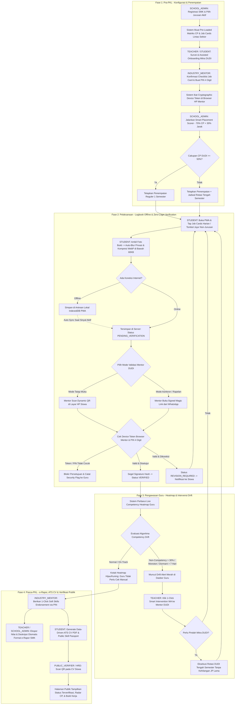
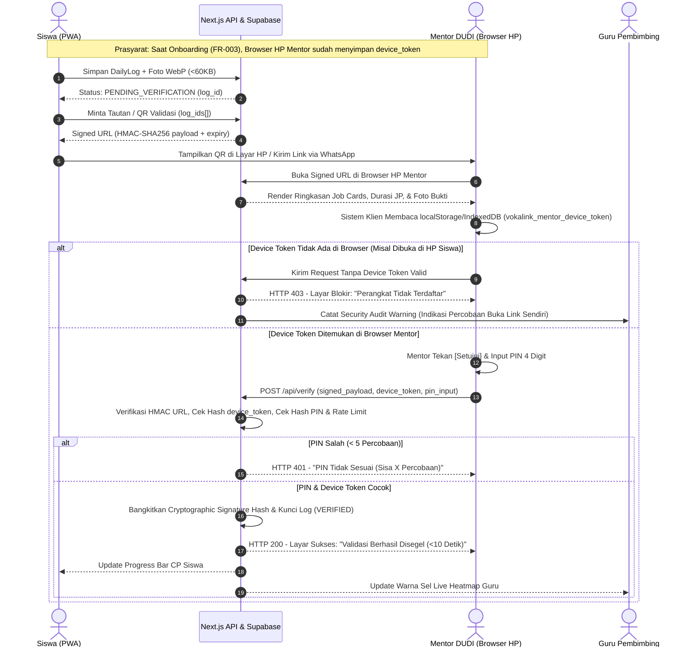
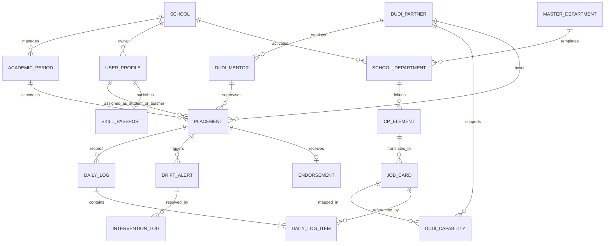
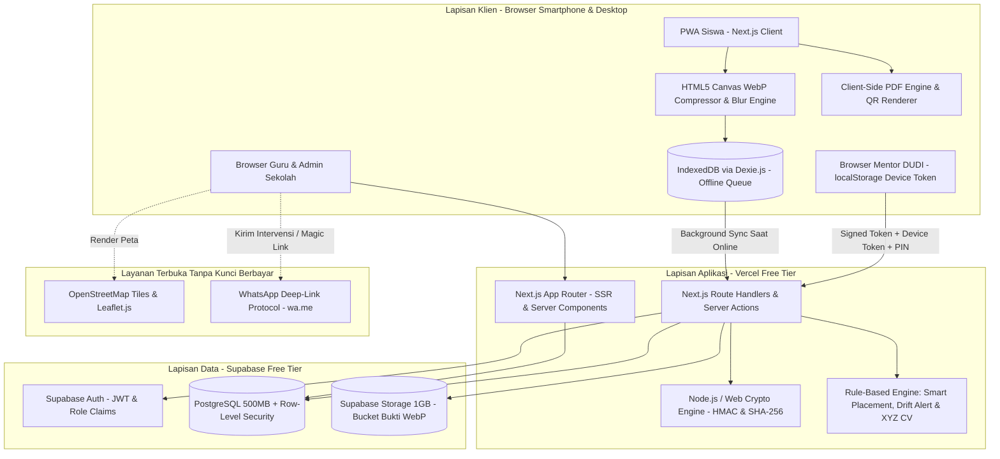
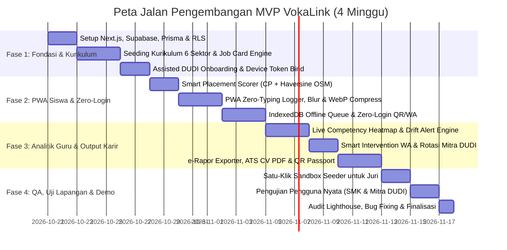

# PRODUCT REQUIREMENTS DOCUMENT (PRD) — VOKALINK

**Interconnected Multi-Sector Vocational Internship (PKL) Competency, Zero-Login Verification & Verifiable Career Ecosystem**

| Atribut Dokumen | Detail Spesifikasi |
|---|---|
| **Nama Produk** | VokaLink — Interconnected Multi-Sector Vocational Internship (PKL) Competency, Zero-Login Verification & Verifiable Career Ecosystem |
| **Konteks Pengembangan** | Kompetisi UINIC 8.0 Web Development 2026 (*Engineering Interconnected Web Solutions to Empower Digital Ecosystems* — Subtema: Education) |
| **Model Arsitektur** | Multi-Sekolah (Multi-Tenant SaaS) dengan Direktori Mitra DUDI Terfederasi Lintas Sekolah |
| **Tech Stack Terkunci** | Next.js (App Router, TypeScript), Tailwind CSS, Supabase (PostgreSQL, Auth, Storage), Prisma / Drizzle ORM, Dexie.js (IndexedDB PWA), Web Crypto API, Leaflet + OpenStreetMap |
| **Target Biaya Operasional** | Rp0 (Zero-Cost Architecture — Tanpa API Berbayar, Tanpa Kartu Kredit) |
| **Status & Versi** | v1.0 — Production Blueprint (Bab 1 s.d. Bab 17) |

---

## Daftar Isi

**Bagian 1 — Spesifikasi Produk, Fungsional, Alur Pengguna, Arsitektur Informasi, dan UI/UX**

1. [Product Overview](#1-product-overview)
2. [Problem Analysis](#2-problem-analysis)
3. [Target Users](#3-target-users)
4. [Product Scope](#4-product-scope)
5. [Functional Requirements](#5-functional-requirements)
6. [User Flow](#6-user-flow)
7. [Information Architecture (IA)](#7-information-architecture-ia)
8. [UI/UX Requirements](#8-uiux-requirements)

**Bagian 2 — Spesifikasi Data, Aturan Bisnis, Arsitektur Teknis, Pengujian QA, dan Peta Jalan**

9. [Data Requirements](#9-data-requirements)
10. [Business Rules](#10-business-rules)
11. [Non-Functional Requirements (NFR)](#11-non-functional-requirements-nfr)
12. [Technical Requirements](#12-technical-requirements)
13. [Acceptance Criteria & Testing (QA Test Plan)](#13-acceptance-criteria--testing-qa-test-plan)
14. [Success Metrics](#14-success-metrics)
15. [Risks & Mitigation](#15-risks--mitigation)
16. [Development Roadmap](#16-development-roadmap)
17. [Open Questions, Assumptions & Audit Kualitas](#17-open-questions-assumptions--audit-kualitas)

---

# BAGIAN 1 — Spesifikasi Produk, Fungsional, Alur Pengguna, Arsitektur Informasi, dan UI/UX (Bab 1 – Bab 8)

## 1. Product Overview

### 1.1 Deskripsi Produk

VokaLink adalah platform ekosistem web berbasis **Multi-Tenant SaaS** dan **Offline-First Progressive Web App (PWA)** yang mengorkestrasi pelaksanaan Praktik Kerja Lapangan (PKL) Sekolah Menengah Kejuruan (SMK) lintas sektor keahlian. Sistem ini menghubungkan empat aktor inti — Sekolah (Pokja PKL/Kaprog), Guru Pembimbing, Siswa SMK Fase F, dan Mentor Dunia Usaha/Dunia Industri (DUDI) — serta satu aktor publik (Perekrut Kerja/HRD) dalam satu rantai data yang saling mengunci (*interconnected workflow*).

VokaLink menerjemahkan dokumen regulasi Capaian Pembelajaran (CP) Kurikulum Merdeka dan SKKNI ke dalam katalog **Kartu Pekerjaan Praktis (Job Cards)** bebas-ketik bagi siswa, memfasilitasi **validasi industri tanpa login (Zero-Login Cryptographic Verification)** dalam waktu kurang dari 10 detik, mendeteksi penyimpangan kompetensi (**Competency Drift**) secara otomatis bagi guru, serta mengonversi akumulasi jam praktik terverifikasi menjadi Rekap Nilai e-Rapor SMK, CV Standar ATS, dan Paspor Kompetensi Ber-QR Anti-Pemalsuan.

### 1.2 Visi & Tujuan Produk

**Visi Produk:** Menjadi infrastruktur digital standar nasional yang menjembatani kurikulum pendidikan vokasi dengan realitas operasional industri lokal secara transparan, tanpa friksi administrasi, dan berbasis bukti kerja terverifikasi.

**Tujuan Spesifik:**

1. **Eliminasi Asimetri Kompetensi:** Menurunkan persentase penugasan magang di luar kurikulum (*non-competency drift*) melalui deteksi dini mingguan sebelum masa PKL berakhir.
2. **Penghapusan Friksi Administrasi Industri:** Meningkatkan tingkat partisipasi validasi asli oleh penyelia DUDI hingga di atas 90% dengan memangkas alur login konvensional menjadi verifikasi kriptografi 1-klik/scan berdurasi kurang dari 10 detik.
3. **Otomatisasi Administrasi Guru:** Memangkas waktu rekapitulasi nilai akhir dan penyusunan deskripsi rapor PKL hingga 90% melalui ekspor terstruktur berformat e-Rapor SMK.
4. **Peningkatan Kredibilitas Lulusan:** Mengubah jurnal kegiatan harian siswa menjadi portofolio karier terukur (CV ATS & Verifiable Skill Passport) yang dapat diaudit keasliannya secara instan oleh pemberi kerja.

### 1.3 Latar Belakang & Konteks Kompetisi

Dalam kerangka UINIC 8.0 Web Development 2026, solusi digital pendidikan dituntut tidak lagi berdiri sebagai aplikasi tunggal yang terisolasi (*siloed CRUD/LMS*), melainkan membentuk ekosistem yang saling memberdayakan antar-pemangku kepentingan. Pelaksanaan PKL SMK adalah titik temu paling krusial antara ekosistem pendidikan dan ekosistem ekonomi daerah, namun hingga saat ini masih dikelola secara terputus antara silabus sekolah, realitas tugas di tempat usaha, dan kebutuhan rekrutmen industri.

### 1.4 Ringkasan Masalah & Solusi Ekosistem

| Tahap Siklus PKL | Masalah Utama di Lapangan | Solusi Interconnected VokaLink |
|---|---|---|
| **Pra-PKL** (Persiapan & Penempatan) | Sekolah menempatkan siswa ke DUDI tanpa memetakan kesesuaian fasilitas kerja mitra dengan target Elemen CP; bahasa kurikulum tidak dipahami oleh penyelia industri. | **Multi-Sector Curriculum Engine & Smart Placement Scorer:** Menerjemahkan Elemen CP ke bahasa Job Cards praktis, memetakan kapasitas DUDI lintas sekolah dalam 60 detik, dan menghitung skor kecocokan kompetensi serta jarak spasial. |
| **Saat PKL** (Eksekusi & Pengawasan) | Siswa dibebani mengarang jurnal teks harian, sinyal di lokasi kerja lemah, penyelia DUDI menolak login ke web sekolah yang rumit, dan guru baru menyadari siswa "magang salah sasaran" saat semester berakhir. | **Zero-Typing PWA Logbook, Zero-Login DUDI Stamp, & Drift Alert:** Pencatatan berbasis tap kartu kerja (offline-capable), kompresi bukti foto otomatis di bawah 60 KB, validasi DUDI tanpa akun via QR/Magic Link ber-PIN kriptografi, serta Heatmap peringatan dini bagi guru. |
| **Pasca-PKL** (Penilaian & Karier) | Guru menyusun nilai dan narasi e-Rapor secara manual; lulusan hanya mendapat sertifikat kertas bernilai umum dan kesulitan menyusun CV profesional. | **e-Rapor Exporter, Smart ATS-CV Generator, & QR Skill Passport:** Konversi otomatis jam praktik terverifikasi menjadi file impor e-Rapor, resume berformula metrik industri (format XYZ), dan halaman verifikasi keaslian publik. |

---

## 2. Problem Analysis

### 2.1 Masalah Utama

1. **Ketidaksinkronan Penugasan Industri dengan Kurikulum (Competency Drift):** Siswa SMK dari berbagai jurusan (Akuntansi, RPL, DKV, Kuliner, Farmasi, Teknik) sering kali ditugaskan pada pekerjaan operasional non-kejuruan selama berbulan-bulan tanpa terdeteksi oleh sekolah.
2. **Kegagalan Adopsi Sistem Sekolah oleh Mitra DUDI (High Verification Friction):** Aplikasi jurnal PKL eksisting mewajibkan penyelia industri (akuntan senior, head chef, lead developer, apoteker, kepala teknisi) membuat akun dan melakukan login berulang kali, sehingga validasi diabaikan atau diserahkan kembali ke siswa.
3. **Ketiadaan Bukti Kompetensi Granular bagi Lulusan (Unverified Output):** Pengalaman praktik selama 1 semester penuh (792 Jam Pelajaran) menguap menjadi selembar sertifikat kertas tanpa rincian unit kompetensi teknis dan volume jam kerja yang dapat diverifikasi oleh perusahaan perekrut.

### 2.2 Akar Masalah (Root Cause Analysis)

- **Kesenjangan Bahasa (Terminology Gap):** Dokumen Capaian Pembelajaran (CP) pemerintah menggunakan nomenklatur pedagogis abstrak, sedangkan DUDI beroperasi berdasarkan daftar pekerjaan konkret harian.
- **Rasio Pengawasan Tidak Seimbang:** Satu Guru Pembimbing rata-rata mengawasi 15 hingga 30 siswa yang tersebar di berbagai titik lokasi usaha sambil tetap mengajar di sekolah, sehingga mustahil membaca ribuan baris jurnal teks bebas setiap hari.
- **Beban Kognitif & Teknis di Lapangan:** Lokasi kerja (dapur komersial, gudang farmasi, ruang produksi, bengkel) memiliki keterbatasan sinyal internet dan waktu luang yang sempit bagi penyelia maupun siswa.

### 2.3 Dampak Kuantitatif & Regulasi

- **Statistik Ketenagakerjaan Nasional:** Berdasarkan Berita Resmi Statistik Badan Pusat Statistik (BPS — Sakernas Agustus 2024), lulusan SMK masih mencatatkan Tingkat Pengangguran Terbuka (TPT) tertinggi secara nasional sebesar **9,01%** (melampaui SMA Umum 7,05%, Diploma 4,83%, dan Universitas 5,25%). Salah satu faktor utamanya adalah keraguan pemberi kerja terhadap penguasaan keterampilan praktis lulusan.
- **Mandat Regulasi Kurikulum Nasional:** Berdasarkan Permendikbudristek No. 12 Tahun 2024, Praktik Kerja Lapangan (PKL) ditetapkan sebagai mata pelajaran intrakurikuler wajib pada Fase F SMK dengan alokasi waktu minimal 1 semester penuh (**792 Jam Pelajaran / JP**) untuk program 3 tahun. Kegagalan mengawasi ketercapaian CP selama 792 JP berarti hilangnya 50% masa belajar efektif siswa di kelas akhir.

### 2.4 Kebutuhan Pengguna Lintas Peran & Validasi Masalah

- **Sekolah** membutuhkan instrumen pemetaan CP ke DUDI yang baku dan laporan audit akreditasi tanpa harus mengetik ulang dokumen kurikulum.
- **Guru Pembimbing** membutuhkan sistem pemantauan berbasis eksepsi (*management by exception*) yang hanya memberi peringatan ketika siswa mengalami defisit kompetensi atau keterlambatan validasi.
- **Siswa** membutuhkan pencatatan logbook cepat tanpa ketik panjang, aman dari pemotongan nilai saat melapor tugas non-kejuruan, hemat kuota internet, dan menghasilkan CV siap lamar kerja.
- **Mentor DUDI** membutuhkan mekanisme persetujuan tugas yang selesai dalam satu layar tanpa registrasi akun dan tanpa mengingat kata sandi.

---

## 3. Target Users

### 3.1 Segmentasi Pengguna & Persona

#### Persona 1: Pengelola Sekolah / Pokja PKL (`SCHOOL_ADMIN`)

- **Profil:** Wakil Kepala Sekolah Bidang Hubungan Industri (Waka Hubin) atau Ketua Program Keahlian (Kaprog) di SMK Negeri/Swasta (usia 30–55 tahun).
- **Kebutuhan Utama:** Mengatur matriks kurikulum lintas jurusan, memetakan siswa ke mitra DUDI yang tepat kapasitas dan dekat secara geografis, serta mengekspor nilai akhir ke e-Rapor SMK.
- **Pain Points:** Mengelola ratusan siswa di puluhan DUDI menggunakan spreadsheet terpisah; sulit mengevaluasi mitra DUDI mana yang benar-benar melatih siswa sesuai kurikulum.

#### Persona 2: Guru Pembimbing Lapangan (`TEACHER`)

- **Profil:** Guru mata pelajaran kejuruan yang ditugaskan membimbing 15–30 siswa PKL (usia 25–50 tahun).
- **Kebutuhan Utama:** Memantau progres ketercapaian CP seluruh siswa binaan dalam satu tampilan visual dan melakukan intervensi cepat jika siswa diberi tugas yang melenceng dari jurusan.
- **Pain Points:** Harus memeriksa ratusan entri jurnal harian teks bebas dan baru mengetahui siswa tidak mendapat materi kejuruan saat kunjungan penarikan di bulan ke-6.

#### Persona 3: Siswa Peserta PKL (`STUDENT`)

- **Profil:** Siswa SMK Kelas XI atau XII (Fase F, usia 16–18 tahun) dari berbagai konsentrasi keahlian (Akuntansi, RPL, DKV, Kuliner, Farmasi, Teknik).
- **Kebutuhan Utama:** Mencatat pekerjaan harian dengan cepat lewat HP (termasuk saat susah sinyal), mengetahui target kompetensi yang belum tercapai, dan memiliki CV profesional saat lulus.
- **Pain Points:** Lelah mengarang kalimat jurnal setiap sore, takut melapor jika disuruh melakukan pekerjaan kasar di luar jurusan, kuota data terbatas untuk unggah foto, dan bingung menulis CV.

#### Persona 4: Penyelia / Mentor Industri (`INDUSTRY_MENTOR`)

- **Profil:** Praktisi di tempat kerja mitra (Senior Accountant, Lead Developer, Art Director, Head Chef, Apoteker, Kepala Teknisi; usia 25–55 tahun).
- **Kebutuhan Utama:** Memvalidasi laporan kerja siswa magang secara instan dari HP tanpa mengganggu pekerjaan utama.
- **Pain Points:** Menolak membuat akun baru di website sekolah, lupa password, dan tidak memahami istilah birokrasi kurikulum sekolah.

#### Persona 5: Perekrut Kerja / HRD (`PUBLIC_VERIFIER`)

- **Profil:** Staf HRD perusahaan atau pemilik usaha lokal yang menyeleksi lamaran kerja lulusan SMK.
- **Kebutuhan Utama:** Memastikan klaim keterampilan pada CV kandidat benar-benar pernah dikerjakan dan divalidasi oleh industri tempat magang.
- **Pain Points:** Sertifikat PKL konvensional hanya mencantumkan nilai angka rata-rata dan mudah dipalsukan secara visual.

### 3.2 Matriks Hak Akses (Role-Based & Token-Based Access Matrix)

| Modul / Kapabilitas Sistem | SCHOOL_ADMIN | TEACHER | STUDENT | INDUSTRY_MENTOR (Zero-Login) | PUBLIC_VERIFIER (Tanpa Akun) |
|---|---|---|---|---|---|
| Konfigurasi Profil Sekolah & Tahun Ajaran (Multi-Tenant) | Penuh (CRUD) | Baca | Tidak Ada | Tidak Ada | Tidak Ada |
| Pengelolaan Matriks Elemen CP & Katalog Job Cards | Penuh (CRUD) | Baca & Usul | Baca | Baca (Job Cards Mitra) | Tidak Ada |
| Direktori Mitra DUDI & Assisted Onboarding | Penuh (CRUD) | Buat & Edit Mitra | Bantu Input Survei | Konfirmasi & Set PIN | Tidak Ada |
| Smart Placement Scorer & Penugasan Siswa | Penuh (Eksekusi) | Baca | Baca Penempatan Diri | Baca Siswa Magang | Tidak Ada |
| Input Logbook Harian, Kompresi Foto & Blur Privasi | Baca Audit | Baca Binaan | Penuh (Buat & Edit Pending) | Baca & Validasi | Tidak Ada |
| Validasi Zero-Login (QR / Magic Link + PIN 4 Digit) | Baca Status | Baca Status | Tampilkan QR / Kirim Link | Eksekusi Tanda Tangan | Tidak Ada |
| Live Competency Heatmap & Drift Alert | Baca Seluruh Jurusan | Penuh (Kelas Binaan) | Progres Diri Sendiri | Tidak Ada | Tidak Ada |
| Smart Intervention WA & Rotasi DUDI Tengah Semester | Penuh (Persetujuan) | Eksekusi Intervensi | Baca Riwayat Rotasi | Terima Pesan WA | Tidak Ada |
| Pemberian Endorsement Etos Kerja Akhir PKL | Baca | Baca | Baca di CV/Passport | Eksekusi (1-Klik) | Baca di CV/Passport |
| Ekspor Nilai & Deskripsi Capaian Format e-Rapor SMK | Penuh (Ekspor) | Penuh (Kelas Binaan) | Tidak Ada | Tidak Ada | Tidak Ada |
| Generator CV Standar ATS & Verifiable Skill Passport | Baca & Segel Sekolah | Baca | Penuh (Kustomisasi & Unduh) | Segel Kriptografi DUDI | Baca & Verifikasi QR |

---

## 4. Product Scope

### 4.1 Ruang Lingkup MVP (In-Scope)

#### Prioritas *Must Have* (Wajib Berfungsi 100% pada Saat Demo & Pengujian)

1. **Multi-School Tenant Onboarding (FR-001):** Pendaftaran instansi SMK, isolasi data berbasis sekolah, dan pemilihan jurusan aktif.
2. **Pre-Loaded Multi-Sector Curriculum & Job-Card Engine (FR-002):** Database bawaan untuk minimal 5 konsentrasi keahlian lintas sektor (Akuntansi/AKL, RPL/PPLG, DKV, Kuliner, Farmasi, dan Teknik Otomotif) beserta terjemahan Job Cards dan target 792 JP.
3. **Assisted DUDI Onboarding & Device-Bound Cryptographic Setup (FR-003):** Pemetaan fasilitas DUDI berbasis checklist cepat, pengambilan titik koordinat peta OpenStreetMap, dan pengikatan token kriptografi perangkat mentor beserta PIN 4 digit.
4. **Smart Placement & Spatial Compatibility Scorer (FR-004):** Kalkulasi otomatis skor kecocokan kompetensi DUDI terhadap CP jurusan (bobot 70%) dan jarak spasial Haversine dari domisili siswa (bobot 30%).
5. **Zero-Typing Job Card Logger & Safe Non-Competency Whistleblower (FR-005):** Pencatatan kegiatan harian berbasis tap kartu kerja, durasi jam, tingkat kemandirian, serta opsi aman pelaporan tugas non-kejuruan ("Tombol Jujur").
6. **Client-Side WebP Compressor, Privacy Blur Tool, & Offline Sync Queue (FR-006):** Kompresi foto bukti kerja di browser menjadi di bawah 60 KB, alat pemburaman data sensitif pada foto, dan penyimpanan luring di IndexedDB (PWA) saat tidak ada internet.
7. **Dual-Mode Zero-Login DUDI Verification (FR-007):** Validasi tanpa akun melalui pemindaian QR dinamis tatap muka atau tautan WhatsApp bertanda tangan kriptografi (Batch Approval harian/mingguan) menggunakan PIN 4 digit.
8. **Live Competency Heatmap & Algorithmic Drift Alert (FR-008):** Visualisasi matriks warna ketercapaian CP kelas dan pendeteksian otomatis 3 kondisi penyimpangan (*Non-Competency Overload*, *Skill Monotony*, *Approval Dormancy*).
9. **Smart Intervention Dispatcher & Mid-Term Rotation (FR-009):** Generator draf pesan koordinasi WhatsApp berbasis data defisit siswa kepada mentor DUDI serta fitur pemindahan/rotasi mitra tengah semester.
10. **Automated e-Rapor SMK Exporter (FR-011):** Kalkulasi nilai akhir per Tujuan Pembelajaran, pembangkitan kalimat deskripsi rapor otomatis, dan unduhan CSV/XLSX sesuai format e-Rapor SMK.
11. **Data-Driven ATS-CV Generator & Verifiable Skill Passport (FR-012):** Konversi logbook terverifikasi menjadi CV berformula XYZ standar ATS (unduh PDF di sisi klien) dan halaman portofolio publik ber-QR anti-pemalsuan.

#### Prioritas *Should Have* (Penting untuk Kelengkapan Ekosistem)

- **1-Click Work Ethic Endorsement & DUDI Quality Index (FR-010):** Pemberian lencana etos kerja oleh mentor industri di akhir masa magang dan dasbor audit kelayakan perpanjangan MoU mitra DUDI bagi sekolah.

### 4.2 Pengembangan Lanjutan Pasca-MVP (*Post-MVP / Could Have*)

- **Bursa Kerja Khusus (BKK) Talent Pool:** Portal pencarian kandidat lulusan lintas SMK bagi perusahaan regional berdasarkan filter jam minimal penguasaan unit SKKNI tertentu.
- **Integrasi WebPush Notification Native:** Pengiriman notifikasi push langsung ke sistem operasi smartphone siswa dan guru.
- **Analitik Dinas Pendidikan Provinsi:** Dasbor agregasi makro tingkat keterserapan kompetensi vokasi per kabupaten/kota.

### 4.3 Fitur di Luar Ruang Lingkup (Out-of-Scope)

- **Chat / Video Call Internal:** Tidak membangun sistem pesan instan internal; seluruh komunikasi interpersonal memanfaatkan deep-link WhatsApp (`wa.me`) dengan teks terformat otomatis.
- **Integrasi API Privat Dapodik / e-Rapor Pemerintah Secara Langsung:** Tidak melakukan koneksi server-to-server ke jaringan tertutup Kemendikdasmen yang membutuhkan izin birokrasi khusus; integrasi dilakukan melalui standar interoperabilitas impor/ekspor CSV/XLSX resmi.
- **Blockchain / Smart Contract Berbayar (Gas Fee):** Keaslian dokumen tidak menggunakan jaringan kripto berbayar, melainkan tanda tangan kriptografi standar industri (HMAC-SHA256 & Ed25519 via Web Crypto API) yang 100% gratis dan terverifikasi secara matematis.
- **Penggajian / Uang Saku Magang (Payroll):** Sistem tidak memproses transaksi keuangan atau pembayaran uang saku antara DUDI dan siswa.

---

## 5. Functional Requirements

> Setiap spesifikasi di bawah ini menjadi kontrak teknis yang mengikat antara UI/UX, Frontend, Backend, dan QA.

### FR-001: Registrasi Multi-Sekolah (SaaS Onboarding) & Manajemen Tahun Ajaran

| Atribut | Detail |
|---|---|
| **Requirement ID** | FR-001 |
| **Nama Fitur** | Registrasi Multi-Sekolah (SaaS Onboarding) & Manajemen Tahun Ajaran |
| **Aktor** | `SCHOOL_ADMIN` (Waka Hubin / Operator Pokja PKL) |
| **Prioritas** | Must Have |
| **Dependensi** | Tidak ada (fitur dasar) |

**Tujuan Fitur:** Memungkinkan banyak SMK mendaftar secara mandiri di dalam satu platform (Multi-Tenant) dengan isolasi data akademik masing-masing sekolah.

**Deskripsi dan Ruang Lingkup:** Mencakup pendaftaran akun admin sekolah, pencarian identitas sekolah berdasarkan referensi NPSN (Nomor Pokok Sekolah Nasional), pengaktifan konsentrasi keahlian yang dimiliki sekolah, dan pengaturan periode gelombang PKL (contoh: Semester Genap 2026/2027, target durasi 792 JP).

**Prasyarat:** Pengguna belum memiliki sesi aktif atau mendaftar sebagai instansi baru.

**Alur Utama:**

1. Pengguna membuka halaman registrasi instansi sekolah dan menginput NPSN (8 digit), nama sekolah, provinsi, kabupaten/kota, email resmi, dan kata sandi.
2. Sistem memvalidasi keunikan NPSN dan email, lalu membuat entitas `School` (Tenant) baru beserta akun `SCHOOL_ADMIN`.
3. Pengguna memilih daftar Konsentrasi Keahlian yang aktif di sekolahnya dari katalog multi-sektor bawaan sistem.
4. Pengguna menetapkan periode akademik PKL aktif (Tanggal Mulai, Tanggal Selesai, dan Target Total JP default = 792 JP).
5. Sistem menginisialisasi ruang kerja sekolah dan mengarahkan pengguna ke Dasbor Pokja PKL.

**Alternatif Alur:**

- **A1 (Sekolah Menggunakan Data Demo Instan untuk Penjurian):** Pengguna menekan tombol "Muat Data Demo Sekolah Multi-Sektor"; sistem langsung menginjeksikan data simulasi lengkap (4 jurusan, 20 siswa, 6 mitra DUDI, dan riwayat logbook 8 minggu) ke dalam tenant sandbox terisolasi.

**Input dan Output:**

- **Input:** `npsn` (string, 8 digit angka), `school_name` (string), `province` (string), `city` (string), `admin_email` (string), `password` (string, min 8 karakter), `selected_department_ids` (array UUID), `target_total_jp` (integer, default 792).
- **Output:** Record `School`, sesi autentikasi JWT Supabase, dan salinan matriks kurikulum aktif untuk tenant tersebut.

**Business Rules:**

- Satu kode NPSN (8 digit) hanya boleh didaftarkan oleh satu tenant sekolah utama (kecuali mode demo sandbox).
- Setiap data siswa, guru, dan penempatan wajib memiliki atribut `school_id` untuk menjamin isolasi data antar-sekolah (Row-Level Security).

**Validasi dan Error Handling:**

- Jika NPSN bukan 8 digit angka: tampilkan pesan inline *"NPSN wajib terdiri dari 8 digit angka."*
- Jika NPSN sudah terdaftar: tampilkan pesan *"Sekolah dengan NPSN ini sudah terdaftar. Hubungi admin sekolah Anda atau gunakan fitur Masuk."*

**Acceptance Criteria yang Dapat Diuji:**

- `SCHOOL_ADMIN` dapat menyelesaikan pendaftaran sekolah baru dan memilih minimal 2 jurusan berbeda dalam waktu kurang dari 2 menit.
- Data siswa dan guru milik Sekolah A tidak dapat dilihat atau diakses oleh `SCHOOL_ADMIN` dari Sekolah B.
- Target default JP otomatis terisi 792 JP sesuai regulasi Permendikbudristek No. 12 Tahun 2024 dan dapat disesuaikan pada rentang 300 hingga 1.200 JP.

---

### FR-002: Pre-Loaded Multi-Sector Curriculum Engine & Job-Card Mapper

| Atribut | Detail |
|---|---|
| **Requirement ID** | FR-002 |
| **Nama Fitur** | Pre-Loaded Multi-Sector Curriculum Engine & Job-Card Mapper |
| **Aktor** | `SCHOOL_ADMIN`, `TEACHER` |
| **Prioritas** | Must Have |
| **Dependensi** | FR-001 |

**Tujuan Fitur:** Menyediakan matriks Elemen Capaian Pembelajaran (CP) dan SKKNI lintas sektor secara instan serta menerjemahkannya ke dalam katalog Kartu Pekerjaan Praktis (Job Cards) yang dipahami siswa dan DUDI.

**Deskripsi dan Ruang Lingkup:** Sistem menyediakan template kurikulum bawaan untuk berbagai jurusan (Akuntansi/AKL, RPL/PPLG, DKV, Kuliner, Farmasi, Teknik Otomotif). Sekolah dapat menyesuaikan bobot target JP per Elemen CP dan mengelola daftar Job Cards di bawah setiap elemen tersebut.

**Prasyarat:** Sekolah telah mengaktifkan jurusan pada FR-001.

**Alur Utama:**

1. `SCHOOL_ADMIN` membuka menu Kurikulum & Job Cards dan memilih salah satu jurusan aktif (misal: Akuntansi dan Keuangan Lembaga).
2. Sistem menampilkan daftar Elemen CP Fase F beserta bobot target JP masing-masing (total akumulasi = 792 JP) dan daftar Job Cards praktis di bawah tiap elemen.
3. Pengguna dapat menambah Job Card baru (mengisi nama pekerjaan praktis maks 60 karakter, kode unit SKKNI opsional, dan daftar alat/perangkat kerja terkait) atau mengubah bobot target JP per elemen menggunakan slider proporsional.
4. Pengguna menekan tombol "Simpan & Kunci Matriks Kurikulum".

**Alternatif Alur:**

- **A1 (Impor Kurikulum Kustom via CSV/JSON):** Jika sekolah memiliki jurusan spesifik yang belum ada di template bawaan, `SCHOOL_ADMIN` mengunggah file CSV/JSON sesuai template kolom standar (`kode_elemen`, `nama_elemen_cp`, `target_jp`, `nama_job_card`, `kode_skkni`, `alat_kerja`).

**Input dan Output:**

- **Input:** `department_id` (UUID), daftar `cp_elements` (title, target_jp), daftar `job_cards` (title, skkni_code, tools_list, description).
- **Output:** Struktur matriks kurikulum dan katalog Job Cards berstatus `PUBLISHED` yang siap digunakan saat DUDI Onboarding dan Student Logbook.

**Business Rules:**

- Total `target_jp` dari seluruh Elemen CP dalam satu jurusan wajib sama dengan `target_total_jp` periode PKL sekolah tersebut (default 792 JP).
- Setiap Elemen CP wajib memiliki minimal 2 Job Cards aktif sebelum kurikulum dapat dikunci.
- Sistem wajib menyediakan satu kategori sistem bawaan bernama **"Bantuan Operasional Umum (Non-Jurusan)"** di luar kuota CP untuk menampung pelaporan tugas non-kejuruan.

**Validasi dan Error Handling:**

- Jika total bobot JP seluruh elemen tidak sama dengan target total JP: tombol kunci dinonaktifkan dan muncul indikator selisih *"Total alokasi saat ini 740 JP (Kurang 52 JP dari target 792 JP)."*
- Jika nama Job Card melebihi 60 karakter: tampilkan validasi *"Gunakan bahasa praktis maksimal 60 karakter agar mudah dibaca di layar HP."*

**Acceptance Criteria yang Dapat Diuji:**

- Saat memilih salah satu dari 6 jurusan bawaan (AKL, RPL, DKV, Kuliner, Farmasi, Otomotif), sistem langsung menampilkan minimal 4 Elemen CP dan 12 Job Cards relevan tanpa ketik manual.
- Perubahan Job Card langsung tercermin pada daftar pilihan tugas siswa dan checklist kapasitas DUDI.

---

### FR-003: Assisted DUDI Onboarding, Pemetaan Kapasitas & Pengikatan Token Kriptografi

| Atribut | Detail |
|---|---|
| **Requirement ID** | FR-003 |
| **Nama Fitur** | Assisted DUDI Onboarding, Pemetaan Kapasitas Lintas Sekolah & Pengikatan Token Kriptografi (Device-Bound PIN) |
| **Aktor** | `TEACHER` / `SCHOOL_ADMIN` / `STUDENT` (fasilitator survei) bersama `INDUSTRY_MENTOR` |
| **Prioritas** | Must Have |
| **Dependensi** | FR-002 |

**Tujuan Fitur:** Memetakan ketersediaan pekerjaan di mitra DUDI dalam waktu kurang dari 60 detik dan mengaktifkan verifikasi Zero-Login pada perangkat HP mentor industri tanpa mengharuskan registrasi akun/password.

**Deskripsi dan Ruang Lingkup:** Fitur pendaftaran entitas DUDI ke dalam direktori terfederasi, pencentangan Job Cards yang sanggup disediakan oleh tempat usaha tersebut, perekaman koordinat lokasi peta, serta pengikatan kriptografi perangkat HP mentor menggunakan PIN 4 digit.

**Prasyarat:** Matriks Job Cards jurusan telah tersedia (FR-002).

**Alur Utama:**

1. Guru/Siswa membuka menu "Onboarding Mitra DUDI" saat berada di lokasi usaha (kantor akuntan, software house, studio desain, restoran, apotek, atau bengkel).
2. Pengguna mencari nama usaha di direktori terfederasi; jika belum ada, pengguna menginput Nama Usaha, Sektor Industri, Alamat, Kuota Siswa, dan menekan "Ambil Titik Koordinat Lokasi" pada peta OpenStreetMap.
3. Sistem menampilkan daftar Job Cards untuk jurusan terkait; pengguna mencentang kartu pekerjaan apa saja yang tersedia di tempat usaha tersebut.
4. Pengguna menginput Nama Mentor Industri dan Nomor WhatsApp aktif, lalu memunculkan QR Aktivasi Perangkat Mentor (atau mengirimkan tautan aktivasi ke WA mentor).
5. `INDUSTRY_MENTOR` membuka QR/tautan tersebut di browser HP pribadinya, meninjau daftar pekerjaan yang dicentang, membuat PIN 4 Digit, dan menekan "Aktifkan Perangkat Verifikator".
6. Sistem membangkitkan pasangan kunci/token kriptografi (`device_token` disimpan di localStorage & IndexedDB browser mentor, sedangkan `token_hash` dan `pin_hash` disimpan di server Supabase).

**Alternatif Alur:**

- **A1 (Mitra DUDI Sudah Terdaftar oleh SMK Lain):** Pengguna memilih profil DUDI dari direktori lintas sekolah, lalu cukup menambahkan pemetaan kapasitas untuk jurusannya sendiri tanpa menduplikasi data entitas usaha.
- **A2 (Pergantian HP Mentor / Reset Token):** Jika HP mentor hilang atau berganti perangkat, `TEACHER` atau `SCHOOL_ADMIN` dapat memicu fitur "Reset Token Perangkat Mentor" yang mencabut token lama dan mengirimkan tautan pengikatan baru.

**Input dan Output:**

- **Input:** `company_name`, `sector_category`, `latitude`, `longitude`, `quota`, `supported_job_card_ids` (array UUID), `mentor_name`, `mentor_whatsapp`, `mentor_pin` (4 digit angka).
- **Output:** Profil DUDI terverifikasi, skor persentase cakupan kurikulum DUDI (`coverage_ratio`), dan penyimpanan `vokalink_mentor_device_token` di perangkat mentor.

**Business Rules:**

- `mentor_pin` wajib di-hash menggunakan algoritma satu arah sebelum disimpan ke database.
- Satu profil DUDI dapat memiliki lebih dari satu mentor (misal: penyelia cabang atau shift berbeda).

**Validasi dan Error Handling:**

- Jika tidak ada satu pun Job Card yang dicentang: tampilkan pesan *"Pilih minimal 1 pekerjaan teknis yang tersedia di lokasi mitra ini."*
- Jika akses GPS browser ditolak saat mengambil lokasi: peta otomatis memungkinkan penggeseran pin manual (*draggable marker*) ke lokasi usaha di OpenStreetMap.

**Acceptance Criteria yang Dapat Diuji:**

- Proses pencentangan kapasitas Job Cards dan pembuatan PIN mentor dapat diselesaikan dalam waktu kurang dari 60 detik.
- Setelah aktivasi selesai, browser HP mentor menyimpan token perangkat secara persisten dan mentor tidak pernah diminta menginput email atau password.

---

### FR-004: Smart Placement & Spatial Compatibility Scorer

| Atribut | Detail |
|---|---|
| **Requirement ID** | FR-004 |
| **Nama Fitur** | Smart Placement & Spatial Compatibility Scorer |
| **Aktor** | `SCHOOL_ADMIN`, `TEACHER` |
| **Prioritas** | Must Have |
| **Dependensi** | FR-002, FR-003 |

**Tujuan Fitur:** Memberikan rekomendasi penempatan siswa ke mitra DUDI secara objektif berdasarkan kecocokan cakupan kompetensi kurikulum dan efisiensi jarak tempuh dari domisili siswa.

**Deskripsi dan Ruang Lingkup:** Kalkulator pencocokan multi-kriteria yang mengevaluasi kesesuaian antara daftar Job Cards yang tersedia di DUDI dengan Elemen CP jurusan serta jarak geografis rumah siswa ke lokasi DUDI.

**Prasyarat:** Data siswa (beserta koordinat kelurahan/domisili) dan data kapasitas DUDI (FR-003) telah terdaftar.

**Alur Utama:**

1. `SCHOOL_ADMIN` membuka halaman Penempatan Cerdas (Smart Placement) dan memilih jurusan serta daftar siswa yang belum ditempatkan.
2. Sistem menghitung Total Placement Score ($S_{total}$) untuk setiap pasangan Siswa–DUDI yang kuotanya masih tersedia dengan formula:

   $$S_{total} = (0.70 \times S_{kompetensi}) + (0.30 \times S_{jarak})$$

3. Sistem menampilkan peringkat rekomendasi DUDI terbaik untuk setiap siswa lengkap dengan label indikator:
   - **Cakupan Kompetensi ($S_{kompetensi}$):** Persentase bobot JP Elemen CP jurusan yang dapat dipenuhi oleh fasilitas DUDI.
   - **Jarak Spasial:** Jarak dalam kilometer (dihitung dengan rumus Haversine).
4. Jika DUDI yang dipilih memiliki $S_{kompetensi}$ kurang dari 50%, sistem menampilkan lencana peringatan kuning: *"Wajib Rotasi Tengah Semester (Cakupan CP hanya X%)"*.
5. `SCHOOL_ADMIN` mengonfirmasi penempatan dan menetapkan `TEACHER` (Guru Pembimbing) untuk kelompok tersebut.

**Alternatif Alur:**

- **A1 (Override Manual oleh Pokja PKL):** Admin sekolah tetap dapat menempatkan siswa ke DUDI pilihan di luar rekomendasi teratas dengan memilih alasan penempatan manual.

**Input dan Output:**

- **Input:** `student_id`, koordinat domisili siswa (lat, lng), daftar kandidat `dudi_id`, dan `teacher_id`.
- **Output:** Record `Placement` berstatus `ACTIVE` dan jadwal rencana rotasi jika cakupan di bawah 50%.

**Business Rules:**

- Rumus jarak menggunakan **Haversine Formula** murni di sisi aplikasi (tanpa memanggil API berbayar Google Distance Matrix):
  - Jarak $\le 5\text{ km}$ mendapat skor $S_{jarak} = 100$.
  - Jarak antara $5\text{ km}$ hingga $25\text{ km}$ mengalami penurunan linier: $S_{jarak} = \max\left(0, 100 - \frac{(d - 5)}{20} \times 100\right)$.
- Penempatan tidak dapat disimpan jika kuota aktif DUDI sudah penuh, kecuali admin menaikkan batas kuota mitra terlebih dahulu.

**Validasi dan Error Handling:**

- Jika koordinat domisili siswa belum diatur: sistem menggunakan titik tengah kelurahan/kecamatan siswa atau menampilkan tombol pilih titik di peta.

**Acceptance Criteria yang Dapat Diuji:**

- Sistem menampilkan daftar rekomendasi DUDI terurut dari skor tertinggi beserta rincian persentase kompetensi dan jarak kilometer secara akurat.
- Mitra DUDI dengan cakupan CP di bawah 50% otomatis ditandai dengan status rekomendasi rotasi tengah semester.

---

### FR-005: Zero-Typing Job Card Logger & Safe Non-Competency Whistleblower

| Atribut | Detail |
|---|---|
| **Requirement ID** | FR-005 |
| **Nama Fitur** | Zero-Typing Job Card Logger & Safe Non-Competency Whistleblower ("Tombol Jujur") |
| **Aktor** | `STUDENT` |
| **Prioritas** | Must Have |
| **Dependensi** | FR-002, FR-004, FR-006 |

**Tujuan Fitur:** Memungkinkan siswa mencatat kegiatan praktik harian dalam waktu kurang dari 15 detik tanpa perlu mengetik narasi panjang, sekaligus menyediakan jalur aman untuk melaporkan penugasan di luar materi kejuruan.

**Deskripsi dan Ruang Lingkup:** Antarmuka PWA harian siswa yang menampilkan Progress Bar ketercapaian 792 JP, pilihan kartu pekerjaan visual sesuai jurusan/tempat magang, pemilihan durasi jam kerja, tingkat kemandirian, dan kartu khusus pelaporan tugas operasional non-jurusan.

**Prasyarat:** Siswa memiliki penempatan `ACTIVE` (FR-004).

**Alur Utama:**

1. Siswa membuka aplikasi PWA VokaLink di smartphone dan menekan tombol **+ Catat Kegiatan Hari Ini**.
2. Sistem menampilkan daftar Job Cards yang relevan dengan jurusannya (kartu yang tersedia di DUDI tempatnya magang ditampilkan di urutan paling atas), ditambah kartu khusus "Bantuan Operasional Umum (Di Luar Materi Jurusan)".
3. Siswa melakukan tap pada 1 hingga 3 Job Cards yang dikerjakan hari itu.
4. Untuk setiap kartu yang dipilih, siswa menggeser slider durasi jam (rentang 1 hingga 10 JP per hari) dan memilih tingkat keterlibatan:
   - **Level 1:** Mengamati / Membantu (Observasi)
   - **Level 2:** Mengerjakan dengan Bimbingan (Terbimbing)
   - **Level 3:** Mengerjakan Secara Mandiri (Mandiri)
5. Siswa melampirkan 1 foto bukti kerja (diproses oleh FR-006) dan opsional menambahkan catatan singkat (maks 140 karakter).
6. Siswa menekan tombol **Simpan Log Harian**.

**Alternatif Alur:**

- **A1 (Siswa Memilih Kartu "Bantuan Operasional Umum / Non-Jurusan"):** Saat kartu ini dipilih, sistem menampilkan banner penjaminan hijau: *"Memilih kartu ini TIDAK mengurangi nilai maupun jam kehadiran PKL kamu. Data ini membantu Guru Pembimbing memintakan rotasi tugas ke pihak industri agar hak belajarmu terpenuhi."* Siswa memilih sub-kategori cepat (misal: Administrasi Umum/Fotokopi, Kebersihan/Gudang, Kurir/Antar Barang, Jaga Toko Non-Teknis).
- **A2 (Siswa Sakit / Izin):** Siswa memilih tab "Tidak Hadir (Sakit/Izin)" dan mengunggah foto surat keterangan tanpa memengaruhi rasio deviasi kompetensi.

**Input dan Output:**

- **Input:** `log_date` (tanggal), array `selected_items` (`job_card_id` atau `is_non_competency = true`, `duration_jp`, `autonomy_level`), `evidence_photo_blob`, `short_note` (opsional).
- **Output:** Record `DailyLog` dengan status `PENDING_VERIFICATION` (jika online) atau `QUEUED_OFFLINE` (jika tanpa sinyal).

**Business Rules:**

- Total akumulasi `duration_jp` dalam satu tanggal kalender untuk satu siswa dibatasi maksimal **12 JP** untuk mencegah manipulasi penggelembungan jam kerja.
- Siswa hanya dapat menginput log untuk hari berjalan atau maksimal mundur 3 hari kalender ke belakang (*backdate limit*).
- Jam kerja pada kartu "Bantuan Operasional Umum (Non-Jurusan)" tetap dihitung ke dalam Total Jam Kehadiran PKL, tetapi dihitung sebagai `non_competency_jp` pada algoritma Competency Drift (FR-008).

**Validasi dan Error Handling:**

- Jika total durasi melebihi 12 JP dalam sehari: tampilkan pesan *"Total jam praktik harian tidak boleh melebihi 12 JP."*
- Jika belum memilih satu pun Job Card: tombol simpan nonaktif.

**Acceptance Criteria yang Dapat Diuji:**

- Siswa dapat menyelesaikan pencatatan log harian tanpa mengetik satu huruf pun di papan ketik dalam waktu kurang dari 15 detik.
- Memilih kartu non-kompetensi tetap menambah jam kehadiran siswa namun tercatat terpisah pada metrik analitik guru.

---

### FR-006: Client-Side WebP Compressor, Privacy Blur Tool, & Offline Sync Queue

| Atribut | Detail |
|---|---|
| **Requirement ID** | FR-006 |
| **Nama Fitur** | Client-Side WebP Compressor, Privacy Redaction (Blur Tool), & Offline-First Sync Queue |
| **Aktor** | `STUDENT` (dan Mesin Browser PWA) |
| **Prioritas** | Must Have |
| **Dependensi** | FR-005 |

**Tujuan Fitur:** Menghemat kuota data siswa serta kapasitas penyimpanan server gratis (Supabase 1 GB) dengan menekan ukuran foto bukti kerja menjadi di bawah 60 KB di sisi browser, melindungi kerahasiaan data industri/klien, dan menjamin aplikasi tetap berjalan tanpa koneksi internet.

**Deskripsi dan Ruang Lingkup:** Pemrosesan gambar lokal menggunakan HTML5 Canvas API sebelum unggah, kuas pemburaman (*blur brush*) untuk menutupi informasi sensitif pada foto (seperti nominal faktur pajak klien, nama pasien di resep apotek, atau kode rahasia perusahaan), serta penyimpanan antrean luring menggunakan IndexedDB (Dexie.js).

**Prasyarat:** Siswa mengambil atau memilih foto bukti kerja pada FR-005.

**Alur Utama:**

1. Saat siswa memilih foto dari kamera/galeri (ukuran mentah 3 MB – 10 MB), sistem membaca file secara lokal di memori browser menggunakan `FileReader` & `HTMLCanvasElement`.
2. Sistem menampilkan pratinjau gambar dengan tombol opsional **"Buramkan Data Sensitif (Blur)"**; jika diaktifkan, siswa dapat mengusap jari pada area gambar untuk menerapkan efek Gaussian/Pixelate Blur di atas kanvas.
3. Sistem mengubah ukuran dimensi gambar (lebar/tinggi maksimum 800px dengan rasio aspek terjaga) dan mengonversinya ke format `image/webp` dengan kualitas 0.65 (target ukuran akhir 35 KB – 60 KB).
4. Sistem memeriksa status jaringan (`navigator.onLine` dan heartbeat ping):
   - **Jika Online:** Mengunggah blob WebP ke Supabase Storage dan menyimpan metadata `DailyLog` ke PostgreSQL.
   - **Jika Offline:** Menyimpan payload log beserta blob WebP ke tabel lokal `offline_logs_queue` di IndexedDB dan menampilkan lencana kuning *"Tersimpan di HP (Menunggu Sinyal)"*.
5. Saat koneksi internet kembali aktif (event `window.ononline` atau saat aplikasi dibuka kembali), modul sinkronisasi mengirim seluruh antrean IndexedDB secara berurutan ke server dan memperbarui status menjadi *"Terkirim — Menunggu Validasi Mentor"*.

**Alternatif Alur:**

- **A1 (Browser Lama Tidak Mendukung Ekspor WebP):** Sistem otomatis melakukan fallback ke format `image/jpeg` dengan kualitas 0.6 sehingga ukuran tetap di bawah 80 KB.

**Input dan Output:**

- **Input:** File gambar mentah (`image/jpeg`, `image/png`, `image/heic` maks 15 MB), koordinat usapan kuas blur (opsional).
- **Output:** Blob `image/webp` berukuran kurang dari 60 KB dan sinkronisasi data yang tahan terputusnya jaringan (*idempotent sync*).

**Business Rules:**

- Setiap entri `DailyLog` yang dibuat di sisi klien wajib diberi `client_log_uuid` (UUID v4) yang dibangkitkan di browser untuk mencegah duplikasi data (*double insert*) apabila koneksi terputus di tengah proses sinkronisasi.
- Server wajib menolak unggahan file gambar yang ukurannya melebihi **150 KB** untuk melindungi kuota penyimpanan gratis 1 GB.

**Validasi dan Error Handling:**

- Jika file yang dipilih bukan gambar: tampilkan error *"Format file tidak didukung. Gunakan foto kamera atau gambar JPG/PNG/WebP."*
- Jika sinkronisasi gagal karena sesi kedaluwarsa: data di IndexedDB tidak boleh dihapus hingga pengguna memperbarui sesi dan server mengembalikan kode HTTP 200/201.

**Acceptance Criteria yang Dapat Diuji:**

- Foto kamera berukuran 5 MB berhasil dikompresi di browser menjadi file WebP berukuran kurang dari 60 KB dalam waktu di bawah 1,5 detik.
- Saat smartphone diaktifkan ke Airplane Mode, siswa tetap dapat menyimpan log beserta foto yang telah di-blur, menutup browser, membukanya kembali, dan melihat log tersebut tetap utuh serta otomatis terkirim begitu Airplane Mode dimatikan.

---

### FR-007: Dual-Mode Zero-Login DUDI Verification & Anti-Forgery Stamp

| Atribut | Detail |
|---|---|
| **Requirement ID** | FR-007 |
| **Nama Fitur** | Dual-Mode Zero-Login DUDI Verification (Dynamic QR Tatap Muka & WhatsApp Magic Link Batch Approval) |
| **Aktor** | `INDUSTRY_MENTOR`, `STUDENT` |
| **Prioritas** | Must Have |
| **Dependensi** | FR-003, FR-005 |

**Tujuan Fitur:** Memungkinkan mentor DUDI memvalidasi laporan kerja siswa dalam waktu kurang dari 10 detik tanpa akun dan tanpa kata sandi, sekaligus mencegah pemalsuan validasi oleh siswa melalui pengikatan token perangkat kriptografi dan PIN 4 digit.

**Deskripsi dan Ruang Lingkup:** Menyediakan dua metode validasi tanpa login: (1) Pemindaian QR dinamis secara langsung di layar HP siswa saat jam pulang kerja, dan (2) Tautan Magic Link via WhatsApp untuk persetujuan harian maupun rapelan mingguan (Batch Approval).

**Prasyarat:** Perangkat mentor telah diikat pada FR-003 dan siswa memiliki log berstatus `PENDING_VERIFICATION` (FR-005).

**Alur Utama:**

**Mode 1: Validasi Tatap Muka via Dynamic QR**

1. Siswa memilih satu atau beberapa log berstatus `PENDING_VERIFICATION` dan menekan "Tampilkan QR Validasi".
2. Sistem menghasilkan URL verifikasi bertanda tangan HMAC dengan masa berlaku singkat dan merendernya sebagai QR Code di layar HP siswa.
3. `INDUSTRY_MENTOR` memindai QR tersebut dengan kamera HP miliknya.
4. Browser HP mentor membuka halaman ringkasan kartu kerja siswa beserta foto bukti kerja (tanpa halaman login).
5. Mentor menekan **[Setujui Pekerjaan]**, memasukkan PIN 4 Digit, dan sistem memverifikasi kecocokan `vokalink_mentor_device_token` di browser mentor + `mentor_pin`.

**Mode 2: Validasi Asinkron & Rapelan (Batch Approval) via WhatsApp Magic Link**

1. Siswa menekan tombol "Kirim Link Validasi ke WA Mentor".
2. Sistem menyusun pesan WhatsApp otomatis berisi tautan Magic Link (HMAC-SHA256 berlaku 7 hari) yang merangkum seluruh log siswa yang belum divalidasi.
3. Mentor mengeklik tautan dari WhatsApp, melihat daftar kartu pekerjaan siswa selama beberapa hari dalam satu halaman bersih, menekan **[Setujui Semua (X Hari)]**, dan memasukkan PIN 4 Digit.

**Penyegelan Kriptografi:**

Setelah PIN dan `device_token` tervalidasi, sistem menyimpan `signature_hash` (SHA-256 dari `log_id + student_id + job_card_ids + jp + timestamp + dudi_secret_salt`) dan mengubah status log menjadi `VERIFIED`.

**Alternatif Alur:**

- **A1 (Mentor Mengoreksi Jam atau Menolak Klaim):** Mentor menekan tombol **[Koreksi / Tolak]**, mengubah jumlah jam atau memilih alasan koreksi cepat (misal: "Pekerjaan belum selesai", "Durasi jam tidak sesuai"), lalu memasukkan PIN 4 digit. Status log berubah menjadi `REVISION_REQUIRED` di HP siswa.
- **A2 (Percobaan Kecurangan — Tautan Dibuka di HP Siswa / Perangkat Tanpa Token Mentor):** Jika tautan Magic Link dibuka pada browser yang tidak memiliki `vokalink_mentor_device_token` yang sah, sistem memblokir tombol persetujuan, menampilkan pesan peringatan keamanan, dan mencatat **Security Audit Flag** pada dasbor Guru Pembimbing.

**Input dan Output:**

- **Input:** `verification_token` (HMAC payload), `device_token` (dari penyimpanan browser mentor), `pin_input` (4 digit), `action` (`APPROVE` | `REJECT`), `correction_note` (opsional).
- **Output:** Status log `VERIFIED`, `verified_at` (timestamp), dan `cryptographic_signature_hash`.

**Business Rules:**

- Salah memasukkan PIN sebanyak **5 kali berturut-turut** akan mengunci tautan verifikasi selama **15 menit** (rate-limiting) untuk mencegah serangan tebak PIN (brute-force 4 digit).
- Log yang sudah berstatus `VERIFIED` bersifat **Immutable** (tidak dapat diubah/dihapus) oleh siswa agar integritas audit terjaga.

**Validasi dan Error Handling:**

- Jika PIN salah: tampilkan pesan *"PIN 4 Digit tidak sesuai. Sisa percobaan: X kali."*
- Jika `device_token` tidak ditemukan di browser: tampilkan layar *"Perangkat Tidak Dikenali — Validasi hanya dapat dilakukan melalui smartphone resmi Mentor DUDI yang telah didaftarkan. Hubungi Guru Pembimbing jika Anda berganti HP."*

**Acceptance Criteria yang Dapat Diuji:**

- Mentor dengan perangkat terdaftar dapat menyetujui 5 log harian sekaligus melalui Batch Magic Link dalam waktu kurang dari 10 detik tanpa login email/password.
- Jika siswa menyalin tautan Magic Link dan membukanya di browser HP siswa sendiri, sistem secara akurat menolak persetujuan karena ketidakcocokan `device_token`.

---

### FR-008: Live Multi-Sector Competency Heatmap & Algorithmic Drift Alert

| Atribut | Detail |
|---|---|
| **Requirement ID** | FR-008 |
| **Nama Fitur** | Live Multi-Sector Competency Heatmap & Algorithmic Competency Drift Alert |
| **Aktor** | `TEACHER`, `SCHOOL_ADMIN` |
| **Prioritas** | Must Have |
| **Dependensi** | FR-002, FR-005, FR-007 |

**Tujuan Fitur:** Memberikan visibilitas instan kepada Guru Pembimbing atas ketercapaian kurikulum seluruh siswa binaan dalam satu matriks warna, serta mendeteksi secara otomatis siswa yang mengalami penyimpangan penugasan magang (Competency Drift) sejak dini.

**Deskripsi dan Ruang Lingkup:** Dasbor pengawasan visual berbasis matriks (Baris = Siswa, Kolom = Elemen CP) dan mesin evaluasi aturan (*rule-based engine*) yang memindai riwayat logbook siswa untuk mendeteksi 3 jenis anomali pelaksanaan PKL.

**Prasyarat:** Terdapat data siswa yang ditempatkan (FR-004) dan entri log harian (FR-005, FR-007).

**Alur Utama:**

1. `TEACHER` membuka halaman Dasbor Monitoring & Heatmap.
2. Sistem mengagregasi seluruh jam kerja berstatus `VERIFIED` per siswa per Elemen CP dan merender Matriks Heatmap Kelas:
   - **Abu-abu (`NOT_STARTED`):** Capaian $0\%$ dari target JP elemen tersebut.
   - **Kuning (`IN_PROGRESS`):** Capaian antara $1\%$ hingga $74\%$ dari target JP elemen.
   - **Hijau (`ACHIEVED`):** Capaian $\ge 75\%$ dari target JP elemen.
   - **Merah Berkedip (`DRIFT_WARNING`):** Siswa terdeteksi mengalami anomali pada elemen atau penempatan tersebut.
3. Di bagian atas halaman, mesin analitik menampilkan panel **Prioritas Intervensi (Competency Drift Alerts)** yang mengurutkan siswa bermasalah berdasarkan tingkat keparahan anomali.
4. Guru mengeklik kartu peringatan salah satu siswa untuk melihat rincian grafik distribusi jam kerja kejuruan vs non-kejuruan dan mengambil tindakan intervensi (FR-009).

**Alternatif Alur:**

- **A1 (Filter Berdasarkan Mitra DUDI atau Jurusan):** `SCHOOL_ADMIN` dapat memfilter Heatmap berdasarkan jurusan atau melihat agregasi per mitra DUDI untuk mendeteksi apakah penyimpangan terjadi secara sistematis di satu tempat usaha tertentu.

**Input dan Output:**

- **Input:** `teacher_id` atau `department_id`, rentang waktu evaluasi (default: 14 hari kalender terakhir dan kumulatif semester).
- **Output:** Matriks persentase ketercapaian CP dan daftar objek `DriftAlert` aktif.

**Business Rules (Rumus Deteksi Competency Drift):**

Sistem memicu `DriftAlert` secara otomatis apabila memenuhi minimal satu dari tiga kondisi berikut:

1. **`NON_COMPETENCY_OVERLOAD`** (Tugas Luar Jurusan Berlebih):

   $$\frac{\sum \text{JP}_{\text{non\_kompetensi (14 hari terakhir)}}}{\sum \text{JP}_{\text{total (14 hari terakhir)}}} > 0.30 \quad (\text{dan total jam 14 hari } \ge 20\text{ JP})$$

2. **`SKILL_MONOTONY`** (Stagnasi Satu Materi): Siswa telah mengumpulkan $\ge 90\text{ JP}$ kumulatif, tetapi lebih dari 80% jam kerjanya hanya terkonsentrasi pada 1 Elemen CP tunggal, sementara terdapat $\ge 2$ Elemen CP lain yang masih berada di angka 0%.
3. **`APPROVAL_DORMANCY`** (Kemacetan Validasi Mentor): Siswa memiliki $\ge 5$ entri log berstatus `PENDING_VERIFICATION` yang umurnya telah melewati 7 hari kalender sejak tanggal input.

**Validasi dan Error Handling:**

- Jika seorang siswa baru memulai PKL kurang dari 5 hari kerja: beri label **"Masa Orientasi Awal"** dan jangan memicu Alert `SKILL_MONOTONY` untuk menghindari *false positive*.

**Acceptance Criteria yang Dapat Diuji:**

- Ketika seorang siswa memiliki 15 JP tugas non-jurusan dari total 40 JP dalam 2 minggu terakhir ($37.5\%$), sistem otomatis menaikkan status siswa tersebut ke panel merah `NON_COMPETENCY_OVERLOAD`.
- Guru dapat mengidentifikasi seluruh siswa yang mengalami defisit kompetensi dari 25 siswa binaan dalam waktu kurang dari 15 detik melalui tampilan Heatmap.

---

### FR-009: Smart Intervention Dispatcher & Mid-Term Cross-DUDI Rotation Manager

| Atribut | Detail |
|---|---|
| **Requirement ID** | FR-009 |
| **Nama Fitur** | Smart Intervention Dispatcher (WhatsApp Generator) & Mid-Term Cross-DUDI Rotation Manager |
| **Aktor** | `TEACHER`, `SCHOOL_ADMIN` |
| **Prioritas** | Must Have |
| **Dependensi** | FR-004, FR-008 |

**Tujuan Fitur:** Memfasilitasi Guru Pembimbing melakukan intervensi komunikasi yang sopan dan berbasis data kepada mentor DUDI hanya dalam 1 klik, serta memindahkan siswa ke mitra DUDI pelengkap tanpa kehilangan histori capaian sebelumnya.

**Deskripsi dan Ruang Lingkup:** Pembangkit pesan koordinasi WhatsApp otomatis berdasarkan jenis Drift Alert yang terdeteksi pada FR-008, pencatatan log tindak lanjut bimbingan guru, dan manajemen perpindahan lokasi magang (rotasi mitra) di tengah semester.

**Prasyarat:** Terdapat peringatan `DriftAlert` (FR-008) atau penempatan dengan cakupan CP parsial (FR-004).

**Alur Utama:**

1. Pada kartu `DriftAlert` siswa, `TEACHER` menekan tombol **"Tindak Lanjuti / Hubungi Mentor DUDI"**.
2. Sistem secara otomatis menyusun draf pesan WhatsApp formal yang menyertakan:
   - Nama siswa dan apresiasi atas bimbingan DUDI pada elemen yang sudah tercapai.
   - Rincian data capaian saat ini (misal: *"Telah tuntas 68 JP pada kompetensi Rekonsiliasi Kas"*).
   - Permohonan spesifik kepada mentor untuk mulai melibatkan siswa pada daftar Job Cards dari Elemen CP yang masih 0% dalam 2 minggu ke depan.
   - Tautan Batch Magic Link (jika terdapat tunggakan validasi).
3. Guru dapat menyunting teks jika diperlukan, lalu menekan **"Kirim via WhatsApp & Catat Intervensi"**.
4. Sistem membuka deep-link WhatsApp ke nomor mentor DUDI dan menyimpan riwayat intervensi guru ke tabel `InterventionLog`.

**Alternatif Alur:**

- **A1 (Eksekusi Rotasi Mitra DUDI Tengah Semester):** Jika mitra DUDI pertama memang tidak memiliki fasilitas untuk sisa Elemen CP yang belum tercapai, `SCHOOL_ADMIN` atau `TEACHER` menekan tombol **"Rotasi Mitra DUDI"**. Sistem mengakhiri periode penempatan di DUDI Pertama (mengunci seluruh JP terverifikasi), lalu membuat penempatan baru di DUDI Kedua yang memiliki kapasitas pada elemen CP yang masih 0%.

**Input dan Output:**

- **Input:** `alert_id`, `student_id`, `intervention_type` (`WA_COORDINATION` | `SITE_VISIT` | `DUDI_ROTATION`), `custom_message`, `new_dudi_id` (jika rotasi).
- **Output:** URL `https://wa.me/...`, record `InterventionLog`, dan pembaruan status `Placement` tanpa mereset akumulasi JP siswa.

**Business Rules:**

- Saat terjadi rotasi DUDI, seluruh log yang telah berstatus `VERIFIED` di DUDI Pertama tetap dihitung dalam akumulasi menuju 792 JP, CV, dan e-Rapor, dengan mencantumkan kedua nama mitra DUDI pada portofolio siswa.

**Validasi dan Error Handling:**

- Jika nomor WhatsApp mentor belum berformat kode negara (`628...`): sistem otomatis menormalisasi awalan `08...` menjadi `628...` sebelum membuat deep-link.

**Acceptance Criteria yang Dapat Diuji:**

- Tombol intervensi menghasilkan teks WhatsApp yang memuat nama siswa, nama mentor, kompetensi yang sudah tuntas, dan kompetensi yang masih kurang secara akurat tanpa perlu diketik manual oleh guru.
- Ketika siswa dirotasi dari DUDI A ke DUDI B, progres capaian JP dari DUDI A tetap utuh di Heatmap dan pilihan Job Cards di HP siswa otomatis berganti mengikuti kapasitas DUDI B.

---

### FR-010: 1-Click Work Ethic Endorsement & DUDI Partnership Quality Audit

| Atribut | Detail |
|---|---|
| **Requirement ID** | FR-010 |
| **Nama Fitur** | 1-Click Soft Skills Endorsement & DUDI Partnership Quality Index |
| **Aktor** | `INDUSTRY_MENTOR`, `SCHOOL_ADMIN` |
| **Prioritas** | Should Have |
| **Dependensi** | FR-007, FR-008 |

**Tujuan Fitur:** Menangkap penilaian sikap/etos kerja siswa dari praktisi industri tanpa formulir kuesioner yang panjang, sekaligus memberikan metrik objektif bagi sekolah untuk mengevaluasi mutu kemitraan setiap DUDI.

**Deskripsi dan Ruang Lingkup:** Fitur pemberian lencana etos kerja (*endorsement badges*) dan kutipan rekomendasi singkat oleh mentor industri pada akhir masa magang, serta dasbor DUDI Quality Index bagi manajemen sekolah.

**Prasyarat:** Siswa telah mencapai $\ge 70\%$ target jam PKL atau masa penempatan memasuki minggu terakhir.

**Alur Utama:**

1. Saat masa PKL berakhir (atau melalui tautan evaluasi penutupan di WhatsApp), `INDUSTRY_MENTOR` membuka halaman Pengesahan Akhir & Endorsement Siswa (tetap Zero-Login dengan PIN 4 digit).
2. Mentor memilih nilai predikat sikap kerja secara keseluruhan dan mencentang maksimal 3 dari 5 Lencana Etos Kerja Utama:
   1. Ketelitian & Akurasi Kerja Tinggi
   2. Cepat Menguasai Prosedur & Alat Baru
   3. Inisiatif Mandiri & Pemecahan Masalah
   4. Disiplin Waktu & Kepatuhan SOP/K3
   5. Komunikasi Efektif & Kerjasama Tim
3. Mentor dapat memilih template kalimat testimoni cepat atau menuliskan 1 kalimat rekomendasi khusus, lalu menekan **"Sah & Terbitkan Segel Industri"**.
4. Di sisi sekolah, sistem mengagregasi seluruh data periode berjalan ke dalam **DUDI Partnership Quality Index** (Skor 0–100) untuk setiap mitra usaha.

**Alternatif Alur:**

- **A1 (Mentor Hanya Memilih Lencana Tanpa Mengetik Testimoni):** Sistem otomatis merangkai kalimat rekomendasi formal berdasarkan 3 lencana yang dicentang mentor.

**Input dan Output:**

- **Input:** `placement_id`, `selected_badges` (array maks 3 item), `attitude_score` (rentang 1–100), `endorsement_quote` (string opsional), `mentor_pin`.
- **Output:** Data Endorsement yang siap ditampilkan di CV & Skill Passport, serta skor mutu mitra DUDI pada dasbor sekolah.

**Business Rules (Formula DUDI Quality Index):**

Skor mutu kemitraan suatu DUDI dihitung dari agregasi seluruh siswa yang magang di tempat tersebut:

$$\text{DUDI Score} = (0.50 \times \text{Rasio Jam Relevan Kurikulum}) + (0.30 \times \text{Kecepatan Validasi Mentor}) + (0.20 \times \text{Cakupan Realisasi CP})$$

| Rentang Skor | Kategori |
|---|---|
| $\ge 80$ | **Mitra Unggulan** (Direkomendasikan Perpanjangan MoU) |
| $50 - 79$ | **Mitra Perlu Evaluasi Penugasan** |
| $< 50$ | **Mitra Zona Merah** (Dominan Tugas Non-Kejuruan / Pasif) |

**Validasi dan Error Handling:**

- Jika mentor memilih lebih dari 3 lencana: batasi pilihan agar lencana di CV benar-benar mencerminkan keunggulan paling menonjol dari siswa tersebut.

**Acceptance Criteria yang Dapat Diuji:**

- Mentor dapat menyelesaikan endorsement akhir siswa dalam waktu kurang dari 20 detik menggunakan PIN 4 digit.
- `SCHOOL_ADMIN` dapat melihat tabel peringkat seluruh mitra DUDI lengkap dengan persentase rasio tugas relevan vs non-relevan sebagai dasar audit MoU.

---

### FR-011: Automated e-Rapor SMK Grade & Narrative Exporter

| Atribut | Detail |
|---|---|
| **Requirement ID** | FR-011 |
| **Nama Fitur** | Automated e-Rapor SMK Grade & Narrative Exporter |
| **Aktor** | `TEACHER`, `SCHOOL_ADMIN` |
| **Prioritas** | Must Have |
| **Dependensi** | FR-007, FR-010 |

**Tujuan Fitur:** Mengotomatiskan perhitungan nilai akhir mata pelajaran PKL dan penyusunan kalimat "Deskripsi Capaian Kompetensi" sesuai standar Kurikulum Merdeka, serta mengekspornya ke format CSV/XLSX siap impor ke aplikasi e-Rapor SMK.

**Deskripsi dan Ruang Lingkup:** Kalkulator nilai akademik berbasis realisasi jam kerja terverifikasi, tingkat kemandirian (*autonomy level*), dan penilaian mentor, dilengkapi generator deskripsi naratif otomatis per siswa.

**Prasyarat:** Siswa memiliki log terverifikasi (FR-007) dan/atau pengesahan akhir (FR-010).

**Alur Utama:**

1. `TEACHER` atau `SCHOOL_ADMIN` membuka menu Rekap Nilai & Ekspor e-Rapor SMK.
2. Sistem menghitung Nilai Akhir per Elemen CP ($N_{\text{elemen}}$) dengan formula:

   $$N_{\text{elemen}} = \min\left(100, \left(0.60 \times \frac{\text{JP}_{\text{terverifikasi}}}{\text{JP}_{\text{target}}} \times 100\right) + (0.40 \times \text{Skor Kemandirian Rata-rata})\right)$$

   (di mana Skor Kemandirian: Observasi = 75, Terbimbing = 88, Mandiri = 100).
3. Sistem menyusun *Deskripsi Capaian Tertinggi* dan *Deskripsi Capaian yang Perlu Ditingkatkan* secara otomatis menggunakan template tata bahasa baku e-Rapor Kurikulum Merdeka.
4. Guru dapat meninjau dan menyunting nilai atau teks deskripsi jika diperlukan, lalu menekan **"Unduh Format CSV / Excel e-Rapor SMK"**.

**Alternatif Alur:**

- **A1 (Siswa Belum Mencapai 100% Target JP Karena Kondisi Khusus):** Guru dapat memberikan penyesuaian nilai manual (*teacher override*) dengan mencantumkan catatan berita acara akademik.

**Input dan Output:**

- **Input:** `department_id`, `class_group`, opsi penyesuaian bobot penilaian.
- **Output:** File `.csv` dan `.xlsx` dengan kolom standar: `NISN`, `Nama_Siswa`, `Nama_Mitra_DUDI`, `Total_JP_Terverifikasi`, `Nilai_Akhir_PKL`, `Deskripsi_Capaian_Tertinggi`, `Deskripsi_Capaian_Perlu_Bimbingan`.

**Business Rules:**

- Hanya jam kerja yang berstatus `VERIFIED` oleh mentor DUDI yang dihitung ke dalam rumus nilai capaian teknis.
- Kalimat deskripsi otomatis wajib menyebutkan nama pekerjaan spesifik (Job Cards) dengan jam praktik tertinggi dan nama entitas DUDI tempat siswa magang.

**Validasi dan Error Handling:**

- Jika masih ada siswa di kelas tersebut yang memiliki log berstatus `PENDING_VERIFICATION`: sistem menampilkan peringatan *"Terdapat X siswa yang masih memiliki log belum divalidasi mentor. Selesaikan validasi terlebih dahulu agar nilai optimal."*

**Acceptance Criteria yang Dapat Diuji:**

- Sistem menghasilkan kalimat deskripsi capaian yang unik dan akurat untuk setiap siswa sesuai Job Cards yang paling banyak dikerjakannya secara mandiri.
- File CSV/XLSX untuk satu rombongan belajar (30 siswa) berhasil digenerasi dan diunduh dalam waktu kurang dari 2 detik.

---

### FR-012: Data-Driven Smart ATS-CV Generator, Public Verifiable Skill Passport, & Instant QR Verifier

| Atribut | Detail |
|---|---|
| **Requirement ID** | FR-012 |
| **Nama Fitur** | Data-Driven Smart ATS-CV Generator, Public Verifiable Skill Passport, & Instant QR Authenticity Verifier |
| **Aktor** | `STUDENT` (Pemilik), `PUBLIC_VERIFIER` (Perekrut Kerja / HRD) |
| **Prioritas** | Must Have |
| **Dependensi** | FR-002, FR-007, FR-010 |

**Tujuan Fitur:** Mengubah akumulasi data logbook harian siswa menjadi dokumen CV profesional berstandar ATS (Applicant Tracking System) dan halaman portofolio web publik yang keaslian jam praktiknya dapat diverifikasi secara instan oleh HRD/perekrut melalui pemindaian QR Code.

**Deskripsi dan Ruang Lingkup:** Mesin transformasi data berbasis aturan (*Rule-Based NLP Template*) yang mengonversi statistik Job Cards terverifikasi menjadi bullet points pencapaian terukur (Formula XYZ), daftar alat kerja teknis yang dikuasai, kutipan endorsement mentor, pencetakan PDF bersih di browser, serta halaman verifikasi kriptografi publik.

**Prasyarat:** Siswa memiliki minimal 1 log kerja berstatus `VERIFIED` (FR-007).

**Alur Utama:**

**Sisi Siswa (Pembuatan CV & Skill Passport):**

1. Siswa membuka menu "Karier, CV ATS & Skill Passport".
2. Sistem secara otomatis mengekstrak seluruh log berstatus `VERIFIED`, mengelompokkannya berdasarkan Job Card dan Unit SKKNI, lalu menyusun draf CV Standar ATS yang berisi:
   - **Ringkasan Profil Vokasi:** Disusun otomatis dari jurusan, total jam praktik terverifikasi, dan spesialisasi tertinggi.
   - **Pengalaman Praktik Industri (Formula XYZ):** Mengubah agregasi kartu kerja menjadi kalimat tindakan terukur (contoh: *"Melaksanakan 85+ jam pemeliharaan pembukuan kas dan rekonsiliasi faktur pajak secara mandiri melalui 24 penugasan terverifikasi di KAP X sesuai standar SKKNI"*).
   - **Keterampilan Teknis & Alat Kerja Terverifikasi:** Daftar tools/software/instrumen dari Job Cards yang pernah diselesaikan lengkap dengan jumlah jam praktik.
   - **Endorsement Industri:** Lencana etos kerja dan kutipan mentor dari FR-010.
   - **QR Code & Tautan Verifikasi Langsung:** Mengarah ke URL publik `vokalink.../verify/[passport_slug]`.
3. Siswa dapat melengkapi data kontak, riwayat organisasi/sertifikasi tambahan, memilih foto bukti kerja terbaik untuk ditampilkan di Skill Passport, lalu menekan **"Unduh CV PDF (Standar ATS)"**.

**Sisi Perekrut / HRD (Verifikasi QR Tanpa Login):**

1. `PUBLIC_VERIFIER` memindai QR Code pada CV cetak/PDF siswa menggunakan kamera smartphone apa pun.
2. Browser membuka halaman **Public Verifiable Skill Passport** yang menampilkan:
   - Lencana Hijau **"TERVERIFIKASI RESMI — SEGEL KRIPTOGRAFI VALID"**.
   - Grafik Radar Penguasaan Kompetensi.
   - Tabel rincian jam kerja per unit kompetensi SKKNI/CP beserta nama mitra DUDI dan nama sekolah penerbit.
   - Galeri foto artefak/bukti kerja pilihan yang telah divalidasi.
   - Rincian Cryptographic Signature Hash beserta waktu pengesahan.

**Alternatif Alur:**

- **A1 (Siswa Menyembunyikan Foto Bukti Tertentu dari Publik):** Siswa dapat mengatur visibilitas foto bukti kerja menjadi "Hanya Sekolah & Mentor" apabila foto tersebut tidak ingin ditampilkan di halaman publik, sementara jumlah jam dan validasi kriptografinya tetap tampil sah.

**Input dan Output:**

- **Input:** Data agregat `DailyLog` (status = `VERIFIED`), data `Endorsement`, profil kontak siswa, preferensi visibilitas artefak.
- **Output:** Dokumen PDF CV satu kolom berstandar ATS (dirender di browser) dan halaman publik SSR/ISR `/verify/[passport_slug]`.

**Business Rules:**

- Angka jam praktik, nama mitra DUDI, dan daftar keterampilan terverifikasi pada bagian utama CV dan Skill Passport **dikunci dari manipulasi manual siswa** (hanya ditarik dari database log berstatus `VERIFIED`) agar perekrut kerja 100% percaya bahwa angka di CV tidak dikarang sendiri oleh pelamar. Siswa hanya diizinkan mengedit bagian ringkasan profil, kontak, dan kegiatan ekstrakurikuler tambahan.

**Validasi dan Error Handling:**

- Jika QR Code / URL `/verify/[slug]` yang diakses tidak ditemukan atau hash tidak valid: tampilkan layar peringatan merah *"PERINGATAN: Dokumen Tidak Terdaftar atau Tanda Tangan Digital Tidak Valid."*

**Acceptance Criteria yang Dapat Diuji:**

- Siswa dapat menghasilkan dan mengunduh PDF CV berstandar ATS yang memuat angka jam praktik nyata dan kalimat formula XYZ dalam waktu kurang dari 10 detik tanpa biaya server.
- Ketika QR Code pada CV dipindai oleh perangkat lain tanpa login, halaman verifikasi publik terbuka dalam waktu kurang dari 2 detik dan menampilkan status keaslian tanda tangan digital beserta rincian jam per kompetensi secara presisi.

---

## 6. User Flow

### 6.1 Diagram Alur Ekosistem Terhubung Lintas Peran (End-to-End Ecosystem Flow)



### 6.2 Diagram Urutan Verifikasi Kriptografi Tanpa-Login (Zero-Login Sequence & Anti-Forgery)



---

## 7. Information Architecture (IA)

### 7.1 Peta Situs (Sitemap) & Struktur Routing Next.js (App Router)

Seluruh halaman dirancang tanpa halaman kosong/tanpa tujuan (*zero dead-end pages*), dikelompokkan berdasarkan segmen peran:

```text
/ (Landing Page Ekosistem & Demo Selector untuk Juri)
├── /auth
│   ├── /login                          (Masuk untuk SCHOOL_ADMIN, TEACHER, STUDENT)
│   └── /register-school                (FR-001: Onboarding SMK Baru & Tombol Sandbox Demo)
│
├── /school                             (Role: SCHOOL_ADMIN)
│   ├── /dashboard                      (Ringkasan Statistik PKL, Status Mitra, & Quick Actions)
│   ├── /curriculum                     (FR-002: Master Elemen CP & Katalog Job Cards Multi-Sektor)
│   ├── /dudi-directory                 (FR-003 & FR-010: Direktori DUDI Lintas Sekolah & Quality Index)
│   ├── /placements                     (FR-004 & FR-009: Smart Placement Scorer & Rotasi Mitra)
│   └── /erapor-export                  (FR-011: Rekap Nilai & Unduh CSV/XLSX e-Rapor SMK)
│
├── /teacher                            (Role: TEACHER)
│   ├── /heatmap                        (FR-008: Live Competency Heatmap & Panel Drift Alerts)
│   ├── /students/[studentId]           (Detail Log Siswa, Audit Keamanan, & FR-009 Intervensi WA)
│   └── /dudi-onboarding                (FR-003: Form Assisted Onboarding DUDI 60 Detik di Lapangan)
│
├── /student                            (Role: STUDENT — Mobile-First PWA)
│   ├── /home                           (FR-005: Progress Bar 792 JP, Radar CP, & Status Sinkronisasi)
│   ├── /log/new                        (FR-005 & FR-006: Zero-Typing Logger, Blur Tool & WebP Compress)
│   ├── /log/verify-request             (FR-007: Generator Dynamic QR & Kirim Batch WA Magic Link)
│   └── /career-cv                      (FR-012: Editor Terkunci ATS CV PDF & Pengaturan Skill Passport)
│
├── /v/[token]                          (Role: INDUSTRY_MENTOR — Zero-Login Public Dynamic Route)
│   ├── (Tampilan Utama)                (FR-007: Kartu Ringkasan Log Harian/Mingguan + Input PIN 4 Digit)
│   ├── /activate                       (FR-003: Halaman Pengikatan Device Token & Pembuatan PIN Awal)
│   └── /endorse                        (FR-010: Halaman 1-Click Soft Skills Endorsement Akhir PKL)
│
└── /verify/[passportSlug]              (Role: PUBLIC_VERIFIER / HRD — Public SSR Route)
    └── (Tampilan Utama)                (FR-012: Lencana Keaslian Kriptografi, Radar CP, Tabel SKKNI & Bukti)
```

### 7.2 Struktur Navigasi Antar-Peran

- **Navigasi `SCHOOL_ADMIN` & `TEACHER` (Desktop & Tablet):** Menggunakan *Collapsible Sidebar Navigation* di sisi kiri dengan lencana penghitung (*notification badge*) berwarna merah pada menu Heatmap & Drift Alerts yang menunjukkan jumlah siswa yang memerlukan intervensi minggu ini.
- **Navigasi `STUDENT` (Mobile-First PWA):** Menggunakan *Fixed Bottom Navigation Bar* dengan 4 tab utama yang mudah dijangkau ibu jari:
  1. Beranda & Progres
  2. **+ Catat Kerja** (tombol aksi utama di tengah)
  3. Minta Validasi (QR / WA Link)
  4. CV & Paspor

  Dilengkapi *Sticky Top Connectivity Banner* yang otomatis menampilkan status jaringan (*Online*, *Mode Offline — X Log Tersimpan di HP*, atau *Menyinkronkan...*).
- **Navigasi `INDUSTRY_MENTOR` & `PUBLIC_VERIFIER`:** Menggunakan *Single-Task Distraction-Free Layout* (tanpa menu navigasi samping/bawah yang membingungkan) agar mentor fokus menyelesaikan validasi dalam 1 layar dan HRD fokus memeriksa keaslian dokumen.

---

## 8. UI/UX Requirements

### 8.1 Spesifikasi Komponen Utama per Halaman

| Halaman / Rute | Komponen UI Inti yang Wajib Ada | Aturan Interaksi & Perilaku UX |
|---|---|---|
| **Katalog Kurikulum & Job Cards** (`/school/curriculum`) | • Department Switcher Tabs (AKL, RPL, DKV, Kuliner, Farmasi, Otomotif)<br>• Accordion Elemen CP dengan Proportional JP Slider<br>• Job Card Grid + Modal Tambah/Impor CSV | Menggeser slider JP pada satu elemen menampilkan kalkulator sisa kuota JP secara real-time menuju angka tepat 792 JP. |
| **Assisted DUDI Onboarding** (`/teacher/dudi-onboarding`) | • Interactive Map Picker (Leaflet + OSM)<br>• Searchable Job Card Checklist dengan tombol "Pilih Semua yang Umum"<br>• QR/Link Generator untuk pengikatan HP Mentor | Formulir dibagi menjadi 3 langkah akordeon cepat dalam 1 halaman agar selesai di bawah 60 detik saat berdiri di lokasi DUDI. |
| **Zero-Typing Logger Siswa** (`/student/log/new`) | • Visual Job Card Selector (teks tebal maks 60 karakter + ikon kategori)<br>• Segmented Control Kemandirian (Observasi, Terbimbing, Mandiri)<br>• Canvas Image Preview dengan tombol Touch Blur Brush & indikator ukuran KB hasil kompresi | Mengetuk kartu langsung mengaktifkan slider durasi jam (default 4 JP). Saat foto dipilih, tampilkan lencana hijau: *"Hemat Kuota: Foto diperkecil dari 4.2 MB menjadi 48 KB"*. |
| **Zero-Login Mentor Verification** (`/v/[token]`) | • Device Trust Status Banner (hijau jika token perangkat cocok)<br>• Swipe/Scrollable Log Cards dengan thumbnail foto bukti yang bisa diperbesar (lightbox)<br>• 4-Digit Big Keypad PIN Modal | Tombol **[Setujui Semua]** dan **[Koreksi]** memiliki tinggi minimal 56px di bagian bawah layar (*sticky bottom action bar*) agar mudah ditekan satu tangan oleh mentor. |
| **Teacher Competency Heatmap** (`/teacher/heatmap`) | • Priority Drift Alert Cards (di bagian atas halaman)<br>• 2D Color Matrix Table (sticky kolom nama siswa di kiri, kolom Elemen CP di atas)<br>• Slide-over Drawer Detail Siswa & Generator Pesan WA | Mengeklik sel merah/kuning pada tabel langsung membuka Slide-over Drawer di kanan tanpa memuat ulang halaman (*zero page reload*), menampilkan draf pesan WA siap kirim. |
| **Smart ATS-CV & Skill Passport** (`/student/career-cv` & `/verify/[slug]`) | • Split-Screen Live Preview (kiri: kontrol visibilitas & data tambahan, kanan: pratinjau kertas A4 ATS CV)<br>• Radar Chart Kompetensi (Chart.js / SVG)<br>• Cryptographic Verification Modal | Bagian metrik jam praktik dan nama DUDI pada CV diberi ikon gembok (*Terverifikasi Sistem — Tidak Dapat Diedit Manual*) untuk menegaskan integritas data. |

### 8.2 Spesifikasi Kondisi Antarmuka (UI States Matrix)

Setiap halaman dan komponen asinkron wajib mengimplementasikan 5 kondisi berikut secara eksplisit:

1. **Loading State**
   - Dilarang hanya menampilkan layar putih kosong. Gunakan *Skeleton Shimmer* yang menyerupai bentuk kartu Job Card atau baris tabel Heatmap.
   - Pada saat kompresi gambar di browser (FR-006), tampilkan indikator progres mikro: *"Mengoptimalkan ukuran foto..."* (target selesai di bawah 1,5 detik).
2. **Empty State**
   - Jika siswa belum memiliki logbook: tampilkan ilustrasi ringkas dengan teks *"Belum ada catatan praktik minggu ini"* dan tombol utama **"+ Catat Pekerjaan Pertama Kamu (15 Detik)"**.
   - Jika tidak ada siswa yang terkena Competency Drift di dasbor guru: tampilkan kartu status hijau *"Seluruh siswa binaan berada di jalur kurikulum yang tepat (On-Track) minggu ini."*
3. **Offline & Syncing State** (khusus PWA Siswa)
   - Saat koneksi terputus: tampilkan bar **kuning** di bagian atas layar: *"Mode Offline Aktif — Catatan dan foto disimpan aman di memori HP Anda dan akan terkirim otomatis saat ada sinyal."*
   - Saat koneksi kembali dan sinkronisasi berjalan: ubah bar menjadi **biru**: *"Menyinkronkan X catatan praktik ke server..."* lalu **hijau** *"Seluruh catatan berhasil disinkronkan."*
4. **Error State**
   - Jika gagal memuat data atau gagal validasi: tampilkan alasan teknis yang ramah pengguna beserta tombol aksi pemulihan langsung (contoh: *"Gagal mengirim ke server karena sinyal tidak stabil. Data tetap aman di HP Anda — [Coba Kirim Ulang Sekarang]"*).
5. **Unauthorized / Security Block State**
   - Jika pengguna mengakses rute peran lain (misal `STUDENT` mencoba membuka `/school/curriculum`): arahkan otomatis ke halaman dasbor perannya dengan notifikasi toast *"Akses dibatasi untuk Pengelola Sekolah."*
   - Jika tautan `/v/[token]` dibuka pada perangkat tanpa `vokalink_mentor_device_token`: tampilkan halaman blokir keamanan berlatar merah lembut dengan penjelasan prosedur pemulihan token lewat Guru Pembimbing.

### 8.3 Desain Responsif & Aksesibilitas (WCAG 2.1 Level AA)

**Strategi Breakpoint:**

- **Mobile-First (360px – 767px):** Fokus utama untuk seluruh layar `STUDENT`, `INDUSTRY_MENTOR`, dan form survei lapangan `TEACHER`. Tidak boleh ada tabel yang memaksa gulir horizontal rumit di layar siswa/mentor; gunakan tata letak kartu vertikal (*stacked cards*).
- **Tablet & Desktop (768px – 1440px+):** Fokus utama untuk matriks Heatmap `TEACHER`, Smart Placement `SCHOOL_ADMIN`, dan pratinjau cetak A4 pada generator CV.

**Target Sentuh & Kontras Visual:**

- Seluruh tombol interaktif pada layar `STUDENT` dan `INDUSTRY_MENTOR` wajib memiliki area sentuh minimal **48px × 48px** dengan jarak antar-tombol minimal 8px agar ramah digunakan di lingkungan kerja lapangan.
- Warna sel Heatmap dan lencana status **tidak boleh hanya mengandalkan warna semata** (ramah buta warna parsial): setiap sel wajib menyertakan angka persentase dan ikon indikator:

| Status | Warna | Indikator |
|---|---|---|
| Tercapai | Hijau | ✓ 85% |
| Sedang Berjalan | Kuning | ⏳ 40% |
| Penyimpangan | Merah | ⚠️ Drift |
| Belum Dimulai | Abu-abu | — 0% |

---

# BAGIAN 2 — Spesifikasi Data, Aturan Bisnis, Arsitektur Teknis, Pengujian QA, dan Peta Jalan Pengembangan (Bab 9 – Bab 17)

## 9. Data Requirements

Model data dirancang berdasarkan aturan bisnis multi-sekolah (*Multi-Tenant*), direktori DUDI bersama lintas sekolah (*Federated Directory*), serta integritas audit logbook yang tidak dapat diubah setelah disahkan secara kriptografi (*Immutable Verified Logs*).

### 9.1 Diagram Relasi Entitas (Entity Relationship Diagram / ERD)



### 9.2 Kamus Data & Spesifikasi Entitas (Entity Dictionary)

#### 1. `schools` (Entitas Tenant SMK)

| Nama Atribut | Tipe Data | Batasan & Indeks | Deskripsi & Aturan Validasi |
|---|---|---|---|
| `id` | UUID | PK, Default `uuid_generate_v4()` | Identitas unik tenant sekolah. |
| `npsn` | VARCHAR(8) | UNIQUE, NOT NULL | Nomor Pokok Sekolah Nasional (wajib tepat 8 digit numerik). |
| `name` | VARCHAR(150) | NOT NULL | Nama resmi SMK (contoh: SMK Negeri 1 Kota X). |
| `province` | VARCHAR(80) | NOT NULL | Provinsi lokasi sekolah. |
| `city` | VARCHAR(80) | NOT NULL | Kabupaten/Kota lokasi sekolah. |
| `latitude` | DECIMAL(9,6) | NULLABLE | Titik lintang koordinat sekolah. |
| `longitude` | DECIMAL(9,6) | NULLABLE | Titik bujur koordinat sekolah. |
| `is_demo_sandbox` | BOOLEAN | Default `false` | Penanda apakah tenant merupakan akun simulasi penjurian. |
| `created_at` | TIMESTAMPTZ | NOT NULL, Default `now()` | Waktu registrasi tenant. |

#### 2. `academic_periods` (Periode Gelombang PKL Sekolah)

| Nama Atribut | Tipe Data | Batasan & Indeks | Deskripsi & Aturan Validasi |
|---|---|---|---|
| `id` | UUID | PK | Identitas periode akademik PKL. |
| `school_id` | UUID | FK → `schools.id`, INDEX | Referensi sekolah pemilik periode. |
| `name` | VARCHAR(100) | NOT NULL | Nama gelombang (contoh: Semester Genap 2026/2027). |
| `start_date` | DATE | NOT NULL | Tanggal mulai PKL. |
| `end_date` | DATE | NOT NULL | Tanggal berakhir PKL (wajib lebih besar dari `start_date`). |
| `target_total_jp` | INTEGER | NOT NULL, Default 792 | Target akumulasi Jam Pelajaran (rentang validasi: 300 s.d. 1.200 JP). |
| `is_active` | BOOLEAN | Default `true` | Status periode aktif berjalan. |

#### 3. `user_profiles` (Pengguna Terautentikasi: Admin Sekolah, Guru, Siswa)

| Nama Atribut | Tipe Data | Batasan & Indeks | Deskripsi & Aturan Validasi |
|---|---|---|---|
| `id` | UUID | PK, FK → `auth.users.id` | Terhubung langsung ke UUID Supabase Auth. |
| `school_id` | UUID | FK → `schools.id`, INDEX | Isolasi tenant pengguna (Row-Level Security). |
| `school_department_id` | UUID | FK → `school_departments.id`, NULLABLE | Jurusan pengguna (wajib diisi untuk `STUDENT` dan `TEACHER`). |
| `role` | ENUM | `SCHOOL_ADMIN`, `TEACHER`, `STUDENT` | Peran akses pengguna di dalam sistem. |
| `full_name` | VARCHAR(120) | NOT NULL | Nama lengkap sesuai dokumen akademik. |
| `identity_number` | VARCHAR(30) | INDEX, NOT NULL | NISN (10 digit untuk siswa) atau NIP/NUPTK (untuk guru). |
| `whatsapp_number` | VARCHAR(20) | NULLABLE | Nomor WhatsApp dinormalisasi ke format `628...`. |
| `home_latitude` | DECIMAL(9,6) | NULLABLE | Koordinat domisili siswa (digunakan oleh Smart Placement Scorer). |
| `home_longitude` | DECIMAL(9,6) | NULLABLE | Koordinat bujur domisili siswa. |

#### 4. `school_departments` & `cp_elements` (Struktur Kurikulum per Jurusan)

| Entitas | Atribut Utama | Tipe & Relasi | Aturan Validasi & Integritas |
|---|---|---|---|
| `school_departments` | `id`, `school_id`, `sector_code`, `name`, `is_locked` | UUID PK, FK → `schools.id` | Menyimpan konsentrasi keahlian aktif di sekolah (misal: AKL, RPL, DKV, Kuliner, Farmasi, TKR). |
| `cp_elements` | `id`, `school_department_id`, `code`, `title`, `target_jp`, `sort_order` | UUID PK, FK → `school_departments.id` | Menyimpan Elemen Capaian Pembelajaran Fase F. Jumlah seluruh `target_jp` dalam 1 jurusan wajib sama dengan `target_total_jp` (792 JP). |

#### 5. `job_cards` (Katalog Kartu Pekerjaan Praktis)

| Nama Atribut | Tipe Data | Batasan & Indeks | Deskripsi & Aturan Validasi |
|---|---|---|---|
| `id` | UUID | PK | Identitas unik kartu pekerjaan. |
| `cp_element_id` | UUID | FK → `cp_elements.id`, NULLABLE | Bernilai `NULL` hanya jika `is_non_competency = true`. |
| `school_department_id` | UUID | FK → `school_departments.id`, INDEX | Jurusan pemilik kartu kerja. |
| `title` | VARCHAR(60) | NOT NULL | Nama tugas praktis bahasa sehari-hari (maksimal 60 karakter). |
| `skkni_unit_code` | VARCHAR(40) | NULLABLE | Kode unit kompetensi SKKNI terkait (contoh: `J.620100.017.02`). |
| `tools_and_software` | TEXT[] | Default `'{}'` | Array nama alat/perangkat lunak kerja (untuk ekstraksi otomatis ke CV). |
| `action_verb_template` | VARCHAR(250) | NOT NULL | Template kalimat formula XYZ untuk konversi otomatis ke CV ATS. |
| `is_non_competency` | BOOLEAN | Default `false` | Bernilai `true` khusus untuk kartu "Bantuan Operasional Umum (Non-Jurusan)". |

#### 6. `dudi_partners`, `dudi_capabilities`, & `dudi_mentors` (Ekosistem Mitra Industri)

| Entitas | Atribut Utama | Tipe & Relasi | Aturan Validasi & Integritas |
|---|---|---|---|
| `dudi_partners` | `id`, `name`, `sector_category`, `address`, `city`, `latitude`, `longitude`, `max_quota`, `quality_index_score` | UUID PK, INDEX(`city`, `sector_category`) | Direktori mitra DUDI lintas sekolah. Koordinat wajib valid pada rentang peta Indonesia. |
| `dudi_capabilities` | `id`, `dudi_partner_id`, `job_card_id`, `verified_by_school_id` | UUID PK, UNIQUE(`dudi_partner_id`, `job_card_id`) | Memetakan kartu pekerjaan apa saja yang sanggup disediakan oleh lokasi usaha tersebut. |
| `dudi_mentors` | `id`, `dudi_partner_id`, `full_name`, `job_title`, `whatsapp_number`, `pin_hash`, `device_token_hash`, `token_bound_at`, `failed_pin_attempts`, `locked_until` | UUID PK, FK → `dudi_partners.id` | Menyimpan kredensial verifikator Zero-Login. `pin_hash` dan `device_token_hash` disimpan menggunakan SHA-256 + salt; **pantang menyimpan PIN dalam teks biasa (plaintext)**. |

#### 7. `placements` (Penempatan & Rotasi Siswa)

| Nama Atribut | Tipe Data | Batasan & Indeks | Deskripsi & Aturan Validasi |
|---|---|---|---|
| `id` | UUID | PK | Identitas penempatan PKL. |
| `academic_period_id` | UUID | FK → `academic_periods.id`, INDEX | Periode gelombang PKL. |
| `student_id` | UUID | FK → `user_profiles.id`, INDEX | Siswa yang ditempatkan. |
| `teacher_id` | UUID | FK → `user_profiles.id`, INDEX | Guru Pembimbing yang ditugaskan. |
| `dudi_partner_id` | UUID | FK → `dudi_partners.id`, INDEX | Lokasi mitra usaha tempat magang. |
| `dudi_mentor_id` | UUID | FK → `dudi_mentors.id` | Penyelia lapangan yang memvalidasi siswa tersebut. |
| `compatibility_score` | DECIMAL(5,2) | NOT NULL | Skor kecocokan awal ($0.00 - 100.00$) saat ditempatkan. |
| `distance_km` | DECIMAL(6,2) | NOT NULL | Jarak domisili siswa ke lokasi usaha (km). |
| `rotation_sequence` | SMALLINT | Default 1 | Urutan tempat magang (1 = DUDI Pertama, 2 = DUDI Rotasi Kedua). |
| `status` | ENUM | `PLANNED`, `ACTIVE`, `ROTATED_OUT`, `COMPLETED` | Status siklus penempatan siswa. |

#### 8. `daily_logs` & `daily_log_items` (Jurnal Harian & Bukti Kriptografi)

| Entitas | Atribut Utama | Tipe & Relasi | Aturan Validasi & Integritas |
|---|---|---|---|
| `daily_logs` | `id`, `client_log_uuid`, `placement_id`, `student_id`, `log_date`, `attendance_type`, `evidence_webp_url`, `evidence_size_bytes`, `is_evidence_public`, `short_note`, `status`, `verified_by_mentor_id`, `verified_at`, `signature_hash`, `rejection_reason` | UUID PK, UNIQUE(`client_log_uuid`), UNIQUE(`placement_id`, `log_date`) | `status` mencakup: `PENDING_VERIFICATION`, `VERIFIED`, `REVISION_REQUIRED`. `evidence_size_bytes` wajib ≤ 153.600 byte (150 KB). |
| `daily_log_items` | `id`, `daily_log_id`, `job_card_id`, `duration_jp`, `autonomy_level`, `non_competency_category` | UUID PK, FK → `daily_logs.id` | Merinci kartu pekerjaan yang dipilih pada hari tersebut. `autonomy_level` (1 = Observasi, 2 = Terbimbing, 3 = Mandiri). Total `duration_jp` per `daily_log_id` maksimal 12 JP. |

#### 9. `drift_alerts`, `intervention_logs`, `endorsements`, & `skill_passports`

| Entitas | Atribut Utama | Tipe & Relasi | Aturan Validasi & Integritas |
|---|---|---|---|
| `drift_alerts` | `id`, `placement_id`, `student_id`, `alert_type`, `severity`, `metric_snapshot_json`, `status`, `detected_at`, `resolved_at` | UUID PK, INDEX(`placement_id`, `status`) | `alert_type`: `NON_COMPETENCY_OVERLOAD`, `SKILL_MONOTONY`, `APPROVAL_DORMANCY`. `status`: `OPEN`, `INTERVENED`, `RESOLVED`. |
| `intervention_logs` | `id`, `drift_alert_id`, `teacher_id`, `action_type`, `message_sent`, `created_at` | UUID PK, FK → `drift_alerts.id` | Rekam jejak komunikasi intervensi guru ke mentor DUDI. |
| `endorsements` | `id`, `placement_id`, `dudi_mentor_id`, `attitude_score`, `badges_array`, `endorsement_quote`, `signature_hash`, `created_at` | UUID PK, UNIQUE(`placement_id`) | Menyimpan maksimal 3 lencana etos kerja dan kutipan testimoni akhir dari mentor DUDI. |
| `skill_passports` | `id`, `student_id`, `passport_slug`, `summary_bio`, `extra_activities_json`, `total_verified_jp`, `master_signature_hash`, `updated_at` | UUID PK, UNIQUE(`passport_slug`) | Mengatur halaman portofolio publik `/verify/[passport_slug]` dan konfigurasi CV ATS. |

### 9.3 Aturan Siklus Hidup Data (CRUD, Retensi, & Immutability)

- **Create & Idempotency:** Pembuatan `daily_logs` dari antrean luring (IndexedDB) wajib menyertakan `client_log_uuid`. Jika server menerima `client_log_uuid` yang sudah ada di database, server melakukan operasi *Upsert/Ignore* dan mengembalikan status sukses tanpa menggandakan baris data.
- **Update & Immutability Lock:** Baris pada `daily_logs` dan `daily_log_items` hanya boleh diubah oleh siswa apabila status bernilai `PENDING_VERIFICATION` atau `REVISION_REQUIRED`. Begitu status berubah menjadi `VERIFIED` dan `signature_hash` terbentuk, **trigger database PostgreSQL** memblokir segala perintah `UPDATE` pada kolom durasi jam, kartu pekerjaan, maupun tanggal.
- **Delete & Referential Integrity:**
  - Penghapusan permanen (*HARD DELETE*) dilarang pada entitas `schools`, `user_profiles`, `placements`, dan `daily_logs` yang sudah berstatus `VERIFIED`.
  - Siswa hanya diizinkan menghapus log harian miliknya yang masih berstatus `PENDING_VERIFICATION`.
  - Apabila siswa melakukan rotasi DUDI di tengah semester, record `placements` lama tidak dihapus melainkan diubah statusnya menjadi `ROTATED_OUT`, dan dibuatkan record `placements` baru dengan `rotation_sequence = 2`.

---

## 10. Business Rules

Seluruh aturan operasional sistem dikodifikasikan dengan ID unik (BR-001 s.d. BR-012) agar konsisten di lapisan database, backend API, dan antarmuka pengguna:

| Rule ID | Kategori | Definisi Aturan Bisnis & Rumus Operasional |
|---|---|---|
| **BR-001** | Kurikulum & Target JP | Mengacu pada Permendikbudristek No. 12 Tahun 2024, nilai default `target_total_jp` untuk PKL SMK Fase F adalah **792 JP**. Jumlah `target_jp` dari seluruh Elemen CP dalam satu jurusan wajib tepat sama dengan `target_total_jp` sebelum kurikulum dapat diaktifkan. |
| **BR-002** | Batas Input Log Harian | Seorang siswa hanya dapat menginput maksimal 1 laporan kehadiran per tanggal kalender, dengan total durasi akumulasi seluruh item kartu kerja minimal 1 JP dan maksimal 12 JP per hari. |
| **BR-003** | Batas Waktu Mundur (Backdate) | Siswa hanya diizinkan mencatat kegiatan untuk hari berjalan ($H$) hingga maksimal 3 hari kalender ke belakang ($H-3$) untuk mencegah kebiasaan mengisi jurnal secara rapelan karangan di akhir bulan. |
| **BR-004** | Perlakuan Jam Non-Kompetensi | Jam kerja yang dicatat menggunakan kartu "Bantuan Operasional Umum (Non-Jurusan)" tetap dihitung penuh sebagai jam kehadiran kewajiban PKL siswa, namun tidak menambah progres ketercapaian Elemen CP dan tidak dimasukkan ke dalam klaim keterampilan teknis pada CV/Skill Passport. |
| **BR-005** | Kalkulasi Smart Placement | Skor penempatan dihitung dengan rumus: $$S_{\text{total}} = (0.70 \times S_{\text{kompetensi}}) + (0.30 \times S_{\text{jarak}})$$ di mana $S_{\text{kompetensi}} = \frac{\sum \text{JP Elemen CP yang didukung DUDI}}{\text{Target Total JP}} \times 100$, dan $S_{\text{jarak}} = 100$ jika jarak Haversine $d \le 5\text{ km}$, atau $\max\left(0, 100 - \frac{d - 5}{20} \times 100\right)$ jika $d$ lebih dari $5\text{ km}$. |
| **BR-006** | Ambang Batas Rotasi Mitra | Apabila seorang siswa ditempatkan pada DUDI dengan $S_{\text{kompetensi}}$ kurang dari 50%, sistem wajib menandai penempatan tersebut dengan bendera `REQUIRES_MIDTERM_ROTATION` agar Pokja PKL menyiapkan DUDI pelengkap di tengah semester. |
| **BR-007** | Keamanan Validasi Zero-Login | Persetujuan log oleh `INDUSTRY_MENTOR` hanya sah apabila memenuhi dua faktor secara simultan: (1) keberadaan `vokalink_mentor_device_token` yang valid di penyimpanan browser perangkat mentor, dan (2) kecocokan input PIN 4 Digit mentor. Kegagalan PIN 5 kali berturut-turut mengunci fungsi verifikasi selama 15 menit. |
| **BR-008** | Deteksi Competency Drift | Sistem memicu `DriftAlert` merah apabila: (a) rasio jam non-kompetensi dalam 14 hari terakhir melampaui 30% (dengan total jam minimal 20 JP), atau (b) siswa telah mencapai minimal 90 JP kumulatif namun lebih dari 80% jamnya menumpuk di 1 Elemen CP saja sementara minimal 2 Elemen CP lain masih 0%, atau (c) terdapat minimal 5 log berstatus `PENDING_VERIFICATION` yang belum divalidasi lebih dari 7 hari kalender. |
| **BR-009** | Kalkulasi Nilai e-Rapor SMK | Nilai akhir per Elemen CP dihitung dari log berstatus `VERIFIED`: $$N_{\text{elemen}} = \min\left(100, \left(0.60 \times \frac{\text{JP}_{\text{verified}}}{\text{JP}_{\text{target}}} \times 100\right) + (0.40 \times \bar{A})\right)$$ di mana rata-rata bobot kemandirian $\bar{A}$ memberikan nilai 75 untuk Observasi, 88 untuk Terbimbing, dan 100 untuk Mandiri. Nilai akhir PKL adalah rata-rata tertimbang dari seluruh $N_{\text{elemen}}$ (bobot 80%) ditambah nilai sikap mentor DUDI (bobot 20%). |
| **BR-010** | Aturan Integritas CV & Paspor | Seluruh angka durasi jam praktik, nama unit kompetensi SKKNI, nama mitra DUDI, dan kutipan endorsement pada dokumen CV ATS maupun Public Skill Passport bersifat *Read-Only* (terkunci sistem) dan hanya ditarik dari data berstatus `VERIFIED`. Siswa tidak dapat memalsukan atau mengetik manual angka jam praktik. |
| **BR-011** | Isolasi & Federasi Data | Data siswa, guru, logbook, dan nilai bersifat privat per sekolah (*Tenant-Isolated*). Namun, data profil dasar `dudi_partners` (nama usaha, kategori sektor, alamat, koordinat) bersifat terfederasi lintas sekolah untuk mencegah duplikasi entitas usaha yang sama di satu kota. |
| **BR-012** | Kuota Ukuran Bukti Foto | Setiap foto bukti kerja wajib dikompresi di sisi klien menjadi format WebP dengan ukuran target 35 KB – 60 KB dan batas keras (*hard limit*) penolakan di sisi server sebesar 150 KB per file. |

---

## 11. Non-Functional Requirements (NFR)

### 11.1 Keamanan (Security)

- **Row-Level Security (RLS) Multi-Tenant:** Seluruh tabel database PostgreSQL di Supabase wajib mengaktifkan kebijakan RLS yang memeriksa klaim `school_id` dan `role` pada JWT pengguna setiap kali melakukan kueri.
- **Kriptografi Tanda Tangan Dokumen:** Setiap log yang disetujui mentor dan setiap Skill Passport yang diterbitkan disegel menggunakan algoritma HMAC-SHA256 dengan kunci rahasia server (`SERVER_CRYPTO_SECRET`) yang digabungkan dengan hash token perangkat mentor, sehingga modifikasi satu karakter pun di database akan membatalkan validitas segel pada halaman `/verify/[passportSlug]`.
- **Proteksi Brute-Force & Replay Attack:** Tautan validasi Dynamic QR memiliki masa kedaluwarsa (`exp`) **5 menit**, sedangkan tautan WhatsApp Magic Link memiliki masa kedaluwarsa **7 hari** dan hanya dapat dieksekusi satu kali (*nonce / one-time state transition*) untuk setiap kumpulan log.

### 11.2 Privasi & Kepatuhan Regulasi (UU PDP No. 27 Tahun 2022)

- **Redaksi Data Sensitif Mitra Industri:** Menyediakan alat pemburaman (*Canvas Touch Blur Tool*) di sisi browser sebelum foto diunggah agar siswa tidak membocorkan rahasia dagang, nominal pembukuan klien akuntansi, atau identitas pasien apotek ke server publik.
- **Kendali Visibilitas Portofolio Publik:** Nomor induk siswa (NISN lengkap), alamat rumah, dan nomor telepon siswa tidak ditampilkan secara terbuka di halaman `/verify/[passportSlug]` kecuali siswa mengaktifkan opsi berbagi kontak untuk keperluan rekrutmen.

### 11.3 Performa (Performance)

- **Kecepatan Muat Halaman (Core Web Vitals):** Waktu First Contentful Paint (FCP) pada halaman PWA Siswa dan halaman Verifikasi Mentor (`/v/[token]`) wajib di bawah **1,2 detik** pada simulasi jaringan 4G reguler.
- **Kecepatan Kompresi Klien:** Proses pembacaan gambar kamera 5 MB, penerapan filter blur, pengecilan dimensi ke 800px, dan konversi ke blob WebP di bawah 60 KB wajib selesai dalam waktu kurang dari **1,5 detik** pada perangkat smartphone kelas menengah-bawah (RAM 3–4 GB).
- **Efisiensi Kueri Heatmap:** Pengambilan dan perenderan matriks Competency Heatmap untuk 1 kelas (35 siswa × 6 Elemen CP) wajib selesai di bawah **800 milidetik** melalui pengindeksan komposit pada kolom (`placement_id`, `status`).

### 11.4 Keandalan & Ketahanan Luring (Reliability & Offline-First)

- **Zero Data Loss saat Sinyal Terputus:** Apabila koneksi internet mati di tengah pengisian logbook, transaksi wajib berhasil disimpan ke IndexedDB lokal dalam waktu kurang dari **100 milidetik**.
- **Ketahanan Antrean Sinkronisasi:** Antrean luring di IndexedDB wajib bertahan meskipun tab browser ditutup atau smartphone dimatikan, dan melakukan percobaan pengiriman ulang dengan strategi *exponential backoff* saat sinyal kembali terdeteksi.

### 11.5 Skalabilitas & Efisiensi Biaya Rp0 (Zero-Cost Scalability)

- **Kapasitas Penyimpanan Gratis Supabase (1 GB):** Dengan rata-rata ukuran bukti foto WebP sebesar 50 KB, kuota gratis 1 GB pada Supabase Storage sanggup menyimpan hingga **20.000 foto** bukti kerja tanpa biaya sepeser pun.
- **Kapasitas Database PostgreSQL Gratis (500 MB):** Estimasi ukuran 1 baris `daily_logs` beserta itemnya adalah sekitar 600 byte; kuota gratis 500 MB sanggup menampung lebih dari **500.000 catatan log harian** lintas sekolah.

### 11.6 Kemudahan Pemeliharaan (Maintainability)

- **Strict Type-Safety:** Seluruh kode sumber menggunakan TypeScript dengan mode `strict: true` dan validasi skema end-to-end menggunakan **Zod** yang dibagikan antara form Frontend dan Route Handlers / Server Actions Backend.
- **Modularitas Kurikulum:** Penambahan jurusan SMK baru di masa depan cukup dilakukan dengan menambahkan objek pada berkas konfigurasi `curriculum-seed.json` tanpa perlu mengubah struktur tabel database maupun komponen antarmuka.

---

## 12. Technical Requirements

### 12.1 Diagram Arsitektur Sistem (Biaya Rp0 — Next.js + Supabase + PWA)



### 12.2 Spesifikasi Tumpukan Teknologi (Locked Tech Stack — Rp0)

| Lapisan Teknis | Teknologi yang Digunakan | Alasan Pemilihan & Kepatuhan Biaya Rp0 |
|---|---|---|
| **Framework Utama** | Next.js 14/15 (App Router, TypeScript) | Mendukung Server-Side Rendering (SSR) untuk halaman verifikasi QR publik yang instan dan Client Components untuk PWA siswa dalam satu repositori terpadu. |
| **Styling & UI** | Tailwind CSS + Lucide Icons + Recharts / Chart.js | Ukuran bundel CSS sangat kecil, responsif mobile-first, dan mendukung visualisasi Competency Heatmap serta Radar Chart tanpa lisensi berbayar. |
| **Database & ORM** | Supabase PostgreSQL + Prisma / Drizzle ORM | Menyediakan PostgreSQL relasional gratis 500 MB dengan dukungan Row-Level Security (RLS) dan migrasi skema yang terketik kuat (type-safe). |
| **Autentikasi & Otorisasi** | Supabase Auth + Custom Web Crypto HMAC/SHA-256 | Supabase Auth menangani sesi `SCHOOL_ADMIN`, `TEACHER`, dan `STUDENT`, sementara modul kriptografi menangani verifikasi Zero-Login `INDUSTRY_MENTOR`. |
| **Object Storage & Media** | Supabase Storage + HTML5 Canvas API | Penyimpanan objek gratis 1 GB yang dikombinasikan dengan kompresi WebP di sisi browser siswa. |
| **Offline-First Engine** | Dexie.js (IndexedDB) + Next-PWA / Workbox | Menyimpan katalog Job Cards dan antrean log harian beserta blob foto secara lokal saat siswa berada di area tanpa internet. |
| **Geospasial & Peta** | Leaflet.js + OpenStreetMap (OSM) + Rumus Haversine | 100% gratis, terbuka, dan tidak membutuhkan pendaftaran kartu kredit seperti Google Maps Platform. |
| **Dokumen Ekspor (PDF/XLSX)** | Print CSS / `@react-pdf/renderer` + SheetJS (`xlsx`) | Pembuatan CV PDF standar ATS dan file Excel e-Rapor dieksekusi sepenuhnya di memori browser pengguna sehingga tidak membebani CPU server. |
| **Hosting & Deployment** | Vercel (Hobby Free Tier) | Continuous Deployment otomatis dari GitHub, sertifikat HTTPS gratis (wajib untuk fitur kamera & Service Worker PWA), dan bandwidth memadai untuk penjurian. |

### 12.3 Spesifikasi Kontrak API & Server Actions Utama

Berikut adalah daftar endpoint utama yang menghubungkan antarmuka dengan logika bisnis dan basis data:

| Endpoint / Action | Metode & Akses | Payload Input Utama | Respons & Efek Samping Sistem |
|---|---|---|---|
| `/api/schools/onboard` | POST (PUBLIC → `SCHOOL_ADMIN`) | `npsn`, `school_name`, `admin_email`, `password`, `department_codes[]`, `load_demo_data` | Membuat tenant sekolah, menyalin template CP & Job Cards lintas sektor ke sekolah tersebut, dan mengembalikan sesi login. |
| `/api/dudi/onboard-assist` | POST (`TEACHER`, `SCHOOL_ADMIN`, `STUDENT`) | `company_name`, `sector`, `lat`, `lng`, `quota`, `job_card_ids[]`, `mentor_name`, `mentor_wa` | Menyimpan profil DUDI & kapabilitasnya, lalu mengembalikan `activation_url` dan `qr_payload` untuk pengikatan perangkat mentor. |
| `/api/dudi/bind-device` | POST (`INDUSTRY_MENTOR` via Token Aktivasi) | `activation_token`, `generated_device_token`, `pin_4_digit` | Menyimpan `SHA256(device_token)` dan `SHA256(pin)` ke tabel `dudi_mentors`, mengaktifkan verifikasi Zero-Login. |
| `/api/placements/recommend` | GET (`SCHOOL_ADMIN`, `TEACHER`) | `student_id`, `school_department_id` | Mengembalikan daftar mitra DUDI terurut berdasarkan skor $S_{\text{total}}$ beserta rincian $S_{\text{kompetensi}}$, jarak km, dan status peringatan rotasi. |
| `/api/logs/sync` | POST (`STUDENT`) | Array `logs`: `client_log_uuid`, `placement_id`, `log_date`, `items[]`, `evidence_webp_base64/file` | Melakukan *idempotent upsert* berdasarkan `client_log_uuid`, menyimpan foto ke bucket, dan mengembalikan daftar log yang berhasil disinkronkan. |
| `/api/verify/generate-link` | POST (`STUDENT`) | `placement_id`, `log_ids[]`, `mode` (`QR` \| `WA_BATCH`) | Menghasilkan URL `/v/[signedToken]` yang ditandatangani HMAC-SHA256 beserta tautan langsung `wa.me`. |
| `/api/verify/execute` | POST (`INDUSTRY_MENTOR` Zero-Login) | `signed_token`, `device_token`, `pin_4_digit`, `decision` (`APPROVE` \| `REJECT`), `note` | Memverifikasi kecocokan `device_token` & PIN, membangkitkan `signature_hash`, mengunci log menjadi `VERIFIED`, dan memicu perhitungan ulang Drift Alert. |
| `/api/analytics/heatmap` | GET (`TEACHER`, `SCHOOL_ADMIN`) | `school_department_id`, `teacher_id` | Mengembalikan matriks ketercapaian CP seluruh siswa binaan dan daftar aktif `drift_alerts` yang diurutkan menurut tingkat keparahan. |
| `/api/exports/erapor` | GET (`TEACHER`, `SCHOOL_ADMIN`) | `academic_period_id`, `school_department_id` | Mengembalikan array JSON terstruktur berisi nilai akhir PKL dan kalimat deskripsi capaian otomatis untuk diunduh menjadi CSV/XLSX di klien. |
| `/api/passport/[slug]` | GET (`PUBLIC_VERIFIER`) | `slug` (parameter URL) | Mengembalikan data portofolio publik siswa, metrik XYZ, daftar alat kerja, endorsement, dan status verifikasi tanda tangan kriptografi. |

---

## 13. Acceptance Criteria & Testing (QA Test Plan)

Tim QA Engineer wajib mengeksekusi skenario pengujian berikut sebelum produk dinyatakan siap didemonstrasikan di hadapan juri:

### 13.1 Tabel Skenario Pengujian Terstruktur (Test Cases)

| Test ID | Fitur Terkait | Kategori Uji | Langkah Pengujian (Test Steps) | Hasil yang Diharapkan (Expected Result) |
|---|---|---|---|---|
| **TC-001** | FR-001 & FR-002 | Normal Flow | 1. Klik tombol "Muat Data Demo Sekolah Multi-Sektor".<br>2. Buka menu Kurikulum dan periksa jurusan Akuntansi, RPL, DKV, dan Kuliner. | Tenant sandbox terbuat dalam waktu kurang dari 3 detik; keempat jurusan menampilkan Elemen CP dengan total tepat 792 JP dan minimal 12 Job Cards praktis. |
| **TC-002** | FR-002 | Invalid Input | 1. Ubah bobot JP salah satu Elemen CP sehingga total menjadi 750 JP.<br>2. Klik tombol "Simpan & Kunci Kurikulum". | Sistem menolak penyimpanan, menonaktifkan tombol kunci, dan menampilkan pesan error *"Total alokasi saat ini 750 JP (Kurang 42 JP dari target 792 JP)"*. |
| **TC-003** | FR-005 & FR-006 | Normal & Performance | 1. Login sebagai `STUDENT`, pilih 2 Job Cards (total 6 JP, level Mandiri).<br>2. Unggah foto berukuran 5,2 MB dan usapkan kuas blur pada bagian tengah foto.<br>3. Klik Simpan. | Foto terkompresi di sisi klien menjadi format WebP dengan ukuran di bawah 60 KB dalam waktu kurang dari 1,5 detik; area yang di-blur tertutup permanen; log tersimpan berstatus `PENDING_VERIFICATION`. |
| **TC-004** | FR-006 | Offline Edge Case | 1. Matikan koneksi internet (Airplane Mode) pada HP siswa.<br>2. Input log harian baru beserta foto bukti kerja.<br>3. Tutup paksa browser, buka kembali aplikasi, lalu nyalakan internet. | Saat offline, log tampil dengan lencana *"Tersimpan di HP (Menunggu Sinyal)"* dari IndexedDB. Saat internet menyala, data otomatis terkirim ke server tepat 1 kali tanpa duplikasi baris. |
| **TC-005** | FR-007 | Normal Flow | 1. Buka tautan Batch Magic Link (`/v/[token]`) pada browser HP Mentor yang sudah diikat.<br>2. Klik **[Setujui Semua (4 Hari)]** dan masukkan PIN 4 digit yang benar. | Validasi selesai dalam waktu kurang dari 10 detik tanpa login akun; status keempat log berubah menjadi `VERIFIED` dan `signature_hash` tercatat di database. |
| **TC-006** | FR-007 | Security / Anti-Forgery | 1. Salin URL Magic Link validasi mentor.<br>2. Buka URL tersebut di browser HP Siswa (atau Incognito Window yang tidak memiliki `device_token` mentor). | Sistem memblokir tombol persetujuan, menampilkan layar peringatan *"Perangkat Tidak Terdaftar"*, dan mengirimkan bendera peringatan audit ke dasbor Guru Pembimbing. |
| **TC-007** | FR-007 | Security / Brute-Force | 1. Pada perangkat mentor yang sah, masukkan PIN 4 digit yang salah sebanyak 5 kali berturut-turut. | Pada percobaan salah ke-5, sistem mengunci aksi validasi selama 15 menit dan menampilkan penghitung waktu mundur. |
| **TC-008** | FR-008 & FR-009 | Business Rule Edge Case | 1. Simulasikan siswa jurusan Akuntansi yang mencatat 16 JP kartu "Bantuan Operasional Umum (Non-Jurusan)" dari total 40 JP selama 14 hari terakhir (40%).<br>2. Buka dasbor Heatmap Guru. | Sistem otomatis menampilkan peringatan merah `NON_COMPETENCY_OVERLOAD` untuk siswa tersebut; tombol intervensi menghasilkan draf pesan WA berisi rincian kompetensi akuntansi yang masih 0%. |
| **TC-009** | FR-009 | Edge Case Rotasi Mitra | 1. Siswa telah memiliki 380 JP `VERIFIED` di DUDI Pertama (Kantor Akuntan A).<br>2. Eksekusi fitur "Rotasi Mitra" ke DUDI Kedua (Koperasi B) dan catat 50 JP baru. | Total progres siswa terakumulasi menjadi 430 JP tanpa kehilangan histori DUDI Pertama; CV dan Skill Passport mencantumkan kedua mitra usaha secara sah. |
| **TC-010** | FR-012 | Integrity & Public QR | 1. Siswa membuka menu CV ATS, mengunduh PDF, dan mencoba mengedit angka jam praktik.<br>2. Pindai QR Code pada PDF menggunakan HP lain tanpa login. | Angka jam praktik terkunci dari editan manual siswa; pemindaian QR membuka halaman `/verify/[slug]` dengan centang hijau **"TERVERIFIKASI RESMI"** beserta rincian jam per unit SKKNI. |

---

## 14. Success Metrics

Keberhasilan produk diukur melalui tiga dimensi metrik yang dapat dibuktikan secara langsung saat pengujian pengguna nyata dan dipresentasikan di hadapan dewan juri:

### 14.1 Metrik Efisiensi Pengguna (User Experience & Friction Metrics)

- **Mentor Time-to-Verify (TTV):** Rata-rata waktu yang dibutuhkan penyelia DUDI sejak membuka tautan/QR hingga persetujuan selesai di bawah **10 detik** (dibandingkan lebih dari 90 detik pada portal e-PKL konvensional yang mewajibkan login).
- **Student Log Completion Time:** Rata-rata waktu siswa mencatat kegiatan harian melalui Zero-Typing Job Cards di bawah **15 detik** per hari.
- **Teacher Anomaly Identification Speed:** Waktu yang dibutuhkan Guru Pembimbing untuk mengidentifikasi seluruh siswa yang mengalami penyimpangan tugas dari 25 siswa binaan di bawah **15 detik** menggunakan Live Competency Heatmap.

### 14.2 Metrik Kinerja Rekayasa (Engineering & Resource Metrics)

- **Rasio Kompresi Media Klien:** Penurunan ukuran file foto bukti kerja sebesar minimal **95%** (rata-rata dari 3–5 MB menjadi 40–60 KB per foto) sebelum menyentuh jaringan server.
- **Tingkat Keberhasilan Sinkronisasi Offline:** **100%** catatan yang dibuat dalam mode tanpa sinyal berhasil tersinkronisasi tanpa duplikasi begitu koneksi internet pulih.
- **Skor Audit Google Lighthouse:** Skor Performance, Accessibility, dan Best Practices minimal **90/100** pada pengujian halaman utama dan PWA.

### 14.3 Metrik Dampak Pendidikan (Educational Impact Metrics)

- **Penurunan Unnoticed Competency Drift:** 100% kasus penugasan non-kejuruan berlebih (di atas 30% selama 2 minggu) berhasil terdeteksi dan memicu draf intervensi guru pada minggu ke-2, bukan di akhir bulan ke-6.
- **Kesiapan Portofolio Karier Lulusan:** 100% siswa yang menyelesaikan PKL langsung memiliki dokumen CV standar ATS berbasis metrik kuantitatif (Formula XYZ) dan halaman verifikasi QR publik tanpa biaya tambahan.

---

## 15. Risks & Mitigation

| ID Risiko | Kategori | Deskripsi Risiko & Skenario Kegagalan | Dampak | Strategi Mitigasi Teknis & Operasional |
|---|---|---|---|---|
| **RSK-01** | Operasional & Keamanan | Siswa mencoba memalsukan validasi dengan mengirimkan Magic Link ke nomor WhatsApp temannya sendiri lalu menyetujuinya. | Tinggi | Menerapkan **Device-Bound Cryptographic Token**: persetujuan hanya dapat dilakukan oleh browser smartphone mentor yang telah diikat saat Assisted Onboarding bersama guru/siswa di awal PKL, ditambah proteksi PIN 4 digit. |
| **RSK-02** | Operasional Lapangan | Smartphone mentor DUDI rusak, hilang, atau berganti perangkat di tengah masa PKL sehingga kehilangan `device_token`. | Sedang | Menyediakan fitur **"Reset & Re-bind Perangkat Mentor"** satu klik pada dasbor Guru Pembimbing yang mencabut hash token lama dan mengirimkan tautan aktivasi perangkat baru ke nomor WA mentor yang terdaftar. |
| **RSK-03** | Teknis Browser | Penghapusan cache/site data secara tidak sengaja oleh siswa ketika masih ada log di IndexedDB yang belum tersinkronisasi. | Sedang | Memanggil API `navigator.storage.persist()` saat inisialisasi PWA siswa agar browser tidak menghapus penyimpanan lokal secara otomatis, serta menampilkan indikator peringatan mencolok jika ada lebih dari 3 log yang belum tersinkronisasi. |
| **RSK-04** | Teknis Infrastruktur | Proyek Supabase Free Tier otomatis mengalami *pause* (tidur) jika tidak ada aktivitas database selama 7 hari berturut-turut sebelum hari penjurian. | Tinggi | Mengaktifkan jadwal **GitHub Actions Cron Job** ringan (gratis) setiap 3 hari sekali yang melakukan health-check ping ke endpoint publik `/api/health` agar database selalu aktif dan instan saat diuji juri. |
| **RSK-05** | Privasi & Hukum | Siswa tanpa sengaja memotret dokumen rahasia perusahaan mitra (misal: rahasia laporan keuangan klien atau resep pasien) sebagai bukti kerja. | Tinggi | Menyediakan antarmuka **Canvas Touch Blur Tool** langsung pada langkah unggah foto disertai pengingat wajib untuk memburamkan nama/angka rahasia, serta opsi pengaturan visibilitas foto menjadi "Hanya Guru & Mentor". |

---

## 16. Development Roadmap

Peta jalan pengembangan dirancang untuk tim mahasiswa (3 orang) dalam siklus 4 Fase (4 Minggu) berdasarkan urutan dependensi teknis:



### Rincian Urutan Pengerjaan & Dependensi

**Fase 1 (Minggu 1) — Fondasi Data, Multi-Tenant & Kurikulum Pra-PKL**

- **Fokus:** Menyelesaikan FR-001, FR-002, dan FR-003.
- **Deliverable:** Skema database Supabase aktif, data seeding 6 jurusan lintas sektor siap pakai, dan alur pendaftaran DUDI beserta pengikatan token perangkat mentor berfungsi penuh.

**Fase 2 (Minggu 2) — Eksekusi Harian PWA Siswa & Verifikasi Kriptografi DUDI**

- **Fokus:** Menyelesaikan FR-004, FR-005, FR-006, dan FR-007.
- **Deliverable:** Kalkulator penempatan siswa, input logbook tanpa ketik, kompresi gambar WebP di bawah 60 KB, antrean luring IndexedDB, serta validasi Zero-Login via QR dan WhatsApp Magic Link ber-PIN 4 digit.

**Fase 3 (Minggu 3) — Analitik Pengawasan Guru, e-Rapor, & Portofolio Karier**

- **Fokus:** Menyelesaikan FR-008, FR-009, FR-010, FR-011, dan FR-012.
- **Deliverable:** Matriks warna Heatmap, algoritma deteksi Competency Drift, generator pesan intervensi WhatsApp, unduhan CSV/XLSX e-Rapor SMK, generator PDF CV standar ATS (Formula XYZ), dan halaman verifikasi publik `/verify/[passportSlug]`.

**Fase 4 (Minggu 4) — Mode Demo Juri, Pengujian Lapangan, & Audit Kualitas**

- **Fokus:** Eksekusi TC-001 s.d. TC-010, pembuatan tombol **"1-Click Judge Demo Switcher"** (memungkinkan juri berpindah tampilan antara Admin Sekolah, Guru, Siswa, Mentor DUDI, dan Perekrut HRD secara instan saat menguji web), serta pengujian langsung dengan siswa/guru SMK dan mitra usaha lokal.

---

## 17. Open Questions, Assumptions & Audit Kualitas

### 17.1 Asumsi Sistem yang Ditetapkan (System Assumptions)

**A1 — Pilihan Sektor Jurusan Bawaan MVP:** Mengingat pada formulir awal pertanyaan ke-4 (pilihan sektor jurusan untuk seeding awal) dibiarkan terbuka untuk rekomendasi sistem, maka PRD ini mengunci **6 Konsentrasi Keahlian Lintas Sektor** sebagai dataset bawaan (*pre-loaded seed*) agar mewakili seluruh spektrum SMK di Indonesia:

| Bidang | Konsentrasi Keahlian |
|---|---|
| Bisnis & Manajemen | Akuntansi dan Keuangan Lembaga (AKL) |
| Teknologi Informasi | Rekayasa Perangkat Lunak / Pengembangan Perangkat Lunak dan Gim (RPL/PPLG) |
| Seni & Ekonomi Kreatif | Desain Komunikasi Visual (DKV) |
| Pariwisata | Kuliner (Tata Boga) |
| Kesehatan & Pekerjaan Sosial | Farmasi Klinis dan Komunitas |
| Teknologi & Rekayasa | Teknik Kendaraan Ringan (TKR) |

**A2 — Konversi Jam Pelajaran ke Jam Kerja Lapangan:** Diasumsikan 1 Jam Pelajaran (JP) setara dengan 45 menit kegiatan pembelajaran/praktik sesuai standar kurikulum nasional, atau dikonversi proporsional oleh sistem sehingga 1 hari kerja penuh di industri setara dengan 8 hingga 10 JP.

**A3 — Ketersediaan Kamera pada Perangkat Mentor/HRD:** Diasumsikan perangkat smartphone yang digunakan oleh Mentor DUDI dan Perekrut HRD memiliki kamera standar yang mendukung pemindaian QR Code atau aplikasi WhatsApp aktif untuk membuka tautan Magic Link.

### 17.2 Keputusan yang Masih Memerlukan Konfirmasi Tim (Open Questions / TBD)

| ID TBD | Topik Keputusan | Pilihan yang Tersedia | Dampak pada Pengembangan | Rekomendasi Default Arsitek |
|---|---|---|---|---|
| **TBD-01** | Pemilihan ORM pada Proyek Next.js | Prisma ORM vs Drizzle ORM | Mempengaruhi cara penulisan skema migrasi dan kecepatan *cold-start* pada Vercel Serverless Functions. | Gunakan **Drizzle ORM** (atau Prisma dengan Supabase Connection Pooler / Supavisor) agar koneksi database dari Vercel lebih cepat dan ringan. |
| **TBD-02** | Mekanisme Pengunduhan PDF CV ATS (FR-012) | Native Browser Print CSS (`@media print`) vs `@react-pdf/renderer` | Mempengaruhi ukuran bundel JavaScript di sisi klien dan ketajaman seleksi teks oleh mesin ATS. | Gunakan **Native Print CSS** terstandar A4 yang dikombinasikan dengan tombol cetak/simpan PDF bawaan peramban karena menghasilkan teks PDF murni yang 100% terbaca mesin ATS dengan ukuran bundel 0 KB. |
| **TBD-03** | Kebijakan Foto Bukti Kerja untuk Tugas Administratif/Kode | Wajib Foto untuk Setiap Log vs Wajib Foto Hanya untuk Klaim Mandiri | Mempengaruhi kecepatan siswa mencatat tugas rutin harian. | Wajibkan foto bukti kerja untuk klaim level **Mandiri** dan **Terbimbing**, namun jadikan opsional untuk level Observasi atau izin sakit. |

### 17.3 Pemeriksaan Kualitas & Audit Konsistensi PRD (10-Point Quality Gate)

Sebelum dokumen ini disahkan sebagai pedoman eksekusi, dilakukan audit silang terhadap 10 kriteria kualitas utama:

| No | Parameter Audit Konsistensi | Status | Bukti Verifikasi Silang di Dalam PRD |
|---|---|---|---|
| 1 | Setiap masalah utama memiliki solusi yang jelas | ✅ LULUS | Masalah Competency Drift diselesaikan oleh FR-008 & FR-009; penolakan login DUDI diselesaikan oleh FR-003 & FR-007; ketiadaan bukti kompetensi lulusan diselesaikan oleh FR-011 & FR-012. |
| 2 | Setiap fitur memiliki tujuan dan requirement spesifik | ✅ LULUS | Seluruh 12 Functional Requirements (FR-001 s.d. FR-012) memiliki struktur lengkap mulai dari prasyarat, alur utama, alternatif, input/output, hingga kriteria pengujian. |
| 3 | Setiap alur pengguna dapat diselesaikan tanpa langkah terputus | ✅ LULUS | Alur terhubung penuh dari Onboarding Sekolah → Pemetaan DUDI → Penempatan → Logbook Siswa → Validasi DUDI → Heatmap Guru → e-Rapor & CV ATS. |
| 4 | Setiap operasi data memiliki aturan dan validasi jelas | ✅ LULUS | Bab 9 menetapkan tipe data, batasan panjang karakter, aturan idempotency (`client_log_uuid`), dan immutability lock untuk log berstatus `VERIFIED`. |
| 5 | Setiap role hanya dapat mengakses fungsi yang diizinkan | ✅ LULUS | Matriks Hak Akses (Bab 3.2), rute arsitektur informasi (Bab 7.1), dan kebijakan RLS (BR-011) konsisten membatasi tiap peran. |
| 6 | Tidak ada konflik antara Business Rules, Database, User Flow, dan UI/UX | ✅ LULUS | Target 792 JP, batas maksimal 12 JP/hari, batas backdate 3 hari, kompresi WebP 60 KB, dan rumus Drift 30% sinkron di Bab 5, Bab 8, Bab 9, dan Bab 10. |
| 7 | Fitur MVP realistis untuk dikerjakan oleh mahasiswa dengan biaya Rp0 | ✅ LULUS | Tidak ada ketergantungan pada API berbayar, kartu kredit, atau izin birokrasi tertutup pemerintah; seluruh pemrosesan berat dilakukan di browser klien. |
| 8 | Acceptance criteria dapat digunakan langsung sebagai dasar pengujian | ✅ LULUS | Seluruh Acceptance Criteria menggunakan parameter kuantitatif terukur (detik, kilobyte, persentase, jumlah percobaan PIN) dan dipetakan ke TC-001 s.d. TC-010. |
| 9 | Tidak ada fitur atau dependensi penting yang hanya diasumsikan tersedia | ✅ LULUS | Kurikulum menggunakan mekanisme pre-loaded seed dari regulasi publik BSKAP & SKKNI, peta menggunakan OpenStreetMap gratis, dan komunikasi menggunakan protokol `wa.me`. |
| 10 | Semua keputusan yang belum final tercatat dengan jelas | ✅ LULUS | Tiga keputusan teknis minor (TBD-01 s.d. TBD-03) beserta rekomendasi default-nya telah didokumentasikan secara eksplisit pada Bab 17.2. |

---

*Akhir dokumen PRD VokaLink v1.0 — Production Blueprint (Bab 1 – Bab 17).*
