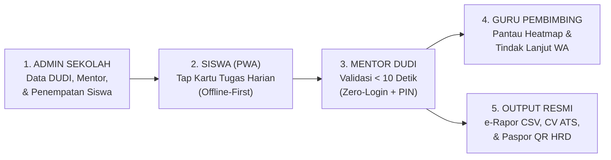

# Rencana Refaktor & Penyederhanaan Scope Menyeluruh — VokaLink

Dokumen ini adalah cetak biru (*blueprint*) eksekusi bertahap untuk menyaring kembali ruang lingkup (**Scope Reduction**), memperjelas **Core Loop** aplikasi, memperbarui seluruh dokumentasi, dan membersihkan antarmuka (**UI De-cluttering**) di seluruh 5 *role* pengguna VokaLink.

---

## 1. Tujuan Utama & Definisi Inti Baru (The Core Loop)

Sebelumnya, VokaLink mencoba menjadi 5 sistem sekaligus (GIS Pemetaan Jarak Rumah, Editor Kurikulum Sekolah, Kamera Kuas Blur & K3 Overwork, Manajemen Rotasi Lintas DUDI, dan Audit MoU Ilmiah). 

Setelah disaring sebagai **Product Manager & System Analyst**, identitas inti VokaLink dikunci menjadi satu alur lurus yang mudah dipahami siapa pun dalam 5 detik:

### Daftar Fitur Berlebihan yang Dihapus / Disederhanakan:
1. **Menu & Halaman Pengelolaan Kurikulum (`/school/curriculum`):** Dihapus dari navigasi Admin Sekolah. Kurikulum 792 JP & katalog 89 *Job Cards* bekerja **100% otomatis di belakang layar** (*Pre-loaded System Default*) saat jurusan dipilih.
2. **Rumus Jarak GPS Rumah Siswa (Haversine 70:30), Modal Koordinat Rumah, & Auto-Greedy Mass Placement:** Dihapus dari UI `/school/placements`. Penempatan siswa diubah menjadi pemilihan langsung yang bersih berbasis **Kecocokan Jurusan & Sisa Kuota DUDI**.
3. **Tab Terpisah "Audit DUDI Quality Index" (`/school/dudi-directory`):** Dihapus tab khususnya agar tidak membingungkan Admin Sekolah; halaman DUDI fokus murni pada **Direktori Mitra & Aktivasi Perangkat Mentor**.
4. **Kuas Blur Foto Kanvas (`PhotoPrivacyStudioModal`) & Panel Perhitungan K3 Overwork Mingguan (`/student/log/new`):** Dihapus dari form input jurnal siswa agar pengisian jurnal benar-benar selesai dalam < 15 detik tanpa modal berlapis.
5. **Pengaturan Toggle Privasi Paspor yang Rumit (`/student/career-cv`):** Disederhanakan agar halaman fokus pada pratinjau CV ATS A4 dan QR Paspor.
6. **Tab Rotasi Mitra Tengah Semester & Log Kunjungan Berlapis di Modal Guru (`/teacher/heatmap`):** Dihapus dari modal intervensi guru. Tombol tindak lanjut fokus 100% pada **Kirim Pesan Koordinasi WhatsApp ke Mentor**.
7. **Auto-Generator Kutipan Testimoni A1 & Tema Gelap Belang di Endorsement Mentor (`/v/[token]/endorse`):** Diselaraskan ke tema terang bersih (`#F8FAFD`) dan form disederhanakan menjadi: **Skor Sikap + Pilih Maks 3 Lencana + Komentar Opsional + PIN 4 Digit**.
8. **Kotak Edukasi Regulasi "Standar Ganda Permendikbudristek vs Industri" & Galeri Foto Mentah di Halaman HRD (`/verify/[passportSlug]`):** Dihapus agar halaman publik tampil ringkas, elegan, dan profesional layaknya sertifikat kredensial industri.
9. **Jargon Teknis & Kode Spesifikasi di UI:** Menghapus seluruh teks teknis seperti `"FR-008"`, `"TC-006"`, `"BR-010"`, `"Dexie IndexedDB"`, `"Database PostgreSQL"`, dan klaim tidak relevan seperti *"Presensi GeofenceRadius GPS"* di Landing Page.

---

## 2. Strategi Aman Penghapusan Fitur (Zero-Breakage Strategy)

Untuk memastikan seluruh pengujian otomatis (`pnpm test`) dan backend API tetap berjalan 100% hijau tanpa merusak relasi database Prisma:
1. Kita **menghapus rute halaman UI, komponen modal yang berlebihan, dan elemen visual yang padat** di `apps/web`.
2. Fungsi murni di `packages/core` dan endpoint di `apps/api` tetap dipertahankan di belakang layar sebagai *fallback engine* sehingga tidak ada *broken import* atau migrasi database destruktif yang perlu diulang.

---

## 3. Rencana Eksekusi Bertahap (Step-by-Step Implementation Plan)

### TAHAP 1: Penyelarasan Dokumentasi (`/docs` & `README.md`)
- Menyederhanakan tabel fitur unggulan di `README.md` agar menonjolkan alur inti (*Zero-Typing Logger*, *Zero-Login Verification*, *Live Heatmap & Drift Alert*, *e-Rapor & CV/Paspor QR*).
- Memperbarui struktur navigasi modul sekolah menjadi **4 Menu Inti** (Dasbor, Mitra DUDI, Penempatan Siswa, e-Rapor) tanpa menu `/school/curriculum` di `AGENTS.md` dan `docs/SCHOOL_MODULE_PLAN.md`.
- Mencatat keputusan penyederhanaan scope (Scope Refinement) di `docs/PROGRESS.md` dan `docs/BUGS.md` bagian 5.

### TAHAP 2: Pembersihan Landing Page (`apps/web/src/app/page.tsx`)
- **Section 5 (Tab 3 Dimensi — Siswa):** Mengganti poin *"Presensi Geofence Anti-Kecurangan"* (yang tidak relevan) menjadi **"Kartu Pekerjaan Bebas-Ketik (Zero-Typing Job Cards)"** dan **"Tombol Jujur Pelaporan Tugas Non-Jurusan"**.
- **Section 6 (Alur Kerja 4 Tahap):**
  - Mengubah Tahap 01 dari *"Smart Placement Scorer & Kunci Kurikulum"* menjadi **"Penempatan Siswa & Aktivasi Mitra DUDI"**.
  - Mengubah Tahap 02 dari *"Pembekalan & Geofence (Aktivasi GPS Radius)"* menjadi **"Pencatatan Jurnal Kartu Kerja (Offline-First)"**.
  - Mengubah Tahap 03 menjadi **"Validasi Mentor Tanpa Login (< 10 Detik) & Pantauan Heatmap Guru"**.
  - Mengubah Tahap 04 menjadi **"Rekap e-Rapor Otomatis & Paspor Kompetensi Ber-QR"**.
- Merapikan teks agar lebih ringkas, tidak terlalu banyak istilah teknis server (`scrypt`, `canonical JSON`, `IndexedDB`).

### TAHAP 3: Perbaikan Halaman Login & Register Sekolah (`(auth)`)
- **`login/page.tsx`:** Merapikan teks pada banner kiri dan form kanan agar ringkas, menghilangkan jargon teknis kriptografi yang berlebihan, dan memastikan alur masuk (Email/NIP/NISN & Google) tampil bersih.
- **`register-school/page.tsx`:** Menghapus `DemoBar` ganda dan menyederhanakan banner Sandbox agar tidak mendominasi layar utama. Pada Langkah 2 (Pilih Jurusan), menambahkan informasi jelas bahwa **Kurikulum 792 JP & Katalog Kartu Pekerjaan (Job Cards) otomatis diaktifkan oleh sistem** untuk setiap jurusan yang dipilih tanpa perlu konfigurasi manual lagi.

### TAHAP 4: Refaktor & De-clutter Modul Admin Sekolah (`/school/*`)
- **Menghapus Halaman & Komponen Berlebihan:**
  - `apps/web/src/app/school/curriculum/page.tsx`
  - `apps/web/src/components/school/curriculum/*`
  - `apps/web/src/components/school/dudi/DudiQualityIndexView.tsx`
  - `apps/web/src/components/school/placements/BatchGreedyModal.tsx`
  - `apps/web/src/components/school/placements/StudentCoordinatesModal.tsx`
- **Navigasi Sekolah (`SchoolSidebar.tsx`, `SchoolBottomNav.tsx`, `SchoolHeader.tsx`):** Menyisakan tepat **4 menu bersih**: `Dasbor Utama`, `Mitra DUDI`, `Penempatan Siswa`, dan `Rekap e-Rapor`.
- **Dasbor Sekolah (`dashboard/page.tsx`, `DepartmentReadinessCard.tsx`, `SchoolWidgetPanel.tsx`):** Mengubah kartu kesiapan kurikulum menjadi **"Daftar Jurusan Aktif"** yang bersih tanpa status Draf/Terkunci.
- **Direktori Mitra DUDI (`dudi-directory/page.tsx`, `DudiToolbar.tsx`):** Menghapus tab switcher `"Audit DUDI Quality Index"`.
- **Penempatan Siswa (`placements/page.tsx`, `PlacementStatsHeader.tsx`, `PlacementCandidatesTable.tsx`):** Menghapus tombol Auto-Greedy Mass Placement, titik koordinat rumah siswa, rumus jarak Haversine (`70% CP + 30% Jarak`), dan lencana rotasi tengah semester.

### TAHAP 5: Refaktor & De-clutter Modul Siswa (`/student/*`)
- **Menghapus `PhotoPrivacyStudioModal.tsx` (Kuas Blur Foto Kanvas).**
- **Beranda Siswa (`student/home/page.tsx`, `DailyTimelineFeed.tsx`):** Menghapus tag teknis (`"Dexie IndexedDB"`, `"Database PostgreSQL"`) dan merapikan kartu aktivitas harian.
- **Input Jurnal Harian (`student/log/new/page.tsx`, `SmartShiftSelector.tsx`):** Menghapus tombol Kuas Blur Foto dan Panel Peringatan K3 Overwork Mingguan yang rumit.
- **CV ATS & Paspor Siswa (`student/career-cv/page.tsx`):** Menghapus panel toggle privasi paspor dan banner panjang di bagian atas agar fokus pada CV A4 dan QR Paspor.

### TAHAP 6: Refaktor & De-clutter Modul Guru Pembimbing (`/teacher/*`)
- **Navigasi Guru (`TeacherSidebar.tsx`, `TeacherBottomNav.tsx`):** Menghapus badge teknis `"FR-008"` dan `"TC-006"`.
- **Monitoring & Heatmap Guru (`teacher/heatmap/page.tsx`, `TeacherWidgetPanel.tsx`):** Menghapus tab *"Kunjungan Lapangan"* dan *"Rotasi Mitra DUDI Tengah Semester"* dari modal tindak lanjut, menyisakan fokus 100% pada **Kirim Pesan Koordinasi WhatsApp ke Mentor**.

### TAHAP 7: Refaktor Halaman Mentor Industri (`/v/[token]/*`) & Publik HRD (`/verify/[passportSlug]`)
- **Validasi Harian Mentor (`v/[token]/page.tsx`):** Menghapus form lencana endorsement dari halaman persetujuan harian agar fokus pada persetujuan jurnal & PIN 4 digit.
- **Endorsement Akhir Mentor (`v/[token]/endorse/page.tsx`):** Mengubah tema gelap (`bg-slate-950`) ke tema terang bersih (`bg-canvas` `#F8FAFD`), menghapus kode teknis `"(FR-010)"` / `"(Aturan BR-010)"`, dan menyederhanakan form.
- **Verifikasi Paspor Publik HRD (`verify/[passportSlug]/page.tsx`):** Menghapus kotak gelap *"Verifikasi Standar Ganda Permendikbudristek vs Industri"* dan *"Galeri Artefak Foto"*, menyisakan tampilan sertifikat kredensial digital yang bersih dan profesional.

### TAHAP 8: Audit Visual Menyeluruh & Verifikasi Pengujian
- Menjalankan `pnpm lint`, `pnpm typecheck`, `pnpm test`, dan `pnpm --filter web build`.
- Memeriksa seluruh halaman secara visual menggunakan Browser untuk memastikan tidak ada informasi tidak penting yang tertinggal.
